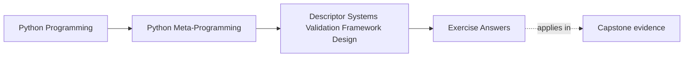

# Exercise Answers

<!-- page-maps:start -->
## Page Maps

<!-- page-maps:end -->

Use this page after attempting the exercises yourself. The point is not to match every
example literally. The point is to compare your reasoning against answers that keep
descriptor-system power, cache policy, backend ownership, and framework boundaries honest.

This page matters because answer keys can accidentally train imitation instead of review.
Use the answers here as reasoning checkpoints, not as short phrases to copy.

Use this page actively:

- compare your stated source of truth against the reference answer
- compare your invalidation owner against the reference answer
- check whether you named a refused weaker owner or stronger owner when the answer needed one

## Answer 1: Design one cached field honestly

Example answer:

A cached `word_count` field might:

- compute on first read
- store its cached value in `obj.__dict__["_word_count_cached"]`
- expose an `invalidate(obj)` method whenever `text` changes

Good conclusion:

The cache design is not complete until the invalidation story is explicit. “It caches the
value” is not enough by itself.

Reasoning checkpoint:

- can you point to the dependency that makes the cache stale?
- can you say who clears it without using vague words such as "somewhere" or "later"?

Repair move if your answer is weak:

- add the exact cache slot
- add the exact invalidation trigger

Weak answer to reject:

- "the cache works because the field stores the result for later"

Why it fails:

it names reuse but not staleness, dependency, or invalidation ownership.

## Answer 2: Review one external-storage field

Example answer:

A field backed by a memory store or database might use a key such as:

- `field:Post:12:title`

and:

- read through the backend on cache miss
- write through on assignment and refresh the local cache

Good conclusion:

Attribute access now hides storage I/O and serialization work, so the design needs clear
documentation or observability rather than pretending the field is purely local.

Reasoning checkpoint:

- did you name the authoritative backend slot?
- did you identify one cost hidden by attribute syntax?

Repair move if your answer is weak:

- rewrite the answer until a reviewer can tell where truth lives and why the access is not purely local

Weak answer to reject:

- "the descriptor just proxies storage"

Why it fails:

proxy language hides the backend slot, serialization boundary, and hidden I/O cost.

## Answer 3: Compose one wrapper field

Example answer:

- the inner field owns storage and ordinary set/get behavior
- the wrapper field adds validation before delegating to the inner descriptor

Good conclusion:

Composition works well when each layer owns one extra concern and forwarding of
`__set_name__`, `__get__`, and `__set__` stays consistent.

Reasoning checkpoint:

- can you state the inner field contract in one sentence?
- can you justify the wrapper without saying only "for flexibility"?

Repair move if your answer is weak:

- remove one wrapper mentally and restate what behavior actually changes

Weak answer to reject:

- "the wrapper makes the field more flexible"

Why it fails:

flexible does not identify the inner contract or the one concern added by the wrapper.

## Answer 4: Validate one narrow hint subset

Example answer:

Support:

- plain runtime classes such as `int` and `str`
- `Union` or `Optional`
- selected `Annotated[...]` validators

Refuse:

- parameterized generics such as `list[int]`

Good conclusion:

This is an honest hint-driven field because it names its supported surface clearly and
does not claim to understand every typing construct.

Reasoning checkpoint:

- did you name one supported hint surface and one refused one?
- did you describe one coercion path instead of saying "it validates types"?

Repair move if your answer is weak:

- add one concrete refused hint form and one concrete coercion boundary

Weak answer to reject:

- "it supports annotations for runtime checking"

Why it fails:

annotations are too broad a surface unless the accepted subset and refusal surface are named.

## Answer 5: Reject one descriptor that became architecture

Example answer:

Suppose one “smart field” tries to own:

- lazy loading
- cache invalidation across related records
- object identity management
- transaction coordination

Better owners:

- explicit session or unit-of-work objects
- model-layer coordination services
- broader framework infrastructure

Good conclusion:

Once multiple records or lifecycle phases must be coordinated, the descriptor is no longer
the whole owner. The design has crossed into framework architecture.

Reasoning checkpoint:

- did you name the extra responsibility precisely?
- did you choose a stronger owner that can actually see that wider lifecycle?

Repair move if your answer is weak:

- replace generic words such as "system" or "framework stuff" with one concrete owner like session, repository, or unit of work

Weak answer to reject:

- "the descriptor got too complex"

Why it fails:

complexity alone is not the boundary; the missing point is which broader owner must take over.

## Answer 6: Review the educational mini relational model

Example answer:

Field layer ownership:

- validating and storing one field value
- reading one field through a backend-backed descriptor

Framework or model layer ownership:

- model registration
- record reconstruction
- relationship orchestration

Good conclusion:

The mini relational model is educational because it exposes the mechanism clearly but
omits the infrastructure a real ORM would need, such as transactions, identity maps, and
query planning.

Reasoning checkpoint:

- did you identify one field-level win and one framework-level omission?
- did you explicitly refuse at least one production claim?

Repair move if your answer is weak:

- add one sentence beginning with "this example does not prove..."

Weak answer to reject:

- "it is basically a tiny ORM"

Why it fails:

that sentence grants production responsibilities the worked example explicitly refuses.

## Answer 7: Make one backend access path observable

Example answer:

Suppose a descriptor reads through a key-value store on cache miss.

Strong observability additions:

- increment a per-field read counter
- emit a small trace or log line when backend access occurs
- expose an explicit helper such as `field_stats(obj)` for teaching and review

Good conclusion:

Backend-backed attribute access is harder to reason about when the I/O stays invisible.
An observation surface makes the hidden cost and lifecycle easier to teach and review.

Reasoning checkpoint:

- did you pick one observation surface that someone can actually inspect?
- did you connect it to one hidden cost or failure path?

Repair move if your answer is weak:

- add one counter, log, or helper that would make the access path visible

Weak answer to reject:

- "backend access can be logged if needed later"

Why it fails:

later is not an observation surface another reviewer can inspect now.

## Answer 8: Separate one field concern from one framework concern

Example answer:

Mixed design:

- a descriptor validates one field
- lazily loads related records
- coordinates cross-record invalidation

Strong split:

- field concern that stays: validating and storing one attribute contract
- framework concern that moves out: coordinating related-record lifecycle and invalidation

Good conclusion:

The split makes review easier because field semantics stay local while coordination logic
moves to an owner that can see the wider model lifecycle.

Reasoning checkpoint:

- did you separate field semantics from coordination rather than only renaming them?
- did you reject one stronger owner as unnecessary at the current scale?

Repair move if your answer is weak:

- redraw the boundary as "stays in field" versus "moves out" and justify each line

Weak answer to reject:

- "the field handles the local part and the framework handles the rest"

Why it fails:

local and the rest are too vague to review or implement cleanly.

## Answer 9: Compare honest field claims with overstated framework claims

Example answer:

Honest description:

- "This descriptor caches one computed value and invalidates it when the backing field changes."

Overstated description:

- "This descriptor keeps the whole model synchronized automatically."

Good conclusion:

The second version is misleading because words such as "whole model" and
"automatically" imply broader orchestration than one field-level owner can honestly
guarantee.

Reasoning checkpoint:

- can you identify the exact words that overstate power?
- can you rewrite them into one bounded field claim?

Repair move if your answer is weak:

- highlight the exaggerated words, then replace them with the smallest honest promise

Weak answer to reject:

- "it mostly keeps the model in sync"

Why it fails:

mostly and in sync overclaim coordination without naming what is actually guaranteed.

## Answer 10: Produce a descriptor-system packet

The packet is strong when another learner can answer:

- what the field layer owns
- where the real source of truth lives
- how invalidation or observation works
- when broader framework coordination should move out of the descriptor

Add these final checks to your own packet:

- one refused weaker owner
- one refused stronger owner
- one remaining uncertainty you would audit next

Extra packet test:

- could a missed-class learner reconstruct your owner ladder from the packet alone?

## What strong Module 08 answers have in common

Across the whole set, strong answers share the same habits:

- they treat invalidation as part of descriptor behavior
- they make the backend or source of truth explicit
- they keep composed fields shallow and readable
- they name the exact hint subset a field understands
- they say when a field system has become broader architecture
- they make invalidation and backend access visible
- they leave behind a packet another learner can review without guessing

If an answer still sounds like "framework behavior can live in the descriptor somehow,"
revise it until you can say exactly what the descriptor owns and what should move out of
it.

## Cross-answer habits to inspect

| Habit to inspect | Strong answer behavior |
| --- | --- |
| naming truth | always points to one authoritative slot, object, or service |
| naming invalidation | always identifies the actor or path that clears stale state |
| naming refusal | always states what the field or model deliberately does not prove |
| naming escalation | always identifies the first broader owner when the field boundary breaks |

## Exit check for this answer key

Before leaving Module 08, make sure you can:

- trace one answer back to concrete code or storage evidence
- rewrite one weak answer into a stronger one
- identify one refused claim in the worked example
- name one precise escalation boundary from field logic to framework ownership

## Continue through Module 08

- Previous: [Exercises](exercises.md)
- Return: [Overview](index.md)
- Next module: [Module 09](../module-09-metaclass-design-class-creation/index.md)
- Terms: [Glossary](glossary.md)
