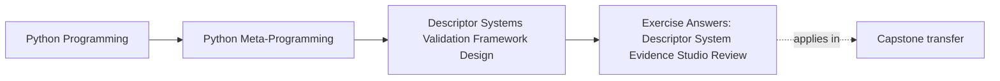
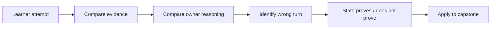

# Exercise Answers: Descriptor System Evidence Studio Review

<!-- page-maps:start -->
## Page Maps




<!-- page-maps:end -->

Use this page only after completing your own evidence journal. The implementations below
are defensible routes, not the only acceptable code. Compare:

- ownership
- event order
- failure timing
- preserved behavior
- explicit non-claims

A result that happens to pass one happy-path assertion is not equivalent to the reasoning
contract.

## Answer 1: Establish the baseline contract

A strong map includes concrete evidence such as:

| Claim | Packet evidence | Focused proof |
| --- | --- | --- |
| source assignment owns local cache freshness | `cache_invalidation.invalidation_owner` | `test_dependency_assignment_invalidates_before_the_next_read` |
| backend is authoritative | `external_storage.field.source_of_truth` | `test_second_instance_reads_the_authoritative_backend_value` |
| wrapper order is policy | `composition.accepted.trace` | `test_assignment_traces_normalization_validation_storage_and_audit` |
| hint support is bounded | `hint_policy.plans` and `.refused` | `test_parameterized_generics_and_unknown_metadata_are_refused` |
| record example is not an ORM | `record_model.explicitly_absent` | `test_evidence_refuses_a_production_orm_claim` |
| owner choice includes escalation | `architecture_boundary.decisions` | `test_evidence_covers_every_named_pressure_and_both_refusals` |

Reasoning:

The JSON packet makes runtime and policy evidence portable, while tests state the
guarantee. Source explains how. None of the three is a complete substitute for the other
two.

Common wrong turn:

> “All tests pass, so the architecture is correct.”

Tests prove named behavior, not that the selected owner fits every future requirement.

What this proves:

- the shipped mechanism claims have executable support
- sources of truth and refusal surfaces are visible

What this does not prove:

- production readiness
- correctness under untested concurrency or infrastructure pressure

Capstone transfer:

Use the same claim-to-proof structure when reading `capstone-field-system`; do not infer
hidden powers from the existence of descriptors or a metaclass.

## Answer 2: Extend dependency-aware caching

A minimal declaration change is:

```python
class Document:
    text = InvalidatingField(
        invalidates=("word_count", "character_count"),
    )
    word_count = CachedComputation(
        lambda document: len(document.text.split()),
        depends_on=("text",),
    )
    character_count = CachedComputation(
        lambda document: len(document.text),
        depends_on=("text",),
    )
```

A focused test should observe both state machines:

```python
document = Document("one cache")

assert document.word_count == 2
assert document.character_count == 9
assert document.word_count == 2
assert document.character_count == 9

document.text = "one refreshed cache"

assert not Document.word_count.evidence(document)["cached"]
assert not Document.character_count.evidence(document)["cached"]
assert document.word_count == 3
assert document.character_count == 19
```

Reasoning:

Both derivations depend on the same source assignment. The source lists both invalidation
targets, while each cache independently lists `text` as its dependency. Values and
computation counters remain on the instance.

Common wrong turns:

- storing `character_count` on the descriptor
- invalidating only one cache
- calling both computations eagerly inside `text.__set__`
- adding a global dependency registry before the current scale requires it

What this proves:

- one source assignment invalidates two local derivations
- both caches retain independent per-instance state

What this does not prove:

- the two declarations cannot drift
- arbitrary dependency graphs are validated
- updates are atomic across threads

Capstone transfer:

The capstone still has no derived configuration values. Adding this machinery there would
create a dependency system without an application pressure.

## Answer 3: Make backend refresh explicit

An honest refresh reads first, then replaces the cache only after success:

```python
def refresh(self, obj):
    raw = self.store.get(self.key_for(obj))
    if raw is None:
        raise AttributeError(f"{self.public_name} has no backend value")
    value = json.loads(raw)
    vars(obj)[self.cache_name] = value
    return value
```

For maintainability, the backend-read and decode path can be extracted into a private
helper used by both `__get__` and `refresh`. The important ordering is:

```text
derive key -> backend read -> decode -> replace cache -> return
```

Reasoning:

Clearing the cache before reading would leave no local value after an outage. Returning
the old cache after an outage would falsely report refresh success. Reading into a local
variable and committing the cache only after success preserves the prior mirror on
failure while keeping the exception visible.

Evidence:

```python
reads_before = len(
    [event for event in store.events if event["operation"] == "read"]
)
assert Record.title.refresh(observer) == "resolved"
reads_after = len(
    [event for event in store.events if event["operation"] == "read"]
)
assert reads_after - reads_before == 1
```

Common wrong turns:

- implement `refresh` as `invalidate` followed by ordinary access without considering
  outage state
- swallow `StoreUnavailable` and return stale data
- write the refreshed value back to an already authoritative backend
- call refresh on every read and quietly remove caching

What this proves:

- one explicit refresh consults the backend once
- local state changes only after a successful decode

What this does not prove:

- freshness after the refresh returns
- compare-and-swap semantics
- retries, timeout policy, or transaction isolation

Capstone transfer:

The capstone field system has no backend mirror, so a refresh API would be meaningless
there.

## Answer 4: Add one earned wrapper layer

A narrow wrapper can be written as:

```python
class MaximumLength(FieldWrapper):
    responsibility = "reject text longer than one explicit limit"

    def __init__(self, inner, *, limit):
        if limit <= 0:
            raise ValueError("maximum length must be positive")
        super().__init__(inner)
        self.limit = limit

    def __set__(self, obj, value):
        if not isinstance(value, str):
            raise TypeError(f"{self.public_name} expected normalized text")
        accepted = len(value) <= self.limit
        _trace(
            obj,
            {
                "layer": type(self).__name__,
                "limit": self.limit,
                "accepted": accepted,
            },
        )
        if not accepted:
            raise ValueError(
                f"{self.public_name} must be at most {self.limit} characters"
            )
        self.inner.__set__(obj, value)
```

The declaration is:

```python
route_label = AuditWrites(
    NormalizeText(
        MaximumLength(
            StoredField(),
            limit=12,
        )
    )
)
```

Reasoning:

`NormalizeText` must be outside `MaximumLength` so the limit applies to the stored form,
not surrounding whitespace. `AuditWrites` remains outside so it records only successful
storage.

The accepted trace should be:

```text
NormalizeText -> MaximumLength -> StoredField -> AuditWrites
```

The rejection trace stops at `MaximumLength`; no `_route_label` or `__field_audit__`
entry should appear.

Common wrong turns:

- combine normalization and maximum length into one vague wrapper
- audit before delegation
- validate raw padded input when the contract is about normalized storage
- alter the existing `channel` stack to make the new test easier

What this proves:

- one more single-purpose layer can remain inspectable
- declaration order controls transformation and failure order

What this does not prove:

- adding further wrappers remains a good design
- the layer participates in cross-field validation

Capstone transfer:

An explicit `StringField(min_length=...)` remains clearer for the capstone’s present
policy. The new wrapper demonstrates a mechanism; it does not force adoption.

## Answer 5: Add policy without widening hint support

A matching value rule is:

```python
@dataclass(frozen=True, slots=True)
class Maximum(ValueRule):
    limit: int | float

    @property
    def label(self):
        return f"maximum={self.limit}"

    def apply(self, value):
        if not isinstance(value, (int, float)) or isinstance(value, bool):
            raise TypeError("Maximum can only validate numeric values")
        if value > self.limit:
            raise ValueError(f"value must be <= {self.limit}")
        return value
```

Then:

```python
attempts: Annotated[int, Minimum(0), Maximum(10)] = HintField()
```

Reasoning:

`compile_hint` already retains metadata order, and `HintPlan._apply_rules` already walks
that tuple in order. No interpreter change is needed. The exercise adds policy, not a new
hint language feature.

Strong tests include:

```python
self.assertEqual(
    RetryPolicy(
        attempts="3",
        label="retry",
        timeout=None,
        enabled=True,
    ).attempts,
    3,
)

with self.assertRaisesRegex(ValueError, "must be <= 10"):
    RetryPolicy(
        attempts="11",
        label="retry",
        timeout=None,
        enabled=True,
    )
```

Also retain direct tests that `True` does not satisfy `int`, `list[int]` is refused, and
unknown `Annotated` metadata fails.

Common wrong turns:

- add special maximum logic to `HintField.__set__`
- run rules before coercion and make `"3"` fail numeric validation
- broaden supported hints while touching the compiler
- accept booleans as numeric values

What this proves:

- explicit metadata can add bounded policy without widening the hint interpreter
- rule ordering survives into the plan manifest

What this does not prove:

- all validators compose safely
- static type checkers understand runtime metadata
- generic or nested model validation

Capstone transfer:

The capstone’s `IntegerField(minimum=..., maximum=...)` keeps equivalent policy explicit
without annotation inference.

## Answer 6: Review the application boundary

A defensible comparison is:

| Concern | Descriptor-system lab | Incident-plugin capstone |
| --- | --- | --- |
| field source of truth | backend JSON slot or instance cache, depending on example | plugin instance dictionary |
| validation | wrappers or `ValueRule` plans | explicit `Field` subclasses |
| class-wide coordination | only static helpers in the record model | `PluginMeta` field collection and constructor generation |
| hidden backend I/O | accepted and exposed in `ExternalField` | rejected |
| derived caching | accepted in local cache lab | rejected |
| wrapper composition | accepted and traced | rejected |
| annotation inference | accepted only in bounded hint lab | rejected for fields |

For atomic updates across two plugin fields:

- `Field.__set__` is too weak because one descriptor cannot see both writes and rollback.
- `PluginMeta` is the wrong owner because class creation happens before runtime
  configuration transactions.
- a session or unit of work is the smallest owner that can stage both values, validate
  them, commit together, and roll back together.

The smallest proof set would include:

1. both valid changes commit
2. failure in the second validation leaves both original values
3. failure during commit rolls back both writes
4. field coercion behavior remains unchanged
5. plugin action execution remains outside the transaction test

Common wrong turns:

- call two ordinary assignments “atomic”
- put rollback state on a shared descriptor
- use a metaclass because it is the strongest mechanism in the course
- add persistence infrastructure before defining what is being committed

What this proves:

- owner selection follows runtime invariant scope
- the capstone can reject Module 08 powers deliberately

What this does not prove:

- a concrete transaction implementation
- persistence durability
- isolation under concurrency

## Final self-review

Before leaving Module 08, make sure every answer states:

- what owns truth
- what executes and when
- what public surface changes
- where failure occurs relative to mutation
- which earlier behavior remains true
- what the result proves
- what it does not prove
- where the capstone accepts or rejects the mechanism

If one answer still depends on words such as “automatic,” “transparent,” or “framework”
without an owner and trace, return to the matching core.

## Continue

- Previous: [Descriptor System Evidence Studio](exercises.md)
- Return: [Module Overview](index.md)
- Next module: [Module 09](../module-09-metaclass-design-class-creation/index.md)
