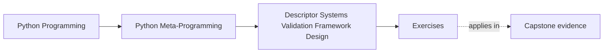

# Exercises

<!-- page-maps:start -->
## Page Maps

<!-- page-maps:end -->

Use these after reading the five core lessons and the worked example. The goal is not to
memorize framework vocabulary. The goal is to make cache policy, backend ownership,
composition, hint support, and architecture boundaries explicit.

This page matters because weak exercises let learners imitate vocabulary without proving
ownership. The point of this set is to leave behind reviewable evidence, not polished
sounding answers.

Each exercise asks for three things:

- the field behavior or framework pressure you are analyzing
- the descriptor or broader owner you chose
- the reason that choice is the clearest one

Add a fourth thing to every answer:

- one rejected alternative owner and why you rejected it

Treat the ten exercises as one full lab day on descriptor systems and framework boundaries.

Do them in order:

- Exercises 1-3 establish honest cache design, external storage, and shallow composition
- Exercises 4-6 keep hint support narrow and separate field ownership from model ownership
- Exercises 7-8 extend that discipline into backend observability and escalation out of field logic
- Exercises 9-10 package the whole module into a reviewable descriptor-system packet

Keep one descriptor-system table while you work:

| Field behavior or framework pressure | Smallest honest owner | Source of truth | Invalidation or coordination rule | Review judgment |
| --- | --- | --- | --- | --- |

Keep a second evidence ledger beside it:

| Exercise | Concrete evidence you inspected or built | Weak claim you refused | Remaining uncertainty |
| --- | --- | --- | --- |

Use one more discipline across the whole set:

- every answer should name one source of truth
- every answer involving caching should name one invalidation owner
- every answer involving escalation should name the first broader owner that becomes necessary

## Exercise 1: Design one cached field honestly

Create or inspect one descriptor that caches a computed value.

What to hand in:

- when the value is computed
- where the cached value is stored
- one explicit invalidation rule
- one rejected weaker answer such as "the caller will remember to refresh it"

Verification hint:
mutate one dependency after the first read and write down the wrong answer you would get
if invalidation never ran.

## Exercise 2: Review one external-storage field

Build or inspect one descriptor whose source of truth lives outside the instance.

What to hand in:

- the backend key shape
- one read-through or write-through behavior
- one explanation of what cost or I/O the attribute access hides
- one rejected description that pretends the field is still purely local

Verification hint:
write the exact backend key and cached local slot side by side before you describe the
field as convenient.

## Exercise 3: Compose one wrapper field

Take one field descriptor and add one extra concern through composition.

What to hand in:

- the inner field's responsibility
- the wrapper layer's added concern
- one explanation of how `__set_name__` or delegation is preserved
- one reason another wrapper layer would make the stack harder to review

Verification hint:
trace one assignment through every wrapper layer and stop if any layer cannot be described
in one sentence.

## Exercise 4: Validate one narrow hint subset

Build or inspect one hint-aware field descriptor.

What to hand in:

- the exact hint forms it supports
- one coercion it allows or refuses
- one explanation of how `Annotated[...]` metadata is used, if present
- one unsupported hint form that must fail clearly

Verification hint:
write one "supported now" example and one "refused now" example before you talk about the
field as type-aware.

## Exercise 5: Reject one descriptor that became architecture

Choose one field-system idea that is starting to exceed one attribute contract.

What to hand in:

- the extra responsibility it is trying to absorb
- the explicit framework or service owner it should move to
- one sentence explaining why the descriptor layer is no longer enough
- one rejected lower-power owner that would still be too weak

Verification hint:
if your answer does not name the first wider owner explicitly, it is still too vague.

## Exercise 6: Review the educational mini relational model

Use the worked example as a case study.

What to hand in:

- one thing the field layer owns honestly
- one thing the model layer or framework layer must own instead
- one explanation of why this example is educational rather than production-grade
- one production claim you explicitly refuse to make

Verification hint:
your refusal sentence should include at least one of these missing concerns: transactions,
identity maps, or query planning.

## Midday self-check

Before moving into the final four exercises, make sure you can already answer these
questions clearly:

- why cache invalidation is part of the field contract instead of an optional extra
- what source of truth a backend-backed descriptor is really hiding
- when composition still keeps a field system readable and when it starts obscuring ownership
- what pressure shows that a descriptor has crossed from field logic into architecture

If you cannot answer those four questions in plain language, return to Exercises 1-6 and
make the source of truth, invalidation rule, and escalation boundary more explicit before
continuing.

If you can answer them only in abstract language, add one concrete code path or storage
path before continuing.

## Exercise 7: Make one backend access path observable

Choose one backend-backed descriptor and design a way for learners or reviewers to see when
attribute access crosses into I/O or shared storage.

What to hand in:

- the backend-backed field
- one observation surface such as logging, counters, tracing, or explicit read helpers
- one explanation of why hidden I/O makes the field harder to reason about
- one reason silent backend access would weaken review or debugging

Verification hint:
pick one observation surface that another learner could inspect without reading your mind.

## Exercise 8: Separate one field concern from one framework concern

Take one descriptor design and split its responsibilities into one field-level concern and
one wider framework or service concern.

What to hand in:

- the mixed design
- the field-level concern that should stay
- the wider concern that should move out
- one explanation of why the split makes the architecture easier to review
- one stronger owner you considered but rejected as unnecessary at this stage

Verification hint:
rewrite the mixed design as two columns: "stays in field" and "moves out."

## Exercise 9: Compare honest field claims with overstated framework claims

Choose one descriptor-system design and write both an honest description and an overstated
description of what it guarantees.

What to hand in:

- the honest description
- the overstated description
- one explanation of which words make the overstated version misleading
- one sentence rewriting the overstated version into an honest boundary claim

Verification hint:
underline the words that overclaim scale, coordination, or automatic behavior.

## Exercise 10: Produce a descriptor-system packet

Assemble:

- one descriptor-system table
- one cached field with an explicit invalidation rule
- one backend-backed field with a named source of truth
- one escalation rule explaining when descriptor logic must move to a framework or service owner

The packet is strong when another learner can use it to answer:

- what the field layer owns directly
- where data really lives
- when the design has crossed into wider architecture

Add these packet requirements:

- one refused weaker owner
- one refused stronger owner
- one named uncertainty you would investigate next in a real code review

Packet quality bar:

- another learner should be able to tell where truth lives without asking you
- another learner should be able to spot when invalidation matters
- another learner should be able to name the first escalation owner from your notes alone

## Mastery standard for this exercise set

Across all six answers, the module wants the same habits:

- you treat invalidation as part of cache design
- you make the source of truth explicit
- you keep composed fields inspectable
- you keep hint-driven validation narrow and honest
- you name the point where field logic turns into framework architecture

Across all ten answers, add two more habits:

- you make backend access and invalidation visible instead of implicit
- you leave behind a descriptor-system packet another learner could review without guessing

If an answer still sounds like "the smart descriptor handles it," keep going.

## Exit check for this exercise set

Before moving on to the answer key, make sure your packet lets another learner:

- trace one cache invalidation owner
- trace one backend source of truth
- explain one wrapper boundary
- name one refused hint surface
- name one point where the design must escalate into broader architecture

## Continue through Module 08

- Previous: [Worked Example: Building an Educational Mini Relational Model](worked-example-building-an-educational-mini-relational-model.md)
- Next: [Exercise Answers](exercise-answers.md)
- Return: [Overview](index.md)
- Terms: [Glossary](glossary.md)
