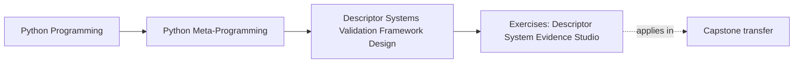
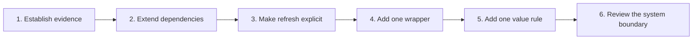

# Exercises: Descriptor System Evidence Studio

<!-- page-maps:start -->
## Page Maps




<!-- page-maps:end -->

This studio is one cumulative review and implementation route. Work in a disposable
learner branch or restore your changes between attempts. Do not edit the answer page
while working.

Start from the Python Metaprogramming program directory:

```bash
make descriptor-system-lab-test
make descriptor-system-lab
```

Keep one evidence journal with these columns:

| Change | Source of truth | Mutation or I/O path | Failure evidence | Preserved contract | Refused claim |
| --- | --- | --- | --- | --- | --- |

Every exercise must leave behind executable evidence. A design explanation without a
test or observable packet is incomplete.

## Exercise 1: Establish the baseline contract

### Starting context

The shipped lab contains six evidence sections and 38 focused tests.

### Objective

Build a claim-to-proof map before changing code.

### Constraints

- do not modify source
- inspect at least one implementation file and one test file per mechanism
- distinguish observed facts from architecture interpretation

### Required evidence

Record:

1. the cache slot and invalidation owner
2. the external field’s exact backend key and authoritative owner
3. the accepted wrapper trace
4. one hint coercion and one refused hint
5. one capability and one omission from the record model
6. one boundary decision with both rejected owners

### Acceptance checks

- `make descriptor-system-lab-test` passes
- the JSON packet parses
- every claim cites a packet key and a test name
- at least three non-claims are recorded

### Earlier contract to preserve

Module 07’s lookup model still explains why class access exposes each descriptor and why
per-instance caches remain isolated.

## Exercise 2: Extend dependency-aware caching

### Starting context

`Document.text` currently invalidates `word_count`.

### Objective

Add a `character_count` cached computation that is also invalidated by `text` assignment.

### Constraints

- store the derived value per instance
- name `text` in the cached computation’s dependency tuple
- add `character_count` to the source field’s invalidation tuple
- do not introduce a metaclass, global cache, or caller-managed refresh
- direct dictionary mutation may remain an explicit bypass

### Required evidence

Add tests proving:

1. two reads compute once
2. assigning `text` removes both derived caches
3. the next reads recompute both values
4. two `Document` instances do not share derived state

Extend the JSON evidence with the new cache name, dependency, count, and bypass limit.

### Acceptance checks

- focused cache tests pass
- existing `word_count` values and computation counts remain correct
- no cache value is stored on the shared descriptor
- the invalidation owner is visible from the declaration

### Earlier contract to preserve

`word_count` still follows `empty -> cached -> invalidated -> refreshed`, and the original
six cache tests remain green.

## Exercise 3: Make backend refresh explicit

### Starting context

`ExternalField.invalidate(obj)` clears a local mirror, after which the next read consults
the backend.

### Objective

Add a `refresh(obj)` method that explicitly invalidates and reloads one field.

### Constraints

- derive the same stable key as ordinary reads
- return the newly authoritative value
- perform exactly one backend read
- propagate `StoreUnavailable`
- do not silently return the old cache after backend failure
- do not add transactions, retries, or identity-map behavior

### Required evidence

Test this sequence:

1. one instance caches `investigating`
2. another actor writes `resolved`
3. ordinary access remains stale
4. `refresh` returns `resolved`
5. the event log contains one additional read

Add a failure test where the backend is unavailable during refresh.

### Acceptance checks

- external-field tests pass
- backend authority remains explicit
- the local cache changes only after a successful read
- stable key and JSON behavior remain unchanged

### Earlier contract to preserve

Ordinary cache-hit access still performs no backend read, and assignment still writes the
backend before changing local state.

## Exercise 4: Add one earned wrapper layer

### Starting context

`DeliveryPolicy.channel` has visible normalization, choice, storage, and audit layers.

### Objective

Implement `MaximumLength`, a wrapper that accepts a configured positive limit and rejects
long text before delegating.

Use it in a new `DeliveryPolicy.route_label` field with:

```text
AuditWrites -> NormalizeText -> MaximumLength -> StoredField
```

### Constraints

- the wrapper owns only maximum-length validation
- reject non-positive limits at wrapper construction
- forward name binding through the existing base
- validate after normalization
- rejected writes must reach neither storage nor success audit
- do not alter the existing `channel` policy

### Required evidence

Add tests for:

- a padded accepted label and its exact trace
- an overlong label with no stored value or audit event
- one `__set_name__` call per layer
- class access exposing the entire wrapper chain

### Acceptance checks

- composition tests pass
- each trace event names one owner
- layer order is visible from both declaration and output
- `channel` retains its original accepted and rejected behavior

### Earlier contract to preserve

The existing four-layer channel trace and failure-before-mutation guarantee remain true.

## Exercise 5: Add policy without widening hint support

### Starting context

`Minimum` and `NonBlank` are the only shipped `ValueRule` implementations.

### Objective

Implement `Maximum(limit)` and apply it with `Minimum(0)` to `RetryPolicy.attempts`.

### Constraints

- `Maximum` accepts numeric, non-boolean values only
- rules run in declaration order after coercion
- `"3"` remains accepted and stored as integer `3`
- values above the maximum fail before storage
- do not add generic containers, arbitrary classes, or best-effort constructor loops

### Required evidence

Publish the rule order in the plan manifest and add tests for:

- coercion followed by both successful rules
- an over-maximum failure
- boolean refusal
- unchanged refusal of `list[int]` and unknown `Annotated` metadata

### Acceptance checks

- hint tests pass
- the supported type list is unchanged
- the coercion table is unchanged
- the refusal surface remains in the evidence packet

### Earlier contract to preserve

Optional `timeout`, non-blank label normalization, explicit boolean text, and all existing
unsupported forms behave exactly as before.

## Exercise 6: Review the application boundary

### Starting context

The lab’s record model accepts external storage and composition. The incident-plugin
capstone accepts explicit field subclasses and class-level collection while rejecting
those stronger field powers.

### Objective

Produce a review decision that compares both systems and proposes the owner for one new
requirement: atomic configuration updates across two plugin fields.

### Constraints

- do not implement the transaction
- do not move transaction ownership into `Field.__set__`
- inspect before constructing or executing a plugin
- distinguish assignment validation from multi-write coordination

### Required evidence

Run:

```bash
make descriptor-system-lab
make capstone-field-system
```

Submit:

1. a field-capability comparison table
2. the source of truth in each system
3. accepted and rejected powers in each system
4. why a field descriptor is too weak for atomic multi-field updates
5. why a metaclass is also the wrong runtime transaction owner
6. the proposed session or unit-of-work boundary
7. the smallest tests that would prove commit and rollback

### Acceptance checks

- every conclusion cites executable evidence
- plugin construction and action execution remain false
- the selected owner can see both writes
- one weaker and one stronger owner are rejected concretely
- the answer states what remains unproved

### Earlier contract to preserve

The capstone’s existing per-field coercion, generated constructor, manifest, and action
behavior remain unchanged.

## Studio completion standard

Your submission is complete when another learner can:

- reproduce every command
- identify where each value is authoritative
- trace every mutation and backend access
- locate failure before or after side effects
- verify earlier behavior remained green
- explain why each stronger mechanism was accepted or rejected

Only then compare your work with the
[Descriptor System Evidence Studio Review](exercise-answers.md).
