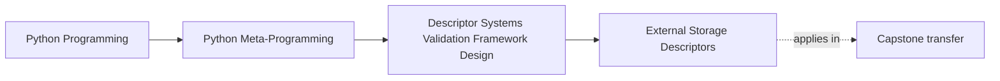
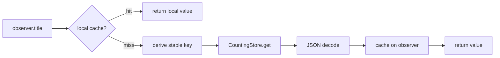
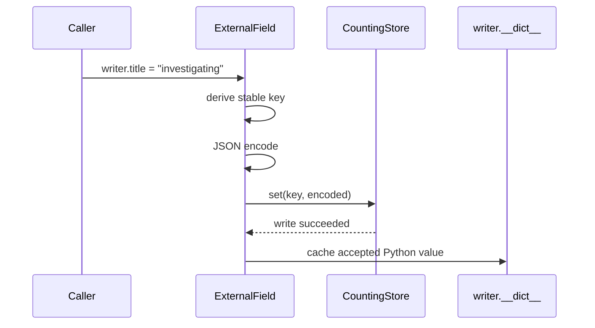

# External Storage Descriptors

<!-- page-maps:start -->
## Page Maps




<!-- page-maps:end -->

An external-storage descriptor keeps attribute syntax while moving authority outside the
instance. That changes the contract:

- a read may perform backend work
- assignment may serialize and persist
- local state can disagree with authoritative state
- identity and failure become part of ordinary attribute access

The descriptor may own one field-shaped access path. It does not become a transaction
manager, identity map, or database merely because the syntax is concise.

## Start with authority

Open `labs/descriptor_systems/external.py`.

The lab separates two owners:

| Owner | Responsibility |
| --- | --- |
| `CountingStore` | authoritative JSON text and observable read/write events |
| `ExternalField` | stable key derivation, serialization, read-through cache, write-through ordering, invalidation |

The instance owns only a local mirror:

```text
observer.__dict__["_title_external_cache"]
```

When the mirror and backend disagree, the backend is authoritative.

## Stable key design

For record `17`, the `title` descriptor publishes:

```text
incident:Record:17:title
```

The segments answer four review questions:

1. Which logical namespace owns the value? `incident`
2. Which record type declared the field? `Record`
3. Which durable record is addressed? `17`
4. Which attribute is stored? `title`

The key does not use `id(obj)`. Process-local identity would make the value inaccessible
to a second instance or another process.

## Write path

Assignment performs backend work before updating the local cache:



That order matters. If the backend write fails, the descriptor must not update the local
cache and pretend persistence succeeded.

## Read path and hidden I/O

A second instance with record ID `17` has no local cache. Its first `title` read:

1. derives the same stable key
2. calls `CountingStore.get`
3. decodes JSON
4. stores a local mirror
5. returns the Python value

Run:

```bash
python3 -m unittest tests/test_descriptor_system_external.py -v
make descriptor-system-lab
```

The packet publishes the policy directly:

```json
{
  "hidden_io": true,
  "read_policy": "read-through on local cache miss",
  "serialization": "JSON text",
  "source_of_truth": "CountingStore",
  "write_policy": "backend write before local cache update"
}
```

Calling the I/O “transparent” would be misleading. The attribute surface is compact; the
cost and failure path still exist.

## Stale local state

The evidence runs this sequence:

| Event | Backend value | Observer cache | Observer reads |
| --- | --- | --- | --- |
| writer assigns | `investigating` | empty | not read |
| observer reads | `investigating` | `investigating` | `investigating` |
| another actor writes | `resolved` | `investigating` | `investigating` |
| descriptor invalidates observer | `resolved` | empty | not read |
| observer reads again | `resolved` | `resolved` | `resolved` |

The stale read is not an accidental omission from the lesson. It is the central
trade-off of a local read-through cache whose source of truth can change elsewhere.

## Failure routes

The focused tests make two failures visible.

### Missing durable identity

An object without `record_id` cannot derive a stable key. Assignment raises before the
store receives an event:

```text
record_id must exist before writing external state
```

### Backend outage

`CountingStore.available = False` makes an uncached read raise `StoreUnavailable`. The
descriptor does not convert outage into “missing,” `None`, or stale success.

This distinction matters:

- missing field value is an attribute-state question
- unavailable backend is an infrastructure failure

Conflating them would make debugging and recovery less honest.

## Serialization boundary

The lab uses JSON text. That gives the example a real boundary without pretending to
solve schema evolution.

Ask these questions for any external field:

- Which Python values round-trip?
- How are absent and `None` distinguished?
- Which decoding errors reach the caller?
- What changes when the stored schema evolves?

The lab proves scalar JSON round trips. It does not prove migrations, compatibility
across versions, or arbitrary object serialization.

## What the tests prove

`tests/test_descriptor_system_external.py` proves:

- keys use stable record and field identity
- a second instance reads the authoritative backend value
- local state remains stale until invalidated
- identity is required before backend access
- backend failure stays visible
- the evidence refuses transaction and identity-map claims

It does not prove:

- atomic multi-field writes
- rollback
- connection pooling or retries
- concurrent cache coherence
- record identity preservation
- query planning

Those missing guarantees are architecture signals, not TODOs for a smarter field.

## Capstone transfer

The incident-plugin capstone rejects external field storage. Plugin configuration values
live in each plugin instance, and inspecting a field performs no backend I/O.

That choice keeps:

- construction deterministic
- field reads local
- failure surfaces separate from configuration access
- persistence outside the descriptor layer

The lab lets you understand the stronger mechanism. The capstone shows why the
application does not currently need it.

## Learner work

Create a backend authority card for one field:

| Required entry | Your evidence |
| --- | --- |
| stable backend key | exact string |
| authoritative representation | stored bytes or text |
| local mirror | exact cache slot |
| cache-miss work | calls and conversions |
| stale-state trigger | concrete external change |
| invalidation owner | method or service |
| outage behavior | exact exception or result |
| refused wider claim | transaction, identity, query, or migration guarantee |

Move on only when you can explain why `obj.field` may be syntactically ordinary while
being operationally expensive and failure-prone.

## Continue

- Previous: [Cached Descriptors and Invalidation](cached-descriptors-and-invalidation.md)
- Next: [Descriptor Composition and Wrapper Fields](descriptor-composition-and-wrapper-fields.md)
- Practice: [Descriptor System Review Lab](exercises.md)
