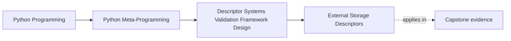

# External Storage Descriptors


<!-- page-maps:start -->
## Page Maps




<!-- page-maps:end -->

The second pressure that turns simple descriptors into framework-shaped machinery is this:

the instance is no longer the source of truth.

Instead, the descriptor mediates access to something outside the object:

- a database row
- a key-value store
- a configuration backend
- a serialized record cache

That changes the design completely.

This page matters because external descriptors are where ordinary attribute syntax starts
to hide backend authority. A learner studying alone needs more than "this field reads from
storage." They need a route for proving where truth lives, what the descriptor is allowed
to cache, and what wider storage responsibilities it must refuse.

## The sentence to keep

An external-storage descriptor is a field descriptor whose source of truth lives outside
the instance, while the descriptor provides attribute access, key derivation, and often a
local read-through cache.

That is much bigger than “store a value in `obj.__dict__`.”

Keep one more sentence beside it:

> the descriptor may shape access, but it does not get to pretend it became the database.

Turn that sentence into three checks any time you inspect one of these fields:

- can I name the authoritative backend slot without reading three helpers?
- can I say what local cache may disagree with that slot?
- can I explain what the caller sees when the backend is missing, stale, or unavailable?

## What changes when storage becomes external

Once storage moves out of the instance, the descriptor usually has to own more than one
thing:

- how to derive or find the backend key
- how to serialize and deserialize values
- when to read through a local cache
- when to write through to the backend

This is why external descriptors feel much closer to framework design.

Use this checklist before trusting an external field:

| Pressure | Review question |
| --- | --- |
| backend keying | what exact identity does the field use to find its record? |
| serialization | what Python value becomes what stored representation? |
| caching | what local state can drift away from the backend? |
| write policy | what happens on assignment, and when does persistence occur? |
| failure surface | what does the caller experience when storage is unavailable or stale? |

## A small educational backend

```python
import json


class MemoryStore:
    def __init__(self):
        self._data = {}

    def get(self, key):
        return self._data.get(key)

    def set(self, key, value):
        self._data[key] = value


store = MemoryStore()
```

This is obviously too small for production, but it is the right scale for showing the
descriptor mechanics honestly.

## A read-through external field

```python
class ExternalField:
    def __init__(self, store, prefix="field", pk_field="id"):
        self.store = store
        self.prefix = prefix
        self.pk_field = pk_field

    def __set_name__(self, owner, name):
        self.name = name
        self.cache_name = f"_{name}_cached"
        self.key_template = f"{self.prefix}:{owner.__name__}:%s:{name}"

    def _pk(self, obj):
        return getattr(obj, self.pk_field, None)

    def __get__(self, obj, owner=None):
        if obj is None:
            return self
        if self.cache_name in obj.__dict__:
            return obj.__dict__[self.cache_name]

        pk = self._pk(obj)
        if pk is None:
            return None

        raw = self.store.get(self.key_template % pk)
        if raw is None:
            return None

        value = json.loads(raw)
        obj.__dict__[self.cache_name] = value
        return value

    def __set__(self, obj, value):
        pk = self._pk(obj)
        if pk is None:
            raise ValueError("primary key must exist before writing external state")

        self.store.set(self.key_template % pk, json.dumps(value))
        obj.__dict__[self.cache_name] = value

    def invalidate(self, obj):
        obj.__dict__.pop(self.cache_name, None)
```

This is a small example, but it already surfaces the real concerns:

- backend key design
- read-through caching
- write-through persistence
- invalidation after local staleness

It also keeps a useful discipline visible:

the descriptor owns one field-shaped backend contract, not the whole record lifecycle.

## Why primary keys matter here

When external state is shared or persisted, object identity in memory is not enough.

That is why examples like this usually derive keys from stable identifiers such as:

- primary keys
- model names
- field names

Those keys let the backend treat stored values as record state rather than as process-local
instance state.

Use this key-design table when the owner story feels vague:

| Key choice | Why it helps or hurts |
| --- | --- |
| stable record identity plus field name | keeps one field mapped to one durable backend slot |
| process-local object identity | breaks as soon as another process or reload touches the same record |
| hidden ad hoc key derivation | makes debugging and migration review much harder |

## Hidden I/O is the risk you should name

External descriptors are powerful, but they can hide expensive behavior behind ordinary
attribute access.

That means `obj.field` may now imply:

- deserialization
- cache lookup
- storage reads
- latency or failure from a remote system

If that cost is not visible in docs, review, or instrumentation, the design is easy to
misread.

Keep one quick visibility card beside every backend-backed field:

| Access path | Hidden work | Why the reviewer should care |
| --- | --- | --- |
| cache miss read | key derivation, backend lookup, deserialization | latency, stale schema, and missing-key behavior all become part of `obj.field` |
| assignment | serialization, backend write, cache update | write ordering and persistence failure now matter to ordinary attribute syntax |
| invalidation | cache clear only or cache plus backend refresh policy | tells you whether local state can drift quietly |

## Evidence route for external field reviews

Use this route whenever a backend-backed descriptor sounds smaller than its blast radius:

| Evidence step | What it proves |
| --- | --- |
| find the authoritative backend slot | tells you where truth lives when local and backend state diverge |
| trace key derivation from object to backend key | tells you whether identity is durable or accidental |
| trace read miss and write path | tells you whether access hides I/O, serialization, or both |
| inspect local cache invalidation | tells you whether stale state has an owner |
| describe one storage failure path | tells you whether the design teaches cost and risk honestly |

## Caching here is different from Core 1

In the previous core, the descriptor usually computed the value from local instance state.

Here, the descriptor does not own the source of truth at all.

So the cache is not only about saving computation. It is about avoiding repeated backend
access while still recognizing that the backend is authoritative.

That makes staleness and invalidation more serious.

Keep the distinction explicit:

- local computed caches protect repeated computation
- external read-through caches protect repeated backend access

The second case carries a stronger truth question because the source of truth lives
elsewhere.

## Backend authority worksheet

Fill out this worksheet for any external-storage field before you trust it:

| Question | Example answer shape |
| --- | --- |
| what exact key names the field value? | `field:Post:12:title` |
| what representation is stored there? | JSON string containing one scalar title |
| what local state may mirror it? | `obj.__dict__["_title_cached"]` |
| what event makes that local state untrustworthy? | backend write by another actor or local assignment bypass |
| who owns the repair? | explicit invalidation helper, reload helper, or wider persistence layer |

## Serialization is part of the contract

External fields do not only store values. They cross a serialization boundary.

That boundary raises questions like:

- how are values encoded?
- what happens to `None`?
- what type information is lost?
- what happens when the stored schema drifts over time?

Even in a toy example, those questions are part of the field design.

Use this table when serialization work starts hiding inside pretty attribute syntax:

| Boundary question | Why it matters |
| --- | --- |
| what raw bytes or strings are stored? | shows the real backend representation |
| what values cannot round-trip cleanly? | shows where type promises can break |
| what default or missing-state representation is used? | prevents silent confusion between unset, null, and empty values |
| what schema drift would break reads? | shows where field logic stops and migration logic begins |

## When external descriptors are a good fit

Use them when:

- one attribute genuinely maps to backend-managed state
- a field-level API improves readability
- the keying strategy is stable and reviewable
- read-through caching and invalidation are explicit

That is the honest zone for this pattern.

Strong educational examples in this zone can answer, in one sentence each:

- where the authoritative value lives
- why attribute access is still acceptable syntax
- what stale local state is allowed and how it is cleared
- what wider persistence claim the field explicitly refuses to make

## When they are a poor fit

External descriptors are a weaker fit when:

- remote access cost is too surprising for normal attribute syntax
- the storage model needs transactions, units of work, or stronger consistency guarantees
- the object graph needs identity maps or relationship orchestration
- the system needs broader observability than a field can provide alone

Those are clues that the design has moved into framework architecture.

## Common overclaims to reject

Reject these descriptions when they appear in review:

| Overclaim | Better replacement |
| --- | --- |
| "it is just a descriptor field" | "it is a descriptor field that crosses into backend access and serialization" |
| "reads are normal attribute access" | "reads may trigger cache checks, backend I/O, and decoding" |
| "the backend details are abstracted away" | "the backend is hidden syntactically but still owns the source of truth" |
| "the field stays fresh automatically" | "freshness depends on an explicit cache and invalidation story" |

## Weak answers to reject early

| Weak answer | Why it fails |
| --- | --- |
| "it stores somewhere in the backend" | somewhere hides the authoritative slot |
| "reads are transparent" | transparency usually means hidden I/O stayed unreviewed |
| "the cache should stay close enough" | close enough is not a source-of-truth rule |
| "backend failure is outside the field discussion" | backend failure is part of what ordinary attribute access now means |

## Failure modes for external descriptors

These are the mistakes this page is trying to prevent:

| Failure mode | Why it weakens the design | Repair move |
| --- | --- | --- |
| key derivation depends on unstable object identity | persisted values become hard to recover or compare across processes | derive keys from stable record identity plus field name |
| local cache outlives backend changes with no owner | readers silently observe stale state | add explicit invalidation or bounded cache lifetime |
| serialization rules stay implicit | the field appears type-safe while round trips can drift | name the encoding and failure cases directly |
| attribute syntax hides expensive or fragile remote access | callers misread cost and reliability | add observability and document the access path honestly |
| one field starts implying transactions or relationship orchestration | the field claims broader architecture power than it has | move wider coordination to explicit services or model infrastructure |

## Review rules for external fields

When reviewing an external-storage descriptor, keep these questions close:

- where is the real source of truth?
- how is the backend key derived?
- what does read-through caching hide or reveal?
- what invalidates stale local state?
- is attribute syntax still a reasonable surface for the cost of this access?
- can another reviewer identify the refused wider owner in one sentence?

## Exit check for this page

Before moving on, make sure you can do all of these:

- name the authoritative backend slot for one field
- explain how the key is derived and why it is durable
- identify one hidden cost of attribute access
- say what stale local state exists and who clears it
- name one stronger infrastructure concern this field must refuse

## What to practice from this page

Try these before moving on:

1. Build one external descriptor with a stable key format and explain why instance identity alone is not enough.
2. Add a local read cache and one explicit invalidation hook.
3. Write one short review note warning that attribute access now hides backend I/O.

If those feel ordinary, the next step is composition: layering field behavior without
turning every variation into a new subclass.

Before you move on, make sure your own notes include:

- one backend key shape
- one hidden-I/O warning
- one invalidation owner
- one refused claim such as "this field now handles persistence in general"

## Continue through Module 08

- Previous: [Cached Descriptors and Invalidation](cached-descriptors-and-invalidation.md)
- Next: [Descriptor Composition and Wrapper Fields](descriptor-composition-and-wrapper-fields.md)
- Return: [Overview](index.md)
- Terms: [Glossary](glossary.md)
