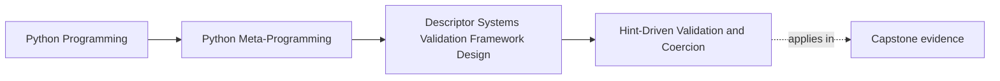

# Hint-Driven Validation and Coercion


<!-- page-maps:start -->
## Page Maps




<!-- page-maps:end -->

The fourth pressure in Module 08 is metadata.

Once a descriptor starts reading annotations and `Annotated[...]` metadata, it stops being
only a storage hook and starts acting like a lightweight model system.

That can be useful. It can also become misleading very quickly.

This page matters because type metadata creates the easiest path to overclaiming runtime
power. A learner studying alone needs a route for proving which hints the field actually
understands, which coercions it allows, and which typing surfaces it correctly refuses.

## The sentence to keep

Hint-driven descriptors use type annotations as runtime evidence for limited validation and
coercion, but they stay honest only when the supported hint surface and coercion rules are
named explicitly.

That is the difference between a useful field system and fake comprehensiveness.

Keep one more sentence beside it:

> a field is honest when its refusal surface is as clearly taught as its success path.

For self-study, keep a refusal ledger while you read:

- one hint form the field supports confidently
- one hint form it refuses immediately
- one coercion it allows
- one coercion it refuses because guessing would be misleading

## What this pattern is trying to do

Hint-aware field descriptors usually want to do some mix of these:

- read a declared type from `get_type_hints`
- use that type for `isinstance`-style checks
- apply metadata validators from `Annotated[...]`
- coerce a narrow set of values into supported scalar types

That can create a very expressive declarative field surface.

It also raises the risk of overclaiming what “runtime typing support” really means.

Use this table before trusting a hint-aware field:

| Pressure | Review question |
| --- | --- |
| hint resolution | what source provides the runtime hint, and when is it read? |
| supported subset | which exact hint forms are accepted? |
| coercion | what conversions are attempted, and in what order? |
| metadata | what `Annotated[...]` items are recognized as meaningful? |
| refusal | what unsupported hint forms fail immediately instead of being guessed through? |

## Supported-versus-refused hint card

Use a card like this for every hint-aware field you review:

| Surface | Supported now | Refused now | Why the refusal is honest |
| --- | --- | --- | --- |
| scalar runtime classes | yes | no | ordinary `isinstance`-style checks stay reviewable |
| `Union` and `Optional` | selected support | no deeper typing algebra | keeps branching logic explicit |
| `Annotated[...]` validators | callable metadata only | richer schema metadata | the field only understands validator-like metadata here |
| parameterized generics | no | yes | element-wise validation is not actually proved |

## A narrow runtime checker

```python
from typing import Any, Union, get_args, get_origin
import types


def supports_instance(value, hint):
    if hint is Any:
        return True

    origin = get_origin(hint)
    if origin in (Union, types.UnionType):
        return any(supports_instance(value, arg) for arg in get_args(hint))

    if origin is not None:
        raise NotImplementedError(
            "parameterized generics are intentionally unsupported here"
        )

    return isinstance(value, hint)
```

This is the right educational shape because it says clearly what it does not support.

That refusal is part of the design, not a missing feature.

## A hint-aware field

```python
from typing import Annotated, Any, get_args, get_origin, get_type_hints


class HintField:
    def __set_name__(self, owner, name):
        hints = get_type_hints(owner)
        self.public_name = name
        self.private_name = f"_{name}"
        self.hint = hints[name]

        origin = get_origin(self.hint)
        if origin is Annotated:
            base, *metadata = get_args(self.hint)
            self.hint = base
            self.validators = [item for item in metadata if callable(item)]
        else:
            self.validators = []

    def __get__(self, obj, owner=None):
        if obj is None:
            return self
        return obj.__dict__.get(self.private_name)

    def __set__(self, obj, value):
        if not supports_instance(value, self.hint):
            for candidate in (int, float, str):
                if candidate is self.hint:
                    try:
                        value = candidate(value)
                        break
                    except Exception:
                        pass
            else:
                raise TypeError(f"{self.public_name} cannot coerce {value!r} to {self.hint!r}")

        if not supports_instance(value, self.hint):
            raise TypeError(f"{self.public_name} expected {self.hint!r}")

        for validator in self.validators:
            value = validator(value)

        obj.__dict__[self.private_name] = value
```

This is useful because it keeps the whole pipeline visible:

- resolve hints once
- extract metadata validators
- coerce conservatively
- validate after coercion
- store the accepted value

That pipeline is what the learner should be able to narrate without hand-waving.

## Evidence route for hint-aware field reviews

Use this route whenever a descriptor sounds more typing-aware than its code proves:

| Evidence step | What it proves |
| --- | --- |
| find where hints are resolved | tells you when annotation state becomes runtime evidence |
| list supported hint forms | tells you whether the field has a bounded contract |
| trace one coercion attempt | tells you whether conversion is conservative or guess-heavy |
| trace `Annotated[...]` extraction | tells you what metadata the field actually uses |
| inspect one unsupported hint path | tells you whether refusal is explicit and reviewable |

## Why `Annotated[...]` is a good fit here

`Annotated[...]` works well for field systems because it lets the type and the extra
runtime metadata travel together.

For example:

```python
Annotated[str, min_length(3)]
```

can mean:

- the base type is `str`
- the metadata carries extra validators

That creates a clean declarative surface as long as the runtime system stays narrow about
what metadata it understands.

Use this table when metadata claims start drifting:

| Metadata surface | Honest question |
| --- | --- |
| callable validators in `Annotated[...]` | when do they run relative to coercion? |
| non-callable metadata markers | are they ignored, stored, or rejected? |
| multiple validators | what order do they run in? |
| richer domain metadata | does the field really understand it, or does it only pass it through? |

## Coercion is where honesty matters most

Coercion can make field systems pleasant to use, but it also creates ambiguity.

That is why this module treats coercion conservatively:

- support a very small scalar subset
- fail loudly when conversion is unclear
- do not pretend to support all typing constructs

If the descriptor silently guesses too much, it becomes harder to trust.

Ask one more question on every coercion path:

> if the conversion fails, does the resulting error tell the learner what narrow rule was attempted?

Use this coercion table when "helpful conversion" starts to sound magical:

| Coercion case | Honest review stance |
| --- | --- |
| `"3"` to `int` | acceptable only if the conversion is explicit and narrow |
| `"3.2"` to `float` | acceptable only if failure cases stay loud |
| arbitrary containers to parameterized generics | refuse unless the design truly proves element validation |
| broad best-effort parsing | reject because the field starts guessing instead of validating |

## Unsupported surfaces should be refused clearly

Strong hint-driven designs are explicit about what they do not handle.

Examples often refused at this stage include:

- parameterized generics such as `list[int]`
- nested model validation
- arbitrary custom typing constructs

Refusing those surfaces is a design strength, not a weakness.

Keep a refusal ledger while you work:

- supported now
- intentionally unsupported now
- wider owner required before support could become honest

If you cannot keep those three columns separate, the field is already sounding more
capable than its code proves.

## Why this is framework-adjacent

Once a field descriptor reads type hints, applies metadata validators, and coerces values,
it starts to resemble lightweight versions of tools such as Pydantic or attrs.

That resemblance is useful for learning, but it creates a new boundary question:

is this still a field-level convenience, or is it drifting into a broader model framework?

The next core will answer that directly.

## Common overclaims to reject

Reject these descriptions when they appear in review:

| Overclaim | Better replacement |
| --- | --- |
| "the field supports runtime typing" | "the field supports a named subset of runtime hint checks" |
| "Annotated validators make it schema-aware" | "Annotated validators add selected runtime metadata hooks" |
| "coercion makes input flexible" | "coercion accepts a narrow set of explicit conversions" |
| "unsupported hints will probably still work" | "unsupported hints must fail clearly or stay out of scope" |

## Weak answers to reject early

| Weak answer | Why it fails |
| --- | --- |
| "it understands type hints" | type hints are too broad a category to audit |
| "Annotated makes it schema-aware" | schema-aware overstates what validator metadata alone proves |
| "the field will try its best to coerce" | best effort usually means hidden guessing |
| "generic containers can come later" | later is not a present contract |

## Failure modes for hint-driven fields

These are the mistakes this page is trying to prevent:

| Failure mode | Why it weakens the design | Repair move |
| --- | --- | --- |
| implementation implies broader hint support than it has | learners overtrust runtime typing guarantees | publish the supported subset directly |
| coercion guesses through too many conversions | values become accepted for the wrong reasons | keep coercion narrow and explicit |
| `Annotated[...]` metadata is mentioned but not interpreted clearly | review cannot tell what metadata matters | document the recognized metadata surface |
| unsupported hints fail late or inconsistently | debugging and review become guesswork | refuse unsupported forms immediately and clearly |
| field starts implying nested-model or schema-system power | the descriptor drifts toward framework behavior | move broader validation to a stronger owner |

## Review rules for hint-driven fields

When reviewing hint-aware descriptors, keep these questions close:

- which hint forms are actually supported?
- what coercions are allowed, and are they conservative enough?
- what metadata from `Annotated[...]` is recognized?
- are unsupported hint surfaces refused clearly?
- is this still a field descriptor, or is it quietly trying to become a model framework?
- can another reviewer point to one exact hint form the field refuses on purpose?

## Exit check for this page

Before moving on, make sure you can do all of these:

- name the exact hint subset the field supports
- explain one coercion path and one refused coercion path
- say what `Annotated[...]` metadata the field recognizes
- identify one unsupported hint form and why refusal is correct
- name one broader validation concern that should move to framework infrastructure

## What to practice from this page

Try these before moving on:

1. Implement one hint-aware field that supports plain classes plus `Union` or `Optional`.
2. Add one `Annotated[...]` validator and explain when it runs relative to coercion.
3. Write one short review note rejecting a claim of “full runtime typing support.”

If those feel ordinary, the next step is the module's design page: where descriptor
systems stop being just fields and start needing broader framework ownership.

## Continue through Module 08

- Previous: [Descriptor Composition and Wrapper Fields](descriptor-composition-and-wrapper-fields.md)
- Next: [Descriptor Systems and Framework Boundaries](descriptor-systems-and-framework-boundaries.md)
- Return: [Overview](index.md)
- Terms: [Glossary](glossary.md)
