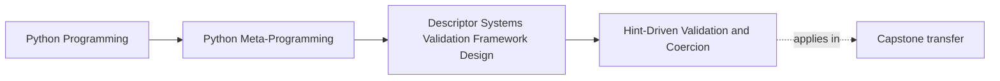
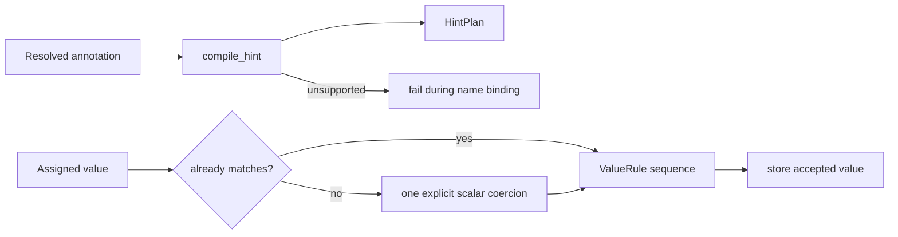
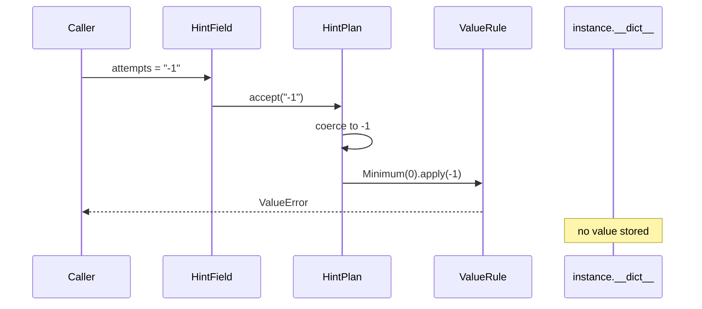

# Hint-Driven Validation and Coercion

<!-- page-maps:start -->
## Page Maps




<!-- page-maps:end -->

Annotations are static metadata until runtime code chooses to interpret them. A
hint-driven descriptor is that interpreter.

The difficult part is not reading `__annotations__`. It is defining a runtime contract
that stays smaller than Python’s typing language:

> publish the supported subset, coercion rules, metadata rules, and refusal surface as
> explicitly as the success path.

“Supports runtime typing” is not an acceptable description of a four-scalar interpreter.

## Starting pressure

The lab wants this declaration:

```python
class RetryPolicy:
    attempts: Annotated[int, Minimum(0)] = HintField()
    label: Annotated[str, NonBlank()] = HintField()
    timeout: float | None = HintField()
    enabled: bool = HintField()
```

It should accept a small configuration boundary:

```python
RetryPolicy(
    attempts="3",
    label="  delivery retry  ",
    timeout=2,
    enabled="yes",
)
```

and store:

```json
{
  "attempts": 3,
  "enabled": true,
  "label": "delivery retry",
  "timeout": 2.0
}
```

That convenience is useful only if the conversion rules remain predictable.

## When interpretation happens

Open `labs/descriptor_systems/hints.py`.

`HintField.__set_name__` runs after its owner class exists. It resolves the annotation
once with:

```python
get_type_hints(owner, include_extras=True)
```

and compiles a `HintPlan`.

The plan—not the raw annotation—owns assignment behavior. This separates:

- class-definition-time interpretation
- instance-time coercion, validation, and storage

If a field lacks an annotation or uses an unsupported form, name binding fails before any
instance can accept values.

## Published support matrix

The lab supports exactly:

| Surface | Support |
| --- | --- |
| scalar classes | `str`, `int`, `float`, `bool` |
| nullable values | unions containing `None` |
| wider unions | combinations of supported scalar classes |
| metadata | `Annotated[...]` containing only explicit `ValueRule` objects |
| nested containers | refused |
| arbitrary classes | refused |
| nested models | refused |

The evidence packet places the refused list beside each plan. A reviewer does not need to
reverse-engineer failure behavior from implementation branches.

## Coercion policy

The conversion table is deliberately narrow:

| Target | Accepted conversion |
| --- | --- |
| `str` | none; non-text input is refused |
| `int` | base-10 integer text |
| `float` | numeric text or a non-boolean integer |
| `bool` | explicit true/false, yes/no, on/off, or 1/0 text |

There is no loop that blindly tries every constructor. Broad “best effort” coercion makes
acceptance depend on accidental Python behavior.

Run:

```bash
python3 -m unittest tests/test_descriptor_system_hints.py -v
make descriptor-system-lab
```

The `hint_policy.trace` section explains each stored value:

```text
attempts: "3" -> 3       (coerced-to-int)
label: padded text -> text (already-matched, then NonBlank normalized)
timeout: 2 -> 2.0        (coerced-to-float)
enabled: "yes" -> true   (coerced-to-bool)
```

## The boolean edge case

In Python:

```python
isinstance(True, int) is True
```

A naïve integer validator would therefore accept `True` as retry count `1`. The lab
explicitly excludes booleans from integer and float matches.

`tests/test_descriptor_system_hints.py` proves that `compile_hint(int).accept(True)`
raises instead of silently accepting language-level subclass behavior as domain intent.

This is a useful metaprogramming lesson: reflection reveals Python semantics; policy must
still decide whether those semantics fit the domain.

## `Annotated` metadata is executable policy

The lab recognizes only `ValueRule` objects:

- `Minimum(0)` checks a numeric lower bound
- `NonBlank()` trims and rejects empty text

Rules run after type matching or coercion:



Strings such as `Annotated[int, "positive"]` are refused. Ignoring unknown metadata
would let declarations appear stronger than runtime behavior.

## Refusal routes

The evidence compiles three unsupported forms:

| Form | Result |
| --- | --- |
| `list[int]` | parameterized generics are intentionally unsupported |
| `Annotated[int, "positive"]` | metadata must contain explicit `ValueRule` objects |
| `bytes` | only the published scalar set is supported |

These are definition errors, not deferred surprises on a later assignment.

Supporting `list[int]` honestly would require decisions about:

- container coercion
- element-by-element validation
- failure location
- mutation after validation
- nested generic recursion

The lab refuses that larger system.

## What the tests prove

`tests/test_descriptor_system_hints.py` proves:

- scalar conversions follow the published table
- optional hints accept `None` without coercion
- rules run after coercion and before storage
- booleans do not pass as integers
- parameterized generics and unknown metadata fail early
- missing annotations fail during name binding
- the evidence publishes success and refusal surfaces

It does not prove:

- full compliance with Python’s typing specification
- container element validation
- arbitrary unions or protocols
- recursive model construction
- static type-checker agreement
- safe parsing of domain-specific formats

## Capstone transfer

The incident-plugin capstone rejects hint inference for fields. It uses explicit
descriptor classes such as `IntegerField` and `ChoiceField`.

That design:

- makes coercion policy visible in the declared field type
- avoids pretending annotations are a runtime schema
- keeps field manifests stable without interpreting the full typing language

The capstone does use annotations for action-call checking in a separate, bounded route
introduced earlier in the course. Keeping action hints and field coercion separate avoids
one interpreter quietly becoming the owner of every runtime type decision.

## Learner work

For one `HintField`, submit:

1. the resolved annotation
2. the compiled plan manifest
3. one already-matched value
4. one coerced value
5. one rule failure after coercion
6. one unsupported hint rejected at definition time
7. one sentence stating why this is not “runtime typing support”

Move on when your refusal table is as precise as your success table.

## Continue

- Previous: [Descriptor Composition and Wrapper Fields](descriptor-composition-and-wrapper-fields.md)
- Next: [Descriptor Systems and Framework Boundaries](descriptor-systems-and-framework-boundaries.md)
- Practice: [Descriptor System Review Lab](exercises.md)
