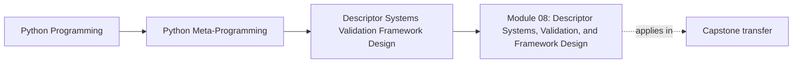
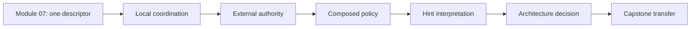
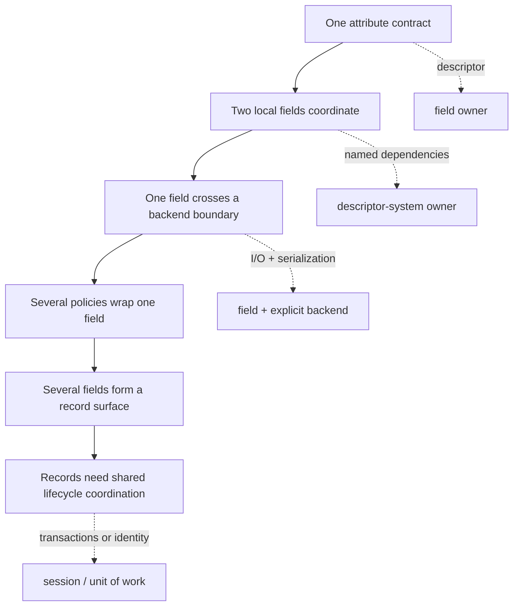

# Module 08: Descriptor Systems, Validation, and Framework Design

<!-- page-maps:start -->
## Page Maps




<!-- page-maps:end -->

Module 07 taught you to predict one attribute lookup. Module 08 asks what happens when
several useful field behaviors begin to cooperate:

- a source field invalidates a derived cache
- an attribute maps to an authoritative backend slot
- wrapper fields normalize, validate, store, and audit in a known order
- annotations become bounded runtime policy
- several field-shaped concerns begin asking for model or service ownership

That is the learning problem. The goal is not to build the cleverest descriptor. It is to
recognize when a field abstraction remains honest and when pleasant attribute syntax has
started hiding architecture.

The course and its runnable lab are the primary learning surfaces. The incident-plugin
capstone appears after the mechanism is understood, as evidence of a deliberately smaller
production-facing choice.

## Prerequisites

Before starting, you should be able to:

- distinguish data and non-data descriptors
- predict descriptor and instance-dictionary precedence
- explain what `__set_name__` records
- identify where a descriptor stores per-instance state
- use class access to inspect a descriptor without invoking instance behavior

If any of those are uncertain, return to
[Module 07](../module-07-descriptors-lookup-attribute-control/index.md) and run:

```bash
make descriptor-lookup-lab-test
make descriptor-lookup-lab
```

## The executable learning surface

From the Python Metaprogramming program directory:

```bash
make descriptor-system-lab-test
make descriptor-system-lab
```

The first command runs 38 focused tests. The second prints one JSON packet with six
top-level evidence sections:

| Evidence section | Question it answers |
| --- | --- |
| `cache_invalidation` | who owns freshness, and when does computation run again? |
| `external_storage` | where is truth, what I/O is hidden, and when is local state stale? |
| `composition` | which layer transforms, validates, stores, and audits? |
| `hint_policy` | which hints and coercions are supported or refused? |
| `record_model` | what can a bounded field-backed model honestly demonstrate? |
| `architecture_boundary` | which owner can see the complete invariant? |

Do not read the packet as a score report. Read one section beside the matching source and
test:

- `labs/descriptor_systems/cache.py`
- `labs/descriptor_systems/external.py`
- `labs/descriptor_systems/composition.py`
- `labs/descriptor_systems/hints.py`
- `labs/descriptor_systems/relational.py`
- `labs/descriptor_systems/boundaries.py`

The tests under `tests/test_descriptor_system_*.py` are part of the lesson. They state
what the code proves and, just as importantly, what it refuses to prove.

## The module argument

The module follows one widening design:



Every move to the right increases review cost. The important question is not whether a
descriptor *can* participate. It is whether one attribute still sees enough of the
invariant to own it.

## Core sequence

Study the cores in order:

1. [Cached Descriptors and Invalidation](cached-descriptors-and-invalidation.md) names
   cache dependencies and makes the freshness owner executable.
2. [External Storage Descriptors](external-storage-descriptors.md) moves truth outside
   the instance and exposes backend reads, writes, serialization, and stale local state.
3. [Descriptor Composition and Wrapper Fields](descriptor-composition-and-wrapper-fields.md)
   traces a full write through four single-purpose layers.
4. [Hint-Driven Validation and Coercion](hint-driven-validation-and-coercion.md) publishes
   a narrow supported subset and an equally visible refusal surface.
5. [Descriptor Systems and Framework Boundaries](descriptor-systems-and-framework-boundaries.md)
   selects owners by invariant visibility rather than by mechanism prestige.
6. [Worked Example: Building an Educational Mini Relational Model](worked-example-building-an-educational-mini-relational-model.md)
   combines the mechanisms and then refuses the production ORM label.

After the worked example, complete the
[Descriptor System Review Lab](exercises.md) before reading the
[review answers](exercise-answers.md).

## What changes from Module 07

| Module 07 question | Module 08 question |
| --- | --- |
| which lookup layer wins? | which component owns truth and freshness? |
| where does one descriptor store a value? | what happens when state spans a cache or backend? |
| what does `__set_name__` record? | how is name binding forwarded through composed fields? |
| is this object a data descriptor? | is this still one field contract or already a system? |
| what does class access expose? | can a reviewer inspect the entire policy stack and its limits? |

Module 08 depends on Module 07; it does not repeat it.

## Evidence before abstraction

Use this study loop for every core:

1. Read the pressure and predict the owner.
2. Open the named lab file.
3. Run the focused test file for that mechanism.
4. Run `make descriptor-system-lab`.
5. Reconcile the JSON evidence with the code path.
6. Write one claim the mechanism proves and one it does not.
7. Only then compare the capstone choice.

A learner who can repeat definitions but cannot trace the evidence has not completed the
core.

## Capstone transfer

The incident-plugin capstone intentionally keeps its field system narrower than this lab:

- values live in each plugin instance
- validation is expressed by explicit field subclasses
- field metadata is collected during class creation
- ordinary field access performs no backend I/O
- no cached derivations, wrapper stacks, or annotation inference are hidden in fields

That is a design decision, not a missing demonstration. Later in this module, the
capstone field-system inspection route will let you compare those accepted and rejected
powers without constructing or executing a plugin.

## Exit evidence

You are ready for Module 09 when you can produce all of the following without classroom
explanation:

- a cache trace naming dependency, storage slot, invalidation owner, and bypass
- a backend trace naming key, source of truth, serialization, stale state, and outage
- a composed write trace naming one concern per layer
- a hint manifest naming supported types, coercions, validators, and refused forms
- a model review that distinguishes field capabilities from absent framework services
- an owner decision naming one rejected weaker owner and one rejected stronger owner

The exit standard is engineering judgment backed by runnable evidence, not familiarity
with descriptor vocabulary.
