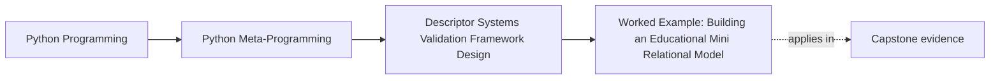

# Worked Example: Building an Educational Mini Relational Model


<!-- page-maps:start -->
## Page Maps




<!-- page-maps:end -->

The five core lessons in Module 08 become easier to trust when they meet one example that
is powerful enough to look like a framework, but still small enough to inspect.

A miniature relational model layer is exactly that kind of example.

It combines:

- cached descriptor reads
- external storage
- wrapper-field composition
- hint-aware validation
- the boundary between field behavior and model-wide orchestration

That makes it the right worked example for the module.

This page matters because worked examples are where readers most often over-trust the
pattern. If the example looks like a miniature ORM, many learners will silently grant it
ORM responsibilities that it never proved. The job of this page is to keep the proof
route visible.

## The incident

Assume a team wants a tiny model system that can:

- declare fields on classes
- read and write some values through a backing store
- validate selected values
- lazy-load simple relationships

Those are reasonable educational goals. The mistake would be pretending this is now a real
ORM.

Keep one more sentence beside it:

> this example is a review packet for field ownership, not a disguised production framework.

If you are studying alone, keep one more rule beside the code:

- every time the example feels impressive, stop and ask what exact responsibility produced that impression
- then decide whether that responsibility is still field-sized or already model- or framework-sized

## The first design rule: keep the “ORM” claim narrow

This worked example is intentionally limited.

It can teach:

- how a field descriptor can read from or write to external storage
- how field wrappers can add validators
- how one relationship field can lazy-load related records

It does not claim:

- transactions
- migrations
- query planning
- identity maps
- session management

That refusal is what keeps the example honest.

Use this non-goal table before trusting the implementation:

| Tempting claim | Why this page refuses it |
| --- | --- |
| "this is basically an ORM" | the example does not prove transactions, identity maps, or query planning |
| "relationships are solved" | the relationship surface is intentionally narrow and instructional |
| "model registration completes the architecture" | registration is only one visible scaffold, not full lifecycle design |
| "descriptor tricks replace surrounding services" | the module teaches the opposite: descriptors still need honest boundaries |

## Step 1: define a base field with visible responsibilities

The base field in this example owns only a few things:

- a field name learned through `__set_name__`
- optional default values
- optional external persistence
- a place to run hint-driven coercion and validators

That is already a lot of responsibility, so the page keeps those responsibilities visible
instead of scattering them across several hidden helpers.

## Review route before reading code

Use this route before you inspect the implementation details:

| Review question | Where the answer should appear |
| --- | --- |
| what belongs to one field? | `BaseField` and wrapper behavior |
| what belongs to backend persistence? | the `DB` structure and external field branch |
| what belongs to relationship loading? | `OneToMany` and reconstruction path |
| what already looks framework-shaped? | `MODEL_REGISTRY`, `ModelMeta`, and reconstruction logic |
| what is explicitly refused? | the non-goal list and final boundary notes |

## Worked-example reading order

Do not read the code top to bottom only once. Use this order instead:

1. trace one scalar `BaseField` write from `__set__` to `DB[...]`
2. trace one `BaseField` read on cache miss or external lookup
3. trace one wrapper-field validation path
4. trace one relationship load through `OneToMany`
5. inspect `ModelMeta` only after the field and relationship responsibilities are clear

That order keeps the field contract visible before the class-level machinery starts
looking more important than it really is.

## Step 2: keep external persistence field-shaped

The field should persist one attribute value, not the whole object graph.

That means the educational model uses a tiny backing store shaped roughly like:

```python
DB[model_name][primary_key][field_name]
```

This is enough to show:

- backend-backed reads
- backend-backed writes
- why primary keys matter

without pretending to be a real storage engine.

The educational win here is not realism. It is inspectability:

a learner can point to where truth lives and where it does not.

## Step 3: let wrappers add narrow extra policy

Validation is layered as a wrapper concern, not built into every field subclass.

That keeps the field system readable:

- one base field for storage and coercion
- one wrapper for extra validation

This reuses the composition lesson instead of bypassing it.

That matters because the example should reinforce the module’s earlier rule:

do not solve every variation by subclass multiplication when one narrow wrapper makes the
ownership clearer.

## Step 4: keep relationships lazy but honest

A relationship field such as `OneToMany` can demonstrate:

- lazy loading on first access
- cache invalidation after related writes
- why relationship loading is already pushing past “just one scalar field”

This is exactly where the framework boundary starts to show.

Keep that sentence active while reading the code:

lazy relationship loading is already a warning that the system is approaching broader
coordination concerns.

## A bounded implementation

```python
import json
from collections import defaultdict
from typing import Any, Annotated, Callable, Union, get_args, get_origin, get_type_hints
import types


DB = defaultdict(dict)
MODEL_REGISTRY = {}


def min_length(n):
    def validator(value):
        if len(value) < n:
            raise ValueError(f"minimum length {n}")
        return value
    return validator


def supports_instance(value, hint):
    if hint is Any:
        return True
    origin = get_origin(hint)
    if origin in (Union, types.UnionType):
        return any(supports_instance(value, arg) for arg in get_args(hint))
    if origin is not None:
        raise NotImplementedError("parameterized generics are unsupported here")
    return isinstance(value, hint)


class BaseField:
    UNSET = object()

    def __init__(self, *, default=UNSET, external=False):
        self.default = default
        self.external = external
        self.validators = []

    def __set_name__(self, owner, name):
        self.name = name
        self.private_name = f"_{name}"
        hint = get_type_hints(owner).get(name, Any)
        origin = get_origin(hint)
        if origin is Annotated:
            base, *metadata = get_args(hint)
            hint = base
            self.validators.extend(item for item in metadata if callable(item))
        self.hint = hint

    def __get__(self, obj, owner=None):
        if obj is None:
            return self
        if self.private_name not in obj.__dict__ and self.default is not BaseField.UNSET:
            obj.__dict__[self.private_name] = self.default
        if self.external:
            pk = obj.__dict__.get("_id")
            if pk is not None:
                record = DB[owner.__name__].get(pk)
                if record is not None and self.name in record:
                    obj.__dict__[self.private_name] = json.loads(record[self.name])
        return obj.__dict__.get(self.private_name)

    def __set__(self, obj, value):
        if not supports_instance(value, self.hint):
            for candidate in (int, float, str):
                if candidate is self.hint:
                    try:
                        value = candidate(value)
                        break
                    except Exception:
                        pass
            else:
                raise TypeError(f"cannot coerce {value!r} to {self.hint!r}")

        for validator in self.validators:
            value = validator(value)

        obj.__dict__[self.private_name] = value

        if self.name == "id":
            obj.__dict__["_id"] = value

        if self.external:
            pk = obj.__dict__.get("_id")
            if pk is None:
                raise ValueError("id must be set before external field assignment")
            DB[obj.__class__.__name__].setdefault(pk, {})[self.name] = json.dumps(value)

    def invalidate(self, obj):
        obj.__dict__.pop(self.private_name, None)


class FieldWrapper:
    def __init__(self, inner):
        self.inner = inner

    def __set_name__(self, owner, name):
        self.inner.__set_name__(owner, name)

    def __get__(self, obj, owner=None):
        if obj is None:
            return self
        return self.inner.__get__(obj, owner)

    def __set__(self, obj, value):
        self.inner.__set__(obj, value)


def validated(validator: Callable, inner):
    class ValidatedField(FieldWrapper):
        def __set__(self, obj, value):
            self.inner.__set__(obj, validator(value))
    return ValidatedField(inner)


class OneToMany(BaseField):
    def __init__(self, related_model, fk_field="post_id"):
        super().__init__(default=BaseField.UNSET, external=False)
        self.related_model = related_model
        self.fk_field = fk_field

    def __get__(self, obj, owner=None):
        if obj is None:
            return self
        if self.private_name not in obj.__dict__:
            pk = obj.__dict__.get("_id")
            related_cls = MODEL_REGISTRY[self.related_model]
            items = []
            for record_pk, record in DB[self.related_model].items():
                fk_raw = record.get(self.fk_field)
                if fk_raw is not None and json.loads(fk_raw) == pk:
                    related = object.__new__(related_cls)
                    for field_name, field in related_cls._fields.items():
                        if field_name in record:
                            field.__set__(related, json.loads(record[field_name]))
                    items.append(related)
            obj.__dict__[self.private_name] = items
        return obj.__dict__[self.private_name]


class ModelMeta(type):
    def __new__(cls, name, bases, namespace):
        new_cls = super().__new__(cls, name, bases, namespace)
        new_cls._fields = {
            key: value.inner if isinstance(value, FieldWrapper) else value
            for key, value in namespace.items()
            if isinstance(value, (BaseField, FieldWrapper))
        }
        MODEL_REGISTRY[name] = new_cls
        return new_cls


class User(metaclass=ModelMeta):
    id: int = BaseField(external=True)
    name: Annotated[str, min_length(1)] = validated(min_length(1), BaseField(external=True))


class Post(metaclass=ModelMeta):
    id: int = BaseField(external=True)
    title: str = BaseField(external=True)
    comments = OneToMany("Comment", fk_field="post_id")


class Comment(metaclass=ModelMeta):
    id: int = BaseField(external=True)
    post_id: int = BaseField(external=True)
    text: str = BaseField(external=True)
```

## Evidence packet to extract from the code

Do not read the code as a magic demonstration. Extract this packet:

| Evidence item | What it proves |
| --- | --- |
| one scalar field write path | shows what one field can honestly own |
| one external field read path | shows where the source of truth sits |
| one wrapper validation path | shows how additive policy stays visible |
| one relationship load path | shows where framework pressure begins |
| one metaclass responsibility | shows why class-level orchestration enters the design |

Add two more packet lines while you review:

| Evidence item | What it proves |
| --- | --- |
| one refused production claim | shows the example knows its own boundary |
| one owner that would have to widen next | shows where the current design would escalate first |

## Why this is useful for review

This example keeps every major responsibility visible:

- the field layer owns attribute reads and writes
- the external store is obviously simplistic
- validation is layered as a wrapper concern
- relationship loading is visible as a bigger step than ordinary scalar fields

That makes the example usable as a boundary exercise rather than as a fake production
recipe.

## Weak readings to reject early

These are the fast wrong turns a missed-class learner is likely to take:

| Weak reading | Why it fails |
| --- | --- |
| "the descriptors built an ORM" | the example omits transactions, identity maps, and query planning |
| "the relationship field solves coordination" | it demonstrates loading pressure, not complete relationship architecture |
| "the metaclass finishes the framework" | registration is one class-creation service, not full model lifecycle design |
| "external fields now own persistence" | they participate in one field-shaped path while the broader persistence story stays missing |

## What to reject while reviewing this example

Reject these readings of the example:

| Misreading | Better reading |
| --- | --- |
| "the model layer is complete" | "the model layer is just complete enough to teach ownership boundaries" |
| "relationships are solved through descriptors" | "relationships are shown narrowly to expose escalation pressure" |
| "metaclass registration means the framework architecture is done" | "registration is one class-level mechanism, not the whole architecture" |
| "external fields make persistence easy" | "external fields make persistence visible but still incomplete" |

## Where the framework boundary appears

Even in this small example, you can already see responsibilities that do not belong to one
field forever:

- model registration
- object reconstruction
- relationship coordination
- persistence conventions

That is the exact point of the exercise. The field layer is still useful, but it is no
longer the whole architecture.

Use this ownership table to keep the escalation explicit:

| Concern | Honest owner in this example | Stronger owner a real system would need |
| --- | --- | --- |
| one field read or write | descriptor field | same unless coordination widens |
| per-field validation | wrapper plus base field | schema or model service if rules grow cross-field |
| backend slot storage | external field branch | repository or persistence layer if storage behavior widens |
| relationship reconstruction | narrow relationship descriptor | identity map, session, or ORM model layer |
| class registration | `ModelMeta` | broader model infrastructure if lifecycle grows |

## What this example makes clear about Module 08

This worked example ties the module together:

- cached and lazy behavior shapes attribute reads
- external storage changes the source of truth
- wrapper fields add policy without immediate subclass sprawl
- hint-driven validation creates a declarative field surface
- the whole system still needs broader architectural owners once it grows

That is the durable takeaway. The point is not to produce an ORM. The point is to see
where a descriptor system stops being just a set of fields and starts becoming framework
design.

Before leaving the page, write one sentence in each of these forms:

- "this field-level mechanism proves..."
- "this model-level mechanism begins here..."
- "this production-grade responsibility is still missing..."

## Exit check for this page

Before moving on, make sure you can do all of these:

- name one responsibility the example proves at field level
- name one responsibility the example intentionally leaves incomplete
- trace one external read or write to the actual source of truth
- identify where relationship logic begins to exceed simple field semantics
- explain why the metaclass is support structure rather than proof of complete architecture

## Continue through Module 08

- Previous: [Descriptor Systems and Framework Boundaries](descriptor-systems-and-framework-boundaries.md)
- Next: [Exercises](exercises.md)
- Reference: [Exercise Answers](exercise-answers.md)
- Terms: [Glossary](glossary.md)
