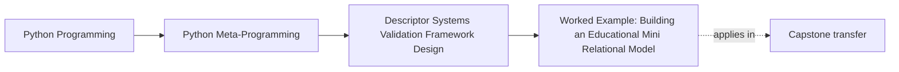
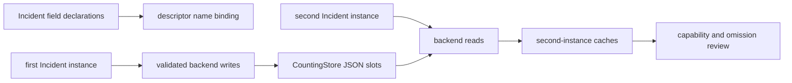
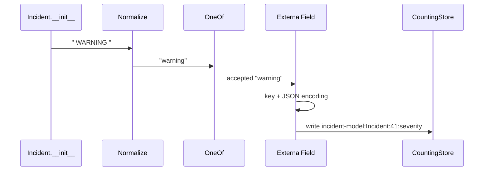

# Worked Example: Building an Educational Mini Relational Model

<!-- page-maps:start -->
## Page Maps




<!-- page-maps:end -->

This worked example combines the module’s mechanisms into one small record surface. It is
not a miniature production ORM. Its purpose is narrower:

- prove that composed descriptors can map attributes to stable backend slots
- reconstruct the same record through a second Python instance
- inspect field layers without constructing a record
- make invalid input and backend work observable
- identify exactly where field ownership ends

The implementation ships in `labs/descriptor_systems/relational.py`; the page explains
that code instead of presenting a second, drifting copy.

## Application pressure

An incident record has:

- a durable integer identity
- a severity restricted to `info`, `warning`, or `critical`
- a summary
- values that a second instance must reload from a shared store

The model should expose ordinary attributes while preserving backend authority and
validation order.

It does **not** need:

- transactions
- an identity map
- query planning
- relationships
- migrations

Those omissions define the example as much as its features do.

## Build an isolated model class

The entry point is:

```python
store = CountingStore()
Incident = build_incident_model(store)
```

Supplying the store explicitly keeps test and evidence state isolated. The function uses
an ordinary class statement; no custom metaclass or dynamic code execution is involved.
Python still performs ordinary descriptor name binding when the local class is created.

The declaration is:

```python
class Incident:
    severity = NormalizeText(
        OneOf(
            ExternalField(store, namespace="incident-model"),
            choices=("info", "warning", "critical"),
        )
    )
    summary = ExternalField(store, namespace="incident-model")
```

The two columns intentionally have different policy stacks:

| Column | Layers |
| --- | --- |
| `severity` | `NormalizeText -> OneOf -> ExternalField` |
| `summary` | `ExternalField` |

This lets the example show both composition and direct backend mapping.

## Inspect before constructing

Run:

```bash
python3 -m unittest tests/test_descriptor_system_relational.py -v
make descriptor-system-lab
```

`inspect_columns(Incident)` walks the class dictionary, unwraps known field wrappers, and
reports the underlying external owner.

The packet contains:

```json
[
  {
    "backend_owner": "CountingStore",
    "layers": ["NormalizeText", "OneOf", "ExternalField"],
    "name": "severity",
    "source_of_truth": "backend JSON slot"
  },
  {
    "backend_owner": "CountingStore",
    "layers": ["ExternalField"],
    "name": "summary",
    "source_of_truth": "backend JSON slot"
  }
]
```

This is the first review route because it answers “what will this class do?” without
performing backend reads or creating record state.

## Create the first record

The evidence constructs:

```python
incident = Incident(
    41,
    severity=" WARNING ",
    summary="queue depth exceeded",
)
```

The severity write follows:



Summary takes the shorter path:

```text
Incident.__init__
  -> ExternalField.__set__
  -> JSON encoding
  -> CountingStore.set("incident-model:Incident:41:summary", ...)
```

Each successful assignment also populates that instance’s local read cache.

## Reconstruct through a second instance

The example then creates:

```python
observer = Incident(41)
```

This is a different Python object with the same durable record identity. Its caches are
empty. Reading the fields produces two backend reads:

```python
observer.severity  # "warning"
observer.summary   # "queue depth exceeded"
```

The evidence reports:

```json
{
  "loaded_from_second_instance": {
    "severity": "warning",
    "summary": "queue depth exceeded"
  }
}
```

This proves stable key reconstruction. It does not prove identity-map behavior: the two
instances remain distinct objects and can hold independently stale caches.

## Reject invalid input before persistence

The failure route attempts:

```python
Incident(
    42,
    severity="urgent",
    summary="unsupported severity",
)
```

`NormalizeText` produces `"urgent"`, then `OneOf` raises. Because validation precedes the
external field, the backend receives no write:

```json
{
  "backend_writes_added": 0,
  "error": "severity must be one of info, warning, critical"
}
```

That is a useful local guarantee: this rejected first assignment has no persistence side
effect.

Do not turn it into a transaction claim. If a later field failed after an earlier field
had persisted, this model has no rollback owner.

## Capability ledger

The field layer honestly owns:

| Capability | Evidence |
| --- | --- |
| one stable backend key per attribute | keys contain namespace, model, record ID, and field |
| JSON scalar serialization | store snapshots contain JSON text |
| severity normalization | padded uppercase input becomes lowercase |
| severity validation | unsupported values fail before storage |
| local read-through cache | second read on one instance avoids another backend call |
| static column inspection | layer and backend owners are visible from the class |

The example explicitly lacks:

| Missing capability | Why a field cannot supply it alone |
| --- | --- |
| transactions | success and rollback span several writes |
| identity map | multiple instances need shared lifecycle coordination |
| query planning | access spans sets of records and predicates |
| relationship loading | object graphs need broader policy |
| schema migration | stored versions outlive one field declaration |

Calling this a production ORM would grant all five absent responsibilities by implication.

## Before-and-after design comparison

| Earlier Module 07 field | Module 08 record column |
| --- | --- |
| instance dictionary is authoritative | backend JSON slot is authoritative |
| one descriptor owns validation and storage | wrappers and external field divide policy |
| another instance has independent values | another instance with the same record ID reloads shared values |
| access has local Python cost | cache misses cross serialization and backend boundaries |
| failure is local validation or unset state | failure can include backend unavailability |

The syntax remains `record.field`; the ownership and failure model has widened
substantially.

## Review the source in this order

1. `ColumnContract` — what static inspection promises.
2. `build_incident_model` — which field stacks are declared.
3. `inspect_columns` — how wrappers are unwrapped without instance access.
4. `relational_model_evidence` — which success and rejection paths become public.
5. `tests/test_descriptor_system_relational.py` — which claims are executable.

Do not begin by copying the class declaration. Begin by explaining the capability and
omission ledgers.

## Capstone transfer

The incident-plugin capstone also declares descriptor-backed fields and collects their
metadata. Unlike this record example, it keeps values on plugin instances and performs no
backend read during attribute access.

Compare them:

| Concern | Record model lab | Incident-plugin capstone |
| --- | --- | --- |
| source of truth | `CountingStore` | plugin instance dictionary |
| serialization in field access | JSON | none |
| wrapper composition | severity has two wrappers | none |
| field collection | static helper in the lab | `PluginMeta` |
| persistence claim | one-field backend mapping only | none |

The capstone is the transfer point, not the primary explanation of the record model.

## Learner review

Before opening the exercises, write a review containing:

1. the exact backend key for `Incident(41).severity`
2. the accepted severity write order
3. the source of truth and local mirror
4. why a second instance can reload values but is not an identity map
5. which rejected input causes zero writes
6. one scenario that could leave a partial multi-field write
7. the first broader owner needed for rollback
8. one sentence refusing the production ORM label

You have understood the example when you can defend both its useful field abstraction and
its deliberately narrow architecture.

## Continue

- Previous: [Descriptor Systems and Framework Boundaries](descriptor-systems-and-framework-boundaries.md)
- Next: [Descriptor System Review Lab](exercises.md)
- Review after attempting: [Exercise Answers](exercise-answers.md)
