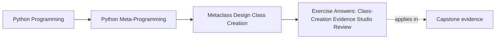
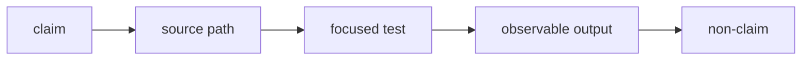

# Exercise Answers: Class-Creation Evidence Studio Review

<!-- page-maps:start -->
## Page Maps




<!-- page-maps:end -->

Use these answers to review reasoning and evidence, not to compare spelling. A different
implementation is defensible when it preserves the requested contract, names its owner,
and proves the same observable behavior.

## Answer 1: Extend the explicit construction recipe

### Defensible implementation

Add the optional input to the recipe:

```python
@dataclass(frozen=True, slots=True)
class ClassRecipe:
    name: str
    bases: tuple[type[object], ...]
    namespace: dict[str, object]
    qualname: str | None = None
```

Validate and apply it in the factory:

```python
def build_class(recipe: ClassRecipe) -> type[object]:
    if not recipe.name.isidentifier():
        raise ValueError(f"class name must be an identifier: {recipe.name!r}")
    if recipe.qualname is not None and not recipe.qualname.strip():
        raise ValueError("explicit qualname cannot be blank")

    namespace = dict(recipe.namespace)
    namespace.setdefault("__module__", __name__)
    if recipe.qualname is not None:
        namespace.setdefault("__qualname__", recipe.qualname)
    return type(recipe.name, recipe.bases, namespace)
```

Representative assertions:

```python
namespace = {"channel": "console"}
created = build_class(
    ClassRecipe(
        "Delivery",
        (),
        namespace,
        qualname="generated.Delivery",
    )
)

assert created.__qualname__ == "generated.Delivery"
assert namespace == {"channel": "console"}
assert build_class(ClassRecipe("Plain", (), {})).__qualname__ == "Plain"
```

### Reasoning

The pressure still belongs to the explicit factory. One call receives one recipe and
creates one class. No future subclass must inherit a policy, and no assignment-time event
must be preserved.

### Common wrong turns

- Mutating `recipe.namespace` leaks factory bookkeeping into caller-owned data.
- Installing a metaclass adds hierarchy-wide authority without a hierarchy-wide rule.
- Silently replacing a blank qualname hides invalid provenance input.

### What this proves

The factory controls explicit introspection metadata while preserving the original
construction contract.

### What this does not prove

It does not recreate compiler provenance, source locations, or nested lexical scope.

### Capstone connection

The capstone uses ordinary class statements, so Python supplies this identity metadata.
Its metaclass should not invent provenance it did not receive.

## Answer 2: Explain and test one metaclass collision

### Defensible implementation

Make both policies cooperative:

```python
events: list[str] = []


class AuditMeta(type):
    def __new__(mcs, name, bases, namespace):
        events.append(f"audit:{name}")
        return super().__new__(mcs, name, bases, namespace)


class PolicyMeta(type):
    def __new__(mcs, name, bases, namespace):
        events.append(f"policy:{name}")
        return super().__new__(mcs, name, bases, namespace)
```

After defining the two base classes, clear setup events and define the joint owner:

```python
events.clear()


class JointMeta(AuditMeta, PolicyMeta):
    pass


class Combined(AuditedBase, PolicyBase, metaclass=JointMeta):
    pass


assert events == ["audit:Combined", "policy:Combined"]
before_instance = list(events)
Combined()
assert events == before_instance
```

The order follows `JointMeta.__mro__`. Both methods must delegate for the chain to reach
`type.__new__`.

### Reasoning

The joint metaclass satisfies Python’s subtype requirement and preserves both toy hooks.
That is mechanical composition evidence.

A separate semantic test is still needed. For example, if both policies inject an
attribute named `policy`, a test must specify which value is allowed or reject the
combination.

### Common wrong turns

- Calling `type.__new__` directly in `AuditMeta` bypasses `PolicyMeta`.
- Asserting only `type(Combined) is JointMeta` proves selection, not policy composition.
- Treating the absence of `TypeError` as a complete integration test hides collisions.

### What this proves

Cooperative metaclass methods execute according to the combined metaclass MRO.

### What this does not prove

It does not prove their mutations, registries, or failure semantics are compatible.

### Capstone connection

`PluginMeta` rejects automatic conflict repair. A real joint owner would need tests at
least as explicit as this trace plus domain-specific compatibility checks.

## Answer 3: Move work to its honest hook

### Defensible placement

Validate the class-body declaration in `__new__`:

```python
def __new__(mcs, name, bases, namespace):
    events.append(f"new:{name}")
    if "policy_version" not in namespace:
        raise TypeError(f"{name} must declare policy_version")
    return super().__new__(mcs, name, bases, namespace)
```

Record the final MRO in metaclass `__init__`:

```python
def __init__(cls, name, bases, namespace):
    super().__init__(name, bases, namespace)
    events.append(f"init:{name}")
    registry.append(
        {
            "name": cls.__name__,
            "mro": [owner.__name__ for owner in cls.__mro__],
        }
    )
```

The critical failure assertion is:

```python
before = list(registry)
with pytest.raises(TypeError):
    class MissingVersion(metaclass=LifecycleMeta):
        pass

assert registry == before
assert events[-1] == "new:MissingVersion"
```

### Reasoning

The raw namespace distinguishes “declared here” from “inherited later,” so validation
belongs in `__new__`. The final MRO exists on the returned class, so its record belongs in
`__init__`.

Moving validation to `__init__` would allow the class object to exist before rejection.
Moving final-MRO bookkeeping before `super().__new__` would be premature because no class
or MRO exists yet.

### Common wrong turns

- Using `hasattr` checks inherited values and weakens the “declared here” rule.
- Appending registry state before validation risks entries for rejected classes.
- Adding instance `__init__` events confuses two construction lifecycles.

### What this proves

The hook split follows required evidence and failure timing.

### What this does not prove

It does not make global registry mutation safe under reload or concurrent imports.

### Capstone connection

The shipped `PluginMeta` uses the same split: structural contract generation in
`__new__`, finished-class registration in metaclass `__init__`.

## Answer 4: Narrow the declaration language

### Defensible implementation

Use an explicit declaration marker:

```python
@dataclass(frozen=True, slots=True)
class Declaration:
    value: object


def is_tracked(value: object) -> bool:
    return isinstance(value, Declaration)
```

Then narrow assignment policy:

```python
class DeclarationNamespace(dict[str, object]):
    def __init__(self) -> None:
        super().__init__()
        self.public_names: list[str] = []

    def __setitem__(self, key: str, value: object) -> None:
        previous = self.get(key)
        if key in self and (is_tracked(previous) or is_tracked(value)):
            raise TypeError(f"duplicate tracked declaration: {key}")
        if is_tracked(value):
            self.public_names.append(key)
        super().__setitem__(key, value)
```

The four required tests are important because a one-sided check is easy to bypass:

```python
tracked -> tracked   # reject
tracked -> ordinary  # reject
ordinary -> tracked  # reject
ordinary -> ordinary # allow
```

### Reasoning

The language protects only names that contribute to its declared contract. Ordinary
helper replacement remains ordinary Python behavior.

### Common wrong turns

- Checking only the new value lets an ordinary value overwrite a tracked declaration.
- Checking only the old value lets a tracked declaration overwrite an ordinary helper.
- Inspecting `vars(cls)` after creation cannot recover the overwritten value.

### What this proves

The custom mapping preserves and enforces one assignment-time fact.

### What this does not prove

It does not validate the declaration’s inner value or guarantee arbitrary tooling
compatibility.

### Capstone connection

`DefinitionNamespace` uses `Field` and action markers instead of the exercise’s
`Declaration`, with the same old-or-new tracked rule.

## Answer 5: Prove registration does not require a metaclass

### Defensible implementation

Reuse `PluginRegistry` from a normal base:

```python
def make_subclass_plugin_family(registry):
    class PluginBase:
        __abstract__ = True
        group = "default"

        def __init_subclass__(cls, **kwargs):
            super().__init_subclass__(**kwargs)
            cls.__abstract__ = bool(vars(cls).get("__abstract__", False))
            inherited_group = next(
                (
                    str(base.group)
                    for base in cls.__bases__
                    if getattr(base, "group", None) is not None
                ),
                "default",
            )
            cls.group = str(vars(cls).get("group", inherited_group))
            cls.plugin_name = str(
                vars(cls).get("plugin_name", _slug(cls.__name__))
            )
            if not cls.__abstract__:
                registry.register(cls.group, cls.plugin_name, cls)

    return PluginBase
```

The comparison should conclude:

| Requirement | `__init_subclass__` | metaclass |
| --- | --- | --- |
| automatic concrete registration | yes | yes |
| duplicate assignment observation | no | yes, with `__prepare__` |
| raw namespace transformation | no direct pre-creation window | yes |
| metaclass conflict cost | no new metaclass | yes |

### Reasoning

The base hook preserves the registration invariant with less class-creation authority.
The registry remains unchanged because state ownership is independent from hook choice.

### Common wrong turns

- Inheriting `__abstract__ = True` without checking `vars(cls)` accidentally keeps every
  descendant abstract.
- Storing registry data on the metaclass mixes policy and state again.
- Claiming the metaclass is preferable because its implementation already exists ignores
  the owner question.

### What this proves

Registration-only requirements stop at `__init_subclass__`.

### What this does not prove

It does not preserve duplicate assignments or provide pre-creation namespace shaping.

### Capstone connection

The capstone crosses the metaclass boundary because it also needs
`DefinitionNamespace`, field/action collection, and generated class structure.

## Answer 6: Produce a capstone class-creation audit

### Defensible evidence map

| Hook trace | Source owner | Focused proof |
| --- | --- | --- |
| `prepare:DefinitionNamespace` | `PluginMeta.__prepare__` and `DefinitionNamespace` | duplicate tracked declaration and ordinary replacement tests |
| `body:complete` | Python class-body execution into the returned mapping | recorded `namespace_names` |
| `new:shape` | `PluginMeta.__new__` | inherited/declared collection and generated-signature assertions |
| `init:register` | `PluginMeta.__init__` and `_register_plugin` | deterministic registry and duplicate-key tests |

The lower-power decision is:

```text
registration only
  -> __init_subclass__ is enough

tracked assignment events plus generated family contract
  -> PluginMeta is justified
```

The package-discovery decision is:

```text
owner: explicit discovery service
reason: installed and enabled packages are deployment/I/O facts, while PluginMeta sees
only classes already imported into the current process
```

### Required JSON review

The report should show:

- `constructed: false`
- `executed: false`
- all four hook events
- accepted class-creation powers
- rejected discovery, external I/O, conflict repair, and reload reconciliation

Validate the captured file:

```console
python3 -m json.tool artifacts/module-09-capstone-class-creation.json >/dev/null
```

### Common wrong turns

- Constructing a plugin to inspect class creation mixes the lifecycle under review.
- Claiming import-time tests prove reload safety overstates the evidence.
- Recommending entry-point scanning from `PluginMeta.__init__` hides I/O in import.
- Treating the generated signature as validation ignores descriptor ownership.

### What this proves

The shipped class family has inspectable namespace, shaping, and registration ownership
without instance execution.

### What this does not prove

Focused tests do not prove arbitrary metaclass compatibility, reload reconciliation,
cross-process discovery, or safe external I/O.

### Remaining risk

The registry is process-global import-time state. Tests can reset it, but real reload and
dynamic-import policy remains outside the framework contract.

## Studio completion review

Strong submissions preserve this chain:

```text
explicit construction
  -> inherited metaclass selection
  -> observable hook timing
  -> declaration-time evidence
  -> lower-power registration alternative
  -> justified capstone metaclass
```

If an answer starts with “use a metaclass” before naming a vanished fact or automatic
family invariant, revisit the owner decision.

Return to the [Module 09 overview](index.md) or continue to
[Module 10](../module-10-runtime-governance-mastery-review/index.md).
