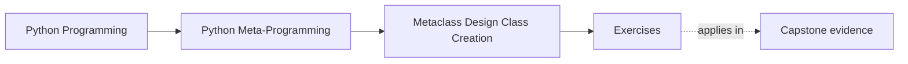

# Exercises

<!-- page-maps:start -->
## Page Maps

<!-- page-maps:end -->

Use these after reading the five core lessons and the worked example. The goal is not to
make metaclasses feel more advanced. The goal is to make class-creation ownership,
definition-time timing, and lower-power alternatives explicit.

Each exercise asks for three things:

- the class-creation or hierarchy rule you are trying to enforce
- the metaclass or lower-power owner you chose
- the reason that choice is the clearest one

For every exercise from 2 onward, add one more line:

- the strongest lower-power owner you rejected and why it was insufficient or clearer

Treat the ten exercises as one full lab day on metaclass design and class creation.

Do them in order:

- Exercises 1-3 establish direct class construction, metaclass conflicts, and the split between structural work and bookkeeping
- Exercises 4-6 focus `__prepare__`, lower-power alternatives, and import-time registry limits
- Exercises 7-8 extend that discipline into hierarchy-wide ownership and reset boundaries
- Exercises 9-10 package the whole module into a reviewable metaclass-boundary packet

Keep one metaclass-boundary table while you work:

| Class-creation rule or hierarchy pressure | Honest owner | When it acts | What lower-power tool was rejected | Review judgment |
| --- | --- | --- | --- | --- |

## Evidence discipline for the whole exercise set

Do not hand in answers that stop at "a metaclass fits here."

Across the set, your evidence should name:

- the exact class-creation or declaration-time fact
- when that fact appears
- what weaker owner you considered first
- what import-time or testing cost comes with escalation

If one of those is missing, the answer is still too soft.

## Exercise 1: Build one class manually with `type(...)`

Create one tiny class dynamically with `type(name, bases, namespace)`.

What to hand in:

- what each of the three arguments contributes
- one piece of metadata you set manually
- one explanation of why this is still lower-power than a custom metaclass
- one sentence naming what would have to repeat across future classes before metaclass escalation became plausible

## Exercise 2: Trigger and explain one metaclass conflict

Construct a small multiple-inheritance example that raises a metaclass conflict.

What to hand in:

- the conflicting bases or metaclasses
- the error you get
- one explanation of why this is an ownership conflict instead of just a syntax problem
- one sentence saying what joint owner or design simplification you would investigate before "fixing" the error mechanically

## Exercise 3: Split one metaclass across `__new__` and `__init__`

Build or inspect one metaclass that does structural work and one bookkeeping task.

What to hand in:

- the rule that belongs in `__new__`
- the bookkeeping that belongs in `__init__`
- one sentence explaining why swapping them would make the design worse
- one lower-power tool you checked first and why it could not carry the same family-wide rule

## Exercise 4: Use `__prepare__` for one declaration-time rule

Create or inspect one custom namespace mapping supplied by `__prepare__`.

What to hand in:

- the declaration-time fact it captures or enforces
- why later hooks would miss or reconstruct that fact poorly
- one explanation of why the custom mapping is still narrow enough to review
- one sentence explaining what would make this `__prepare__` design overengineered

## Exercise 5: Reject one unnecessary metaclass

Take one metaclass proposal and rewrite it mentally as a lower-power design.

What to hand in:

- the original metaclass idea
- the lower-power replacement
- one sentence explaining what the metaclass was not actually needed for
- one sentence naming the exact convenience argument you are refusing

## Exercise 6: Review the plugin registry example honestly

Use the worked example as a case study.

What to hand in:

- one thing the metaclass owns honestly
- one import-time or testing risk it still introduces
- one explanation of why this is narrower than a general plugin framework
- one sentence explaining what would change if registration became opt-in instead of automatic

## Midday self-check

Before moving into the final four exercises, make sure you can already answer these
questions clearly:

- when direct `type(...)` construction is enough and when a repeating class-creation owner is actually needed
- why a metaclass conflict is a design signal about incompatible ownership
- what belongs in `__new__`, what belongs in `__init__`, and when `__prepare__` is justified
- why import-time registration still needs reset and testing discipline

If you cannot answer those four questions in plain language, return to Exercises 1-6 and
make the timing, owner, and rejected lower-power alternative more explicit before
continuing.

Do not continue if your notes still describe the metaclass as "nice," "clean," or
"automatic" without naming the invariant. Those words hide the decision instead of
proving it.

## Exercise 7: Separate hierarchy-wide policy from post-creation bookkeeping

Choose one hierarchy rule and explain which part truly requires class-creation ownership
and which part is only follow-up bookkeeping.

What to hand in:

- the hierarchy rule
- the class-creation part that belongs in the metaclass, if any
- the bookkeeping part that could live elsewhere
- one explanation of why keeping them separate makes the design easier to review
- one sentence naming how test reset or import ordering changes once the two concerns are separated

## Exercise 8: Design one reset boundary for import-time class registration

Take one import-time registry or auto-registration design and make its testing boundary
explicit.

What to hand in:

- the registration design
- one reset, clear, or reinitialization surface
- one explanation of why import-time behavior without reset discipline becomes hard to test honestly
- one sentence naming the failure you would expect to see first if reset discipline were missing

## Exercise 9: Compare honest metaclass claims with overstated claims

Choose one metaclass design and write both an honest description and an overstated
description of what it guarantees.

What to hand in:

- the honest description
- the overstated description
- one explanation of which words make the overstated version misleading
- one sentence rewriting the honest version so a solo learner could review the scope without guessing

## Exercise 10: Produce a metaclass-boundary packet

Assemble:

- one metaclass-boundary table
- one `__new__` versus `__init__` split
- one `__prepare__` case with a real declaration-time need
- one rule explaining when a lower-power owner is clearer than a metaclass

The packet is strong when another learner can use it to answer:

- what class-creation invariant is being enforced
- when in the class lifecycle the rule actually acts
- why a metaclass was necessary or unnecessary
- what weaker owner was rejected and why

## Mastery standard for this exercise set

Across all six answers, the module wants the same habits:

- you explain metaclass behavior in class-creation language
- you keep import-time effects visible
- you separate structural hooks from bookkeeping hooks
- you use `__prepare__` only when declaration-time facts really matter
- you reject metaclass escalation when lower-power tools remain honest owners

Across all ten answers, add two more habits:

- you distinguish hierarchy-wide class-creation policy from post-creation bookkeeping
- you leave behind a metaclass-boundary packet another learner could review without guessing

## Exit check for the exercise set

Before leaving the exercise page, make sure your packet does all of the following:

- rejects at least three unnecessary escalations explicitly
- names at least one import-time cost for every justified metaclass
- separates assignment-time, construction-time, and post-creation reasoning
- leaves another learner enough evidence to agree or disagree with your ownership call

If an answer still sounds like "a metaclass can just handle it," keep going.

## Continue through Module 09

- Previous: [Worked Example: Building a Deterministic Plugin Registry with `PluginMeta`](worked-example-building-a-deterministic-plugin-registry-with-pluginmeta.md)
- Next: [Exercise Answers](exercise-answers.md)
- Return: [Overview](index.md)
- Terms: [Glossary](glossary.md)
