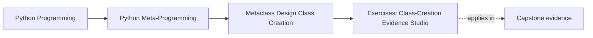
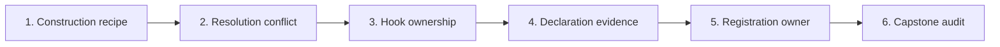

# Exercises: Class-Creation Evidence Studio

<!-- page-maps:start -->
## Page Maps




<!-- page-maps:end -->

These exercises form one cumulative review of the Module 09 executable system. They are
not syntax drills. Each exercise asks you to predict behavior, change or inspect runnable
code, and leave evidence another learner can review without verbal explanation.

Work in a temporary copy or a short-lived local branch if you want to preserve the
reference implementation. Do not put generated output beside source files; write it under
the repository `artifacts/` directory.

## Baseline

Before changing anything:

```console
cd programs/python-programming/python-meta-programming
make class-creation-lab-test
make class-creation-lab > ../../../artifacts/class-creation-baseline.json
```

Record:

- the number of focused tests
- the six top-level evidence sections
- the successful lifecycle trace
- the registry claim that registration alone does not justify a metaclass

If the baseline fails, diagnose it before beginning. A later green run is not useful when
you do not know whether you started from green.

## Exercise 1: Extend the explicit construction recipe

### Starting context

`labs/class_creation/manual.py` creates `DeliveryNotice` from a `ClassRecipe`. The current
factory copies the namespace, supplies `__module__`, and rejects invalid identifiers.

### Objective

Add an optional `qualname` input that gives a manually generated class an explicit
`__qualname__` without changing the existing default route.

### Constraints

- Keep direct `type(name, bases, namespace)` as the construction owner.
- Do not introduce a custom metaclass.
- Do not mutate the caller’s namespace.
- Reject a blank explicit `qualname`.
- Preserve the existing `DeliveryNotice` evidence when no qualname is supplied.

### Expected evidence

Add tests proving:

- an explicit qualname appears in `created.__qualname__`
- an omitted qualname keeps the class name as its qualname
- a blank qualname fails before class construction
- the caller namespace remains unchanged

### Acceptance checks

```console
python3 -m unittest discover -s tests -p "test_class_creation_manual.py" -v
```

Explain why this remains a one-call-site factory problem.

### Earlier contract to preserve

The recipe’s name, bases, and namespace must still map to observable class identity and
behavior.

## Exercise 2: Explain and test one metaclass collision

### Starting context

`labs/class_creation/resolution.py` demonstrates inherited selection, an incompatible pair,
and a `JointMeta`.

### Objective

Add one policy event to each candidate metaclass, then prove whether a cooperative joint
metaclass executes both policies and in which order.

### Constraints

- Keep the original conflict test.
- Make both candidate metaclasses use `super()`.
- Predict the event order before running the test.
- Do not describe a mechanically successful joint metaclass as automatically safe.

### Expected evidence

Your test should show:

- the unresolved class still raises `TypeError`
- `JointMeta` is compatible with both bases
- the event trace follows its metaclass MRO
- constructing an instance adds no class-creation policy events

### Acceptance checks

```console
python3 -m unittest discover -s tests -p "test_class_creation_resolution.py" -v
```

Write one additional semantic compatibility test the toy policies do not provide.

### Earlier contract to preserve

`DeliveryAudit` must continue to inherit `AuditMeta` without an explicit declaration.

## Exercise 3: Move work to its honest hook

### Starting context

`labs/class_creation/lifecycle.py` shapes the class in `__new__` and records the finished
class in `__init__`.

### Objective

Add:

- a required `policy_version` class-body declaration
- a registry record containing the final class name and MRO names

Place each behavior in the hook that owns the needed evidence.

### Constraints

- Validate `policy_version` from the raw namespace.
- Do not register a class that failed validation.
- Build the MRO record only from the returned class.
- Preserve cooperative `super()` calls.
- Keep instance construction outside the class-creation trace.

### Expected evidence

Add tests for:

- the exact successful event order
- failure before metaclass `__init__`
- no registry entry after failure
- a final MRO record after success
- no hook events added by instance construction

### Acceptance checks

```console
python3 -m unittest discover -s tests -p "test_class_creation_lifecycle.py" -v
```

Your review note must state what evidence would be unavailable or premature in the other
hook.

### Earlier contract to preserve

`__new__` still shapes the class and `__init__` still owns finished-class bookkeeping.

## Exercise 4: Narrow the declaration language

### Starting context

The lab `DeclarationNamespace` rejects every duplicate public declaration. The capstone
rejects duplicates only for tracked fields and actions.

### Objective

Change the lab namespace to reject duplicates only for values marked as declarations.
Allow ordinary helper replacement.

### Constraints

- Define one small, inspectable declaration marker.
- Reject when either the old or new value is tracked.
- Preserve public declaration order for tracked values only.
- Do not inspect only the completed class.
- Allow Python’s dunder assignments.

### Expected evidence

Test all four routes:

1. tracked value replaced by tracked value: reject
2. tracked value replaced by ordinary value: reject
3. ordinary value replaced by tracked value: reject
4. ordinary helper replaced by ordinary helper: allow

Also prove the rejected class name is not bound.

### Acceptance checks

```console
python3 -m unittest discover -s tests -p "test_class_creation_namespace.py" -v
```

Compare the resulting rule with `capstone/src/incident_plugins/framework.py`.

### Earlier contract to preserve

The custom namespace must still preserve a fact unavailable from `vars(created_class)`.

## Exercise 5: Prove registration does not require a metaclass

### Starting context

`labs/class_creation/registry.py` demonstrates metaclass registration while its own evidence
warns that `__init_subclass__` is usually sufficient for registration alone.

### Objective

Implement a second isolated plugin family using `__init_subclass__` and the same
`PluginRegistry`.

### Constraints

- Register every concrete subclass automatically.
- Preserve abstract opt-out, deterministic names, duplicate rejection, lookup, and reset.
- Do not use a custom metaclass.
- Keep the original metaclass family for side-by-side evidence.

### Expected evidence

Prove both families provide the same registration behavior. Then write a comparison table:

| Requirement | `__init_subclass__` | metaclass |
| --- | --- | --- |
| automatic concrete registration | | |
| duplicate assignment observation | | |
| raw namespace transformation | | |
| metaclass conflict cost | | |

### Acceptance checks

```console
python3 -m unittest discover -s tests -p "test_class_creation_registry.py" -v
python3 -m unittest discover -s tests -p "test_class_creation_boundaries.py" -v
```

Your conclusion must reject the metaclass for registration-only requirements.

### Earlier contract to preserve

`PluginRegistry` remains the owner of entries, ordering, lookup, duplicates, and reset.

## Exercise 6: Produce a capstone class-creation audit

### Starting context

The capstone exposes one non-constructing report for `ConsoleNotifier`.

### Objective

Produce an evidence packet that connects every accepted metaclass power to source and
tests, then evaluates one proposed new power: package discovery during import.

### Constraints

- Do not construct or execute a plugin for the class-creation audit.
- Do not claim registration alone justifies `PluginMeta`.
- Name the lower-power owner rejected by the combined invariant.
- Reject package discovery from the metaclass with a concrete operational reason.
- Distinguish proven behavior from architectural non-claims.

### Expected evidence

Run:

```console
cd ../../..
make -C programs/python-programming/python-meta-programming capstone-class-creation \
  > artifacts/module-09-capstone-class-creation.json
```

Your packet must contain:

- the four-entry hook trace
- one source location and focused test for every entry
- the tracked duplicate failure route
- the ordinary helper replacement route
- the accepted and rejected power lists
- a decision for package discovery
- one risk that remains even after all focused tests pass

### Acceptance checks

```console
cd programs/python-programming/python-meta-programming/capstone
PYTHONPATH=src ../../../../artifacts/venv/python-programming/python-meta-programming/capstone/bin/python \
  -m pytest -q tests/test_registry.py tests/test_runtime.py tests/test_cli.py \
  -k "registry or class_creation or definition_namespace"
```

Validate the JSON with `python3 -m json.tool`.

### Earlier contract to preserve

Field, action, generated-signature, and registry behavior must remain consistent with the
public capstone report.

## Completion standard

You have completed the studio when another learner can use only your code, tests, and
evidence packet to answer:

- when each class-creation event happens
- what object owns it
- which public class surface changes
- which failure prevents class binding
- why a lower-power owner succeeds or fails
- where the capstone uses and refuses metaclass power

Next: [Exercise Answers: Class-Creation Evidence Studio Review](exercise-answers.md).
