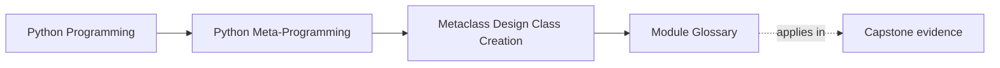

# Module Glossary

<!-- page-maps:start -->
## Page Maps

<!-- page-maps:end -->

This glossary belongs to **Module 09: Metaclass Design and Class Creation** in
**Python Metaprogramming**. It keeps the language of this directory stable so the same
ideas keep the same names across lessons, practice, review, and capstone discussion.

## How to use this glossary

Use the glossary when metaclass discussions start to blur together class creation,
definition-time hooks, namespace control, and lower-power alternatives. Module 09 is meant
to keep those boundaries explicit.

The most important use of this glossary is review discipline: if two learners use the same
word to mean different ownership claims, they will disagree about metaclasses without
realizing it.

## Terms in this directory

| Term | Meaning in this directory |
| --- | --- |
| Class creation pipeline | The definition-time sequence from metaclass resolution through `__prepare__`, class-body execution, metaclass `__new__`, and metaclass `__init__`. |
| Class-creation invariant | A rule that must hold because of how a class is created, not merely because later code prefers it. |
| Declaration-time enforcement | A rule enforced while the class body is still executing, typically through a custom mapping supplied by `__prepare__`. |
| Definition time | The moment a class statement executes and metaclass hooks run, usually during module import. |
| Effective metaclass | The single metaclass Python resolves as the class-creation owner for a new class. |
| Evidence route | A repeatable sequence of review questions used to prove why one owner is honest and another is not. |
| Honest metaclass claim | A metaclass justification stated in terms of invariant, timing, hierarchy scope, and rejected lower-power owners. |
| Import-time blast radius | The total side-effect surface introduced when class creation mutates registries, validates globally, or changes shared state during import. |
| Import-time side effect | Any registry update, validation, or global mutation caused by class creation while a module is being imported. |
| Joint metaclass | A metaclass that subclasses multiple metaclasses in an attempt to satisfy conflict rules, valid only when the behaviors truly compose. |
| Lower-power owner | A clearer mechanism such as explicit code, descriptor logic, or a class decorator that should be preferred when it can still own the rule honestly. |
| Metaclass | The class of a class object; in this module, the owner of class-creation-time behavior. |
| Metaclass conflict | The failure that occurs when multiple bases imply incompatible metaclass owners and Python cannot derive one coherent effective metaclass. |
| Metaclass `__init__` | The post-creation hook that receives the finished class object and is usually best for registration or bookkeeping. |
| Metaclass `__new__` | The class-construction hook that receives the class name, bases, and namespace and is best for structural decisions. |
| Namespace mapping | The mapping object that receives class-body assignments before the class object is created. |
| Overclaim | A description that assigns more power or scope to the metaclass than the implementation or invariant actually owns. |
| `__prepare__` | The metaclass hook that returns the namespace mapping used while the class body executes. |
| Refusal sentence | A concise reason a proposed owner should be rejected, such as "this is post-creation transformation, so a class decorator is clearer." |
| Reset hook | An explicit API such as `clear()` that makes metaclass-owned global state deterministic and testable. |
| `type(name, bases, namespace)` | The default class-construction primitive that shows class creation as a runtime event. |
| Hierarchy-wide invariant | A rule that should apply automatically across every subclass in a class family and can therefore justify metaclass control more often than one-off rules. |

## Confusing pairs to keep separate

| Pair | Difference that matters in this module |
| --- | --- |
| Class-creation invariant vs import-time side effect | The invariant is what the design must guarantee; the side effect is a cost introduced while guaranteeing it. |
| Declaration-time enforcement vs structural validation | Declaration-time enforcement happens while assignments are being made; structural validation inspects the finished namespace. |
| Lower-power owner vs weaker implementation | A lower-power owner is often better, not worse; it simply carries less blast radius. |
| Honest claim vs overclaim | An honest claim names the exact scope; an overclaim smuggles in lifecycle, discovery, or framework promises the code does not own. |
| Registration invariant vs operational support | Automatic registration may be the invariant; reset hooks and ordering helpers are the support surfaces around it. |

## Review prompts this vocabulary should unlock

When using these terms, another learner should be able to answer:

- what is the invariant, and when does it act?
- what lower-power owner was rejected first?
- what import-time blast radius is accepted?
- what would count as an overclaim for this design?

If the glossary terms do not help answer those four questions, return to the module pages
and make the ownership language sharper.

## Keep the module connected

- Return to [Module 09 Overview](index.md) for the full learning route.
- Use [Exercises](exercises.md) and [Exercise Answers](exercise-answers.md) to pressure-test the metaclass vocabulary.
- Revisit the [Worked Example](worked-example-building-a-deterministic-plugin-registry-with-pluginmeta.md) when a registry proposal needs to be checked against import-time and reset boundaries.
