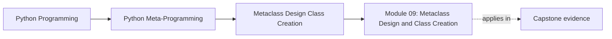

# Module 09: Metaclass Design and Class Creation

<!-- page-maps:start -->
## Page Maps

<!-- page-maps:end -->

Module 09 is the highest-power runtime mechanism in the course, which is exactly why it
has to stay narrower than you might expect. The goal is not to make metaclasses look
impressive. The goal is to understand what truly belongs to class creation time, what
lower-power tools still own more honestly, and how to keep metaclass designs
deterministic, inspectable, and reviewable.

This module now uses the same ten-file learning surface as the deep-dive series so the
overview, five cores, worked example, practice set, answers, and glossary each have one
clear job.

This module matters because metaclasses are the first place in the course where learners
can mistake power for correctness. A missed-class learner needs a route for proving what
must happen before the class exists, what lower-power owner was rejected, and what
import-time blast radius the design accepts on purpose.

## What this module is for

By the end of Module 09, you should be able to explain five things clearly:

- how `type(name, bases, namespace)` exposes the raw class-construction primitive
- how metaclass selection, import-time timing, and conflicts actually work
- what belongs in metaclass `__new__` versus metaclass `__init__`
- why `__prepare__` is the only hook that can enforce rules during class body execution
- when metaclasses are justified and when a class decorator, descriptor, or explicit helper still owns the problem better

Add a sixth:

- how to reject a metaclass design that sounds elegant but still belongs to a lower-power owner

## One-day study route for a missed-class learner

Treat this module like one long ownership clinic, not a survey of powerful hooks.

| Study block | What to produce before moving on |
| --- | --- |
| overview plus `type(...)` page | one class-creation pipeline sketch and one sentence explaining why `type(...)` is still lower-power than a metaclass |
| resolution plus hook-split pages | one note naming the effective metaclass, one import-time cost, and one `__new__` versus `__init__` split |
| `__prepare__` plus boundaries pages | one declaration-time fact that would be lost later and one refused lower-power owner |
| worked example | one owner ladder naming the metaclass invariant, the import-time blast radius, and the reset discipline |
| exercises plus answers | one metaclass-boundary packet another learner could review without verbal context |

If you cannot produce the artifact for a block, do not move on because the prose sounded
familiar. Module 09 gets weak when metaclass vocabulary feels impressive before ownership
proof becomes concrete.

## Keep these pages open

- [Mastery Map](../module-00-orientation/mastery-map.md)
- [Pressure Routes](../guides/pressure-routes.md)
- [Review Checklist](../reference/review-checklist.md)
- [Capstone Architecture Guide](../capstone/capstone-architecture-guide.md)

## The ten files in this module

1. Overview (`index.md`)
2. [Manual Class Creation with `type(...)`](manual-class-creation-with-type.md)
3. [Metaclass Resolution, Timing, and Conflicts](metaclass-resolution-timing-and-conflicts.md)
4. [Metaclass `__new__` and `__init__`](metaclass-new-and-init.md)
5. [`__prepare__` and Declaration-Time Enforcement](prepare-and-declaration-time-enforcement.md)
6. [Metaclass Boundaries and Class-Creation Ownership](metaclass-boundaries-and-class-creation-ownership.md)
7. [Worked Example: Building a Deterministic Plugin Registry with `PluginMeta`](worked-example-building-a-deterministic-plugin-registry-with-pluginmeta.md)
8. [Exercises](exercises.md)
9. [Exercise Answers](exercise-answers.md)
10. [Glossary](glossary.md)

## How to use the file set

| If you need to... | Start here |
| --- | --- |
| understand the raw primitive behind class creation | [Manual Class Creation with `type(...)`](manual-class-creation-with-type.md) |
| explain metaclass selection, import-time effects, and conflicts | [Metaclass Resolution, Timing, and Conflicts](metaclass-resolution-timing-and-conflicts.md) |
| decide whether structural work belongs in `__new__` or bookkeeping belongs in `__init__` | [Metaclass `__new__` and `__init__`](metaclass-new-and-init.md) |
| enforce declaration-time rules that cannot be checked after class creation | [`__prepare__` and Declaration-Time Enforcement](prepare-and-declaration-time-enforcement.md) |
| decide whether class-creation control is truly required at all | [Metaclass Boundaries and Class-Creation Ownership](metaclass-boundaries-and-class-creation-ownership.md) |
| see one honest metaclass case around deterministic registration | [Worked Example: Building a Deterministic Plugin Registry with `PluginMeta`](worked-example-building-a-deterministic-plugin-registry-with-pluginmeta.md) |
| pressure-test your understanding before the mastery review module | [Exercises](exercises.md) |
| compare your reasoning against a reference answer | [Exercise Answers](exercise-answers.md) |
| stabilize the metaclass vocabulary used in this directory | [Glossary](glossary.md) |

## The running question

Carry this question through every page:

> What must happen before the class exists, and why would a descriptor, class decorator, or explicit registration function still be the wrong owner?

Carry a second question beside it:

> What import-time or hierarchy-wide cost did this design accept, and what weaker or stronger owner did it reject first?

Add a third question for the whole day:

> if I removed the metaclass name from the code, would I still be able to explain what fact must exist before the class is bound and why a lower-power owner would lose it?

Strong Module 09 answers usually mention one or more of these:

- class creation as a runtime pipeline
- import-time and definition-time side effects
- structural edits in `__new__` versus final bookkeeping in `__init__`
- declaration-time namespace control through `__prepare__`
- a lower-power decision that rejects metaclass escalation

## The review route through the module

Use this route instead of reading the module as a power tour:

| Page | The review question it must answer |
| --- | --- |
| `type(...)` page | why is direct class creation still smaller than a metaclass? |
| resolution page | who becomes the effective class-creation owner, and when does it act? |
| `__new__` and `__init__` page | what belongs to class shape versus post-creation bookkeeping? |
| `__prepare__` page | what fact exists only while the class body is still executing? |
| boundaries page | why is a metaclass the smallest honest owner here at all? |
| worked example | what import-time cost and reset discipline make the design acceptable? |
| exercises and answers | can another learner review the ownership decision without guessing? |

## Learning outcomes

By the end of this module, you should be able to:

- explain the full class-creation pipeline without treating metaclasses as mystical
- predict common metaclass conflict cases and explain why they arise
- keep metaclass behavior deterministic, resettable, and reviewable
- distinguish real class-creation invariants from problems that still belong to lower-power tools
- justify one metaclass design using ownership rather than appeal to power

## Weak answers to reject early

Reject answers that sound like these:

- "a metaclass is the cleanest place because it is powerful"
- "the class can just register itself automatically"
- "we can combine the metaclasses if needed"
- "this has to happen during class creation" without naming what would be lost later

Replace them with answers that name:

- the exact class-creation-time fact
- the exact lower-power owner that was tested and rejected
- the exact import-time or hierarchy-wide consequence accepted

## Fast diagnostic for metaclass overreach

Use this table before you accept a design as class-creation ownership instead of ordinary
automation.

| If you notice... | Pause and ask... | Likely outcome |
| --- | --- | --- |
| the argument for the metaclass is mostly "automatic" | what exact class-creation fact disappears if the work happens later? | the current justification is probably weak |
| the code mostly records or appends finished classes | does a decorator or explicit helper already keep the design honest? | post-creation owners may still be clearer |
| the proposal mutates global state during import | what reset, ordering, or reload rule keeps the system deterministic? | import-time blast radius needs explicit support |
| multiple bases bring different metaclass ideas | are these really compatible authorities or just two convenient automations? | conflict is likely a design warning, not a repair task |
| the design cannot name a refused lower-power tool | is metaclass escalation happening before the smaller owner was tested honestly? | the owner choice is still under-argued |

## Exit standard

Do not move on until all of these are true:

- you can explain when class creation begins and what hooks run before the class name is bound
- you can say why a joint metaclass is a semantic decision, not a mechanical fix
- you can distinguish `__prepare__`, `__new__`, and `__init__` by responsibility rather than by memorized order alone
- you can reject at least one metaclass proposal in favor of a lower-power tool for a named reason

## Evidence packet to build while you learn

Keep these items in your notes as you move through the module:

- one class-creation pipeline sketch in your own words
- one example of a refused lower-power owner
- one example of an import-time side effect the design accepts
- one example of a metaclass conflict explained as ownership collision
- one reset or reversibility rule for global metaclass state

Use one more quality bar on the packet:

- another learner should be able to point to one refused lower-power owner, one accepted import-time cost, and one remaining uncertainty without needing your verbal explanation

When those feel ordinary, Module 09 has done its job and Module 10 can become a mastery
and review surface instead of another power escalation.
