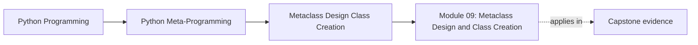
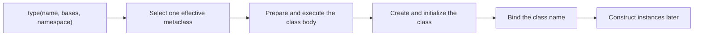

# Module 09: Metaclass Design and Class Creation

<!-- page-maps:start -->
## Page Maps




<!-- page-maps:end -->

Metaclasses are not a bag of advanced hooks. They are one possible owner of class
creation. That owner acts while a module is importing, affects future subclasses, and
can collide with other class-creation owners through multiple inheritance.

The course and executable lab are the primary learning surfaces in this module. The
incident-plugin capstone comes later as a deliberately bounded application of the same
mechanics.

## The engineering problem

Suppose a plugin family needs all concrete subclasses to satisfy one rule. Several tools
could appear to solve it:

- an explicit helper can process selected classes
- a class decorator can transform one completed class
- `__init_subclass__` can react to subclasses
- a metaclass can control the class-construction pipeline

The hard part is not writing a metaclass. The hard part is proving that class creation is
the smallest honest ownership boundary.

Module 09 therefore asks:

> What fact must be observed or enforced while the class is being created, what lower-power
> owner would lose that fact, and what import-time cost does the metaclass accept?

## Prerequisites

Before starting, you should be able to:

- explain the difference between a class object and one of its instances from Module 01
- inspect a class without accidentally invoking dynamic behavior from Module 02
- distinguish wrappers, descriptors, and class decorators from Modules 04 through 08
- run commands from the repository root
- read a focused `unittest` failure as evidence, not merely as a red signal

If class decorators and `__init_subclass__` are still interchangeable in your mental
model, revisit Module 06 before escalating to metaclasses.

## Run the system before reading the implementation

From the repository root:

```console
make -C programs/python-programming/python-meta-programming class-creation-lab
make -C programs/python-programming/python-meta-programming class-creation-lab-test
```

The first command prints stable JSON. The second runs focused tests for the claims in that
packet. Keep the output open while reading.

The evidence packet has six sections:

| Evidence section | Question it answers | Source |
| --- | --- | --- |
| `manual_construction` | What do `name`, `bases`, and `namespace` become? | `labs/class_creation/manual.py` |
| `resolution` | Which metaclass wins, when does it run, and why can selection fail? | `labs/class_creation/resolution.py` |
| `lifecycle` | What is the exact order of body execution, `__new__`, and `__init__`? | `labs/class_creation/lifecycle.py` |
| `declaration_namespace` | Which fact can only be preserved during assignment? | `labs/class_creation/namespace.py` |
| `registry` | Which part is hierarchy policy and which part is ordinary state? | `labs/class_creation/registry.py` |
| `boundaries` | When should the design stop below or move beyond a metaclass? | `labs/class_creation/boundaries.py` |

## The class-creation timeline

Use this sequence as the spine of the module:

```text
resolve effective metaclass
  -> metaclass.__prepare__()
  -> execute class body into returned namespace
  -> metaclass.__new__()
  -> metaclass.__init__()
  -> bind class name
  -> class may later receive instance-construction calls
```

The lab proves a crucial separation:

- the class-creation hooks run before an instance exists
- creating an instance does not rerun those hooks
- a failure in metaclass `__new__` prevents metaclass `__init__`

Do not use “at runtime” as if it were precise enough. Class definition and instance
construction are both runtime events, but they occur at different times and have
different owners.

## Six-section learning route

Follow the sections in order. Each depends on evidence established by the previous one.

1. [Manual Class Creation with `type(...)`](manual-class-creation-with-type.md) connects
   class syntax to explicit construction inputs.
2. [Metaclass Resolution, Timing, and Conflicts](metaclass-resolution-timing-and-conflicts.md)
   proves inherited selection and a real conflict.
3. [Metaclass `__new__` and `__init__`](metaclass-new-and-init.md) traces structure,
   bookkeeping, and failure timing.
4. [`__prepare__` and Declaration-Time Enforcement](prepare-and-declaration-time-enforcement.md)
   preserves a duplicate assignment that final class inspection loses.
5. [Metaclass Boundaries and Class-Creation Ownership](metaclass-boundaries-and-class-creation-ownership.md)
   chooses the smallest honest owner for six design pressures.
6. [Worked Example: Building a Deterministic Plugin Registry with `PluginMeta`](worked-example-building-a-deterministic-plugin-registry-with-pluginmeta.md)
   composes the mechanisms into one bounded plugin-family application.

Then complete the [exercises](exercises.md), review the
[answers](exercise-answers.md), and use the [glossary](glossary.md) only when a term
blocks the trace.

## What the lab intentionally does not claim

The executable system is an educational model, not a production plugin platform.

It proves:

- explicit class inputs become class identity, bases, and attributes
- a base class can supply the effective metaclass to descendants
- incompatible metaclasses cause Python to refuse ambiguous ownership
- a custom namespace can retain assignment-time facts
- a metaclass can enforce automatic registration across one class family
- a separate registry can own duplicates, ordering, lookup, and reset

It does not prove:

- package or entry-point discovery
- safe process-wide reload behavior
- cross-process registry coordination
- compatibility between arbitrary combined metaclass policies
- that automatic registration is always worth its import-time cost

Those non-claims are part of the lesson.

## Capstone transfer comes after the lesson

After completing the lab and exercises, inspect the real incident-plugin class:

```console
make -C programs/python-programming/python-meta-programming capstone-class-creation
```

The report does not construct or execute a plugin. It exposes:

- the prepared namespace type and public class-body names
- inherited and declared fields and actions
- the effective metaclass and its hook trace
- generated constructor behavior
- registration of the finished class
- powers the capstone deliberately rejects

Compare the report with the lab registry. The capstone adds descriptor and decorator
composition, but it still refuses discovery, external I/O, automatic conflict repair, and
reload reconciliation inside its metaclass.

## How to study independently

For each section:

1. Predict one value or event order before running code.
2. Open the named lab source and focused test.
3. Run only that test file while learning the mechanism.
4. Reconcile the test assertion with the JSON packet.
5. Write one claim the evidence proves.
6. Write one attractive overclaim it does not prove.
7. State why the next-lower owner succeeds or fails.

If you took a long break, restart with the timeline and the focused lab. Do not try to
recover by rereading every definition.

## Exit evidence

You are ready for Module 10 when you can produce all of the following:

- a `type(...)` recipe that names and explains all three construction inputs
- a trace showing inherited metaclass selection before instance construction
- a real conflict plus a reason a joint metaclass is a semantic decision
- a hook trace that separates structural work from finished-class bookkeeping
- a declaration-time rule that later `vars(cls)` inspection cannot reconstruct
- a registry review that separates hierarchy policy from mutable registry state
- an owner decision that rejects both one weaker and one stronger mechanism
- a capstone comparison naming accepted and rejected class-creation powers

Completion means you can review the design from evidence. Recognizing metaclass syntax is
not enough.
