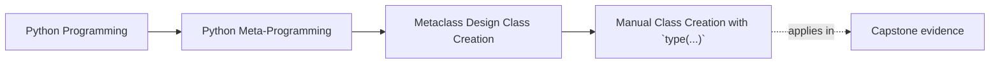

# Manual Class Creation with `type(...)`


<!-- page-maps:start -->
## Page Maps




<!-- page-maps:end -->

Module 09 starts by stripping away the `class` statement and looking at the class creation
primitive directly.

That matters because metaclasses are not a separate magical system. They are an extension
of the same class-construction story.

This page matters because many learners jump from "classes are runtime values" straight to
"therefore metaclasses must be the right owner." This page should stop that jump by making
the smaller owner visible first.

## The sentence to keep

`type(name, bases, namespace)` is the default class-construction primitive, and
understanding it makes metaclasses feel like control over class creation rather than like
mystical syntax.

That is the foundation for the rest of the module.

Keep one more sentence beside it:

> if one explicit `type(...)` call solves the problem clearly, a repeating metaclass owner is usually too strong.

## What the three arguments mean

The shape is:

```python
type(name, bases, namespace)
```

and each part has a clear job:

- `name` becomes the class name
- `bases` defines inheritance and contributes to the MRO
- `namespace` provides the class attributes, methods, and metadata

That is enough to build a class object directly.

Use this table before escalating from `type(...)` to a metaclass:

| Pressure | Review question |
| --- | --- |
| one-off dynamic construction | is one explicit call already enough? |
| repeated hierarchy-wide rule | does every future subclass need the same owner automatically? |
| namespace shaping | does the rule belong to class creation or only to this one factory? |
| blast radius | does the design affect one class or an entire family and import path? |

## A compact example

```python
def make_greeter_class(class_name, greeting):
    def greet(self):
        return f"{greeting} from {self.__class__.__name__}"

    namespace = {
        "__doc__": f"{class_name} created with type()",
        "greet": greet,
        "kind": "generated",
    }
    return type(class_name, (object,), namespace)


Hello = make_greeter_class("Hello", "Hi")
instance = Hello()

print(instance.greet())  # Hi from Hello
print(Hello.kind)        # generated
```

This example is small, but it already shows the main point:

class creation is something Python can perform from data.

That sentence matters because it removes the mysticism without forcing metaclass
escalation.

## Why this matters before metaclasses

Metaclasses only make sense once you see that class creation is already a runtime action.

If a class can be created from:

- a name
- base classes
- a namespace mapping

then a metaclass is a way to intercept or customize that process.

That is much easier to reason about than “metaclasses are the class of a class” by itself.

## Evidence route for `type(...)` reviews

Use this route whenever dynamic construction starts to sound more exotic than it is:

| Evidence step | What it proves |
| --- | --- |
| identify the exact `name`, `bases`, and `namespace` inputs | shows the raw class-construction ingredients |
| inspect one generated method or attribute | shows how namespace data becomes class behavior |
| inspect metadata such as `__module__` | shows what the factory must supply manually |
| ask whether another class needs the same logic automatically | shows whether a metaclass owner is even in scope |

## The namespace is not just a bag of attributes

The `namespace` argument is where the future class body lands conceptually:

- methods
- constants
- descriptors
- documentation
- special names such as `__module__`

This matters because later hooks such as metaclass `__new__` and `__prepare__` are really
about controlling or observing that namespace at the right time.

Use this namespace table when the review gets fuzzy:

| Namespace item | Why it matters for ownership |
| --- | --- |
| methods and descriptors | show what behavior the factory is creating directly |
| metadata such as `__module__` | shows what a plain class statement would usually supply for free |
| helper constants | shows what belongs only to this one generated class |
| special names | shows where dynamic construction can leave a class half-formed if details are skipped |

## A note about `__module__`

A `class` statement fills in `__module__` automatically.

When calling `type(...)` directly, you should set it yourself if you care about:

- debugging and reprs
- pickling
- documentation surfaces

For example:

```python
def make_class_in_module(name, module):
    namespace = {
        "__module__": module,
        "value": 1,
    }
    return type(name, (object,), namespace)
```

This is a small detail, but it keeps dynamic classes from feeling half-formed.

It also teaches a larger lesson:

dynamic construction is honest only when the factory supplies the metadata a human reader
would expect from a normal class statement.

## Why `type(...)` is still lower-power than a custom metaclass

Manual `type(...)` creation is dynamic, but it is still explicit and local:

- one class is being created
- the caller owns the whole construction site
- there is no automatic effect on future subclasses

That makes it a lower-power tool than a metaclass, even though both participate in class
creation.

## Common overclaims to reject

Reject these descriptions when they appear in review:

| Overclaim | Better replacement |
| --- | --- |
| "we are basically doing metaprogramming already" | "we are explicitly constructing one class from data" |
| "dynamic classes need a metaclass next" | "a metaclass is only needed if class-creation control must repeat across a family" |
| "the factory hides the same complexity as a metaclass" | "the factory keeps ownership local to one call site" |
| "the namespace is just an implementation detail" | "the namespace is the class body made explicit" |

## Failure modes for manual class creation

These are the mistakes this page is trying to prevent:

| Failure mode | Why it weakens the design | Repair move |
| --- | --- | --- |
| escalating to metaclasses before one explicit factory is tried | the design jumps to a stronger owner than needed | prove that one-off `type(...)` construction is insufficient first |
| leaving metadata such as `__module__` implicit when it matters | generated classes feel incomplete in debugging and tooling | set the metadata deliberately |
| using factories when no real dynamic input exists | the code becomes harder to read for no gain | replace with a normal class statement |
| describing the factory in mystical terms | readers stop checking the actual `name`, `bases`, and `namespace` inputs | restate the construction in plain class-creation language |

## What this page makes clear

The point is not “build classes dynamically all the time.”

The boundary is:

- class creation is a runtime event
- class objects can be built explicitly
- metaclasses only make sense as control over that event

Once that is clear, the rest of Module 09 becomes much less mystical.

## Review rules for manual class creation

When reviewing code that uses `type(...)`, keep these questions close:

- why is the class being built dynamically at all?
- are the bases and namespace explicit enough to inspect?
- does the class need `__module__` or other metadata set manually?
- would a plain `class` statement still be clearer if no true dynamic construction is needed?
- is this dynamic class creation staying local, or is it drifting toward a metaclass-level concern?
- what exact stronger owner would be required before `type(...)` stopped being enough?

## Exit check for this page

Before moving on, make sure you can do all of these:

- point to what each `type(...)` argument contributes in one real example
- name one metadata field that a dynamic factory may need to set manually
- explain why the design is still local instead of hierarchy-wide
- say what condition would justify escalating from `type(...)` to a metaclass

## What to practice from this page

Try these before moving on:

1. Build one tiny class with `type(...)` and explain which part of the tuple or namespace produced each visible behavior.
2. Add `__module__` manually and explain why it matters for dynamic classes.
3. Write one sentence explaining why `type(...)` is still lower-power than a custom metaclass.

If those feel ordinary, the next step is metaclass resolution: how Python chooses a
metaclass, when the work runs, and why conflicts appear.

## Continue through Module 09

- Previous: [Overview](index.md)
- Next: [Metaclass Resolution, Timing, and Conflicts](metaclass-resolution-timing-and-conflicts.md)
- Practice: [Exercises](exercises.md)
- Terms: [Glossary](glossary.md)
