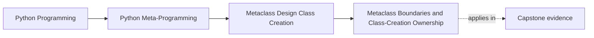

# Metaclass Boundaries and Class-Creation Ownership


<!-- page-maps:start -->
## Page Maps




<!-- page-maps:end -->

This final core is the design page for Module 09.

By now the mechanics are visible:

- manual class creation
- metaclass resolution
- `__new__` versus `__init__`
- `__prepare__`

The remaining question is the one that matters in real reviews:

when is a metaclass truly justified?

This is where many otherwise good modules go soft. A reader can follow the mechanics and
still leave thinking "metaclasses are for clever automation." This page has to leave a
stricter result: metaclasses are for narrow class-creation ownership problems that weaker
tools cannot carry honestly.

## The sentence to keep

Use a metaclass only when the invariant belongs to class creation itself or must apply
automatically across a class hierarchy in a way lower-power tools cannot own honestly.

That is the boundary the module keeps visible.

If the sentence could be rewritten without the phrases "class creation itself" or "across a
class hierarchy," the metaclass claim is probably overstated.

For self-study, turn that into a direct boundary test:

- what exact fact must exist before the class name is bound?
- what exact family-wide rule would be lost if subclasses had to opt in later?
- what lower-power owner would still be clearer if that fact or rule were smaller?

## Evidence route for class-creation ownership reviews

Use this route whenever a design proposes a metaclass:

| Review step | What to inspect | What strong evidence looks like |
| --- | --- | --- |
| Name the invariant | What must always be true? | A precise class-creation or hierarchy-wide rule |
| Name the timing | When must the rule act? | Before class creation finishes, during declaration, or automatically at subclass creation |
| Reject the lower-power owner | What fails if you use explicit code, a descriptor, or a decorator? | The lost behavior is concrete, not hand-wavy |
| Audit the blast radius | What import-time, inheritance, or test costs appear? | Side effects and reset needs are named directly |
| Reject overclaim | What is the metaclass intentionally not owning? | Scope stays narrow and reviewable |

## Why this boundary matters so much

Metaclasses are powerful because they act:

- before the class name is finally bound
- across subclass hierarchies
- at definition time, usually during import

Those are exactly the reasons they are risky.

If a metaclass is chosen for convenience rather than necessity, the code inherits:

- import-time side effects
- wider inheritance consequences
- harder composition in multiple inheritance

That is a very expensive shortcut.

## The lower-power ladder still applies

The useful review ladder here is:

```text
plain explicit code
  -> property or descriptor
  -> class decorator
  -> metaclass only when class-creation control is truly required
```

This is not a sophistication ladder. It is a cost ladder.

Keep one owner worksheet beside every metaclass proposal:

| Proposed rule | Smallest owner that might work | Why it may fail | Why the metaclass case might still be honest |
| --- | --- | --- | --- |
| require every concrete subclass to register | decorator or explicit helper | opt-in loses automatic subclass-time behavior | hierarchy-wide automatic registration is the real invariant |
| your own case | fill this in | fill this in | fill this in |

## The ownership ladder in review form

| Tool | Honest owner when | Typical reason to stop there |
| --- | --- | --- |
| Plain explicit code | One class or one call site needs the behavior | Clear, local, and reversible |
| Descriptor or property | One attribute policy needs enforcement | Attribute ownership is the real boundary |
| Class decorator | Post-creation transformation is enough | The class can be modified after construction |
| Metaclass | Class-creation timing or automatic hierarchy-wide policy is essential | Lower-power tools lose the needed timing or scope |

## Strong metaclass cases

Metaclasses become more reasonable when the requirement is genuinely about:

- class creation timing
- automatic enforcement across every subclass
- declaration-time namespace control
- hierarchy-wide registration or structure that must happen as classes come into existence

Those are all stronger signals than "make this happen automatically."

Strong metaclass defenses usually include at least one of these sentences:

- "the rule must fire whenever subclasses are defined"
- "the class body itself carries information that must be interpreted at creation time"
- "the family needs one automatic class-creation owner rather than repeated opt-in calls"

## Weak metaclass cases

Metaclasses are usually the wrong owner when the real problem is:

- one field rule
- one method wrapper
- opt-in class transformation after creation
- explicit registration that could happen in ordinary code

Those are better served by lower-power tools because they stay:

- easier to reverse
- easier to test
- easier to combine

Weak metaclass defenses often sound like this:

- "it saves boilerplate"
- "it keeps the API magical"
- "it runs automatically"
- "it centralizes everything"

Those phrases describe convenience, not ownership.

## Weak answers to reject early

| Weak answer | Why it fails |
| --- | --- |
| "it belongs in a metaclass because every subclass needs it" | every subclass needs it still does not prove the rule must fire at class creation |
| "a decorator would be too manual" | manual is not a boundary argument unless opt-in truly loses the invariant |
| "centralizing the rule is cleaner" | cleaner does not name the cost or the timing requirement |
| "the metaclass keeps the family consistent" | consistent is too vague unless the invariant and lower-power failure are both explicit |

## Why registration alone is not always enough

Automatic registration is the classic metaclass temptation.

Sometimes it is a good fit, especially when:

- every concrete subclass should be registered
- the behavior should be hierarchy-wide and automatic
- deterministic ordering and reset hooks are part of the design

But registration alone is not magic justification.

If an explicit decorator or registry call would still be clearer and sufficiently honest,
the metaclass may still be overreach.

## A boundary table for common proposals

| Proposal | Honest owner | Why |
| --- | --- | --- |
| Require subclasses to implement a method at creation time | Metaclass or ABC tooling, depending on strictness needed | The family rule applies when classes are defined |
| Register occasional classes in a plugin list | Explicit helper or decorator | Opt-in post-creation registration is enough |
| Validate one field on instance assignment | Descriptor or property | The boundary is attribute control, not class creation |
| Capture duplicate class-body declarations | Metaclass with `__prepare__` | The fact exists during assignment, not after |
| Add one helper method to a single class | Plain explicit code or decorator | No hierarchy-wide owner is needed |

## Why import-time effects must be named

A metaclass always carries timing consequences.

That means a serious review should ask:

- what happens during import?
- what global state is mutated?
- how are tests isolated?
- what happens on reload?

If those answers are vague, the metaclass is not ready, no matter how elegant the hook
code looks.

## Import-time blast radius checklist

Before accepting a metaclass, answer these directly:

- what global state changes while importing the module?
- what test helper resets or isolates those changes?
- what happens if modules are imported in a different order?
- what happens if subclasses are defined in plugin packages or reload paths later?

If those answers are postponed, the design is not honest yet.

## Metaclass conflicts are a design warning, not just a type error

When two bases bring incompatible metaclasses together, Python is not only blocking syntax.

It is telling you that:

- two different class-creation authorities are colliding
- no single clear owner has been established

Treating that as a purely mechanical problem misses the real design signal.

## What strong Module 09 design notes sound like

Good review notes in this module usually sound like:

- "this must happen while the class body is being interpreted"
- "this should apply automatically to every subclass in the family"
- "a decorator would be clearer because the transformation is still post-creation"
- "this registration could be explicit and reversible, so a metaclass is unnecessary"
- "the import-time side effects are too large for this to be an acceptable metaclass"

That tone is what keeps metaclasses narrow and honest.

## Failure modes to keep in view

The most common metaclass design failures are:

- choosing a metaclass because it feels powerful
- hiding expensive work in class creation
- using a metaclass for registration when explicit code would be clearer
- ignoring reset, ordering, or reload behavior in global registries
- treating joint metaclasses as a generic repair pattern

Those are not edge cases. They are the normal risks of the tool.

## Strong refusal language

A reviewer should be able to reject a weak metaclass with sentences such as:

- "this is post-creation transformation, so a class decorator is the clearer owner"
- "this is registry convenience, not a class-creation invariant"
- "the import-time side effects are larger than the value of the automation"
- "the hierarchy rule is real, but the bookkeeping can be separated from the metaclass"

Before you leave this page, write one sentence beginning:

- "a metaclass is still the smallest honest owner here because..."
- "the next-lower tool fails here because..."

## Review rules for metaclass boundaries

When reviewing a metaclass proposal, keep these questions close:

- what must happen before the class exists?
- why can a descriptor, class decorator, or explicit helper not own this instead?
- what import-time or hierarchy-wide effects does this introduce?
- how will this behave under testing, reload, and multiple inheritance?
- is the design naming the real class-creation invariant, or just reaching for the most powerful tool?

Add one more final question:

- what exact sentence explains why the next-lower tool loses something essential?

## What to practice from this page

Try these before moving on:

1. Take one metaclass proposal and rewrite it downward as a decorator or explicit helper to see what is actually lost.
2. Write one short review note rejecting a metaclass because the transformation is still post-creation.
3. Defend one metaclass use only in terms of class-creation ownership, not power or convenience.

## Exit check for this page

Before moving on, make sure you can do all of the following:

- defend one metaclass without using the words "automatic," "powerful," or "convenient"
- reject one weak metaclass by naming the clearer lower-power owner
- state one import-time cost introduced by a justified metaclass
- separate the class-creation invariant from surrounding bookkeeping or framework ambitions

If those feel ordinary, the worked example can now show one honest metaclass case:
deterministic plugin registration across a class family.

## Continue through Module 09

- Previous: [`__prepare__` and Declaration-Time Enforcement](prepare-and-declaration-time-enforcement.md)
- Next: [Worked Example: Building a Deterministic Plugin Registry with `PluginMeta`](worked-example-building-a-deterministic-plugin-registry-with-pluginmeta.md)
- Return: [Overview](index.md)
- Terms: [Glossary](glossary.md)
