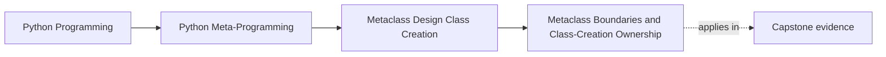
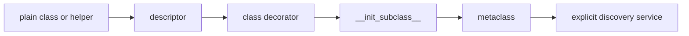

# Metaclass Boundaries and Class-Creation Ownership

<!-- page-maps:start -->
## Page Maps




<!-- page-maps:end -->

A metaclass is justified by a class-creation invariant that a lower-power owner would
lose—not by automatic behavior, reduced boilerplate, or a desire to centralize code.

This section turns that rule into executable owner decisions.

## Run the boundary table

From the course directory:

```console
python3 -m unittest discover -s tests -p "test_class_creation_boundaries.py" -v
python3 -m labs.class_creation
```

Inspect:

- `labs/class_creation/boundaries.py`
- `tests/test_class_creation_boundaries.py`
- the `boundaries` object in the JSON packet

Every decision names:

- the design pressure
- the selected owner
- why that owner fits
- one refused owner and why it is wrong
- the cost being accepted
- the signal that would require escalation

An owner choice without those fields is not ready for review.

## The owner ladder is a cost ladder

```text
plain class definition or explicit helper
  -> descriptor
  -> class decorator
  -> __init_subclass__
  -> metaclass
  -> explicit discovery service
```

Moving right buys broader timing or scope. It also increases hidden behavior,
composition cost, and operational consequences. Stop at the first owner that preserves
the required invariant.

## Decision 1: one local helper

Pressure:

> Add one helper to one class.

Selected owner: the ordinary class definition.

A class decorator is refused because post-creation transformation adds no useful
contract. The visible method is easier to find, override, type-check, and review.

Escalate only if several unrelated classes need a shared, explicit transformation.

## Decision 2: one attribute invariant

Pressure:

> Validate one attribute on every assignment.

Selected owner: a descriptor.

A metaclass is refused because class creation is not the enforcement boundary. The
descriptor already owns lookup, assignment, and per-instance storage.

Escalate only if the class family must also collect field declarations into a generated
contract. Even then, the descriptor should retain assignment validation.

## Decision 3: opt-in class marking

Pressure:

> Mark selected classes after they have been created.

Selected owner: a class decorator.

A metaclass is refused because automatic hierarchy-wide participation is not required.
The visible decorator documents opt-in at each class.

Escalate only if every future subclass must participate without authors remembering a
decorator.

## Decision 4: automatic subclass registration

Pressure:

> Register every concrete subclass in one class family.

Selected owner: `__init_subclass__`.

This inherited hook runs as subclasses are created and can register the completed
subclass. Registration alone does not require namespace preparation or metaclass
selection.

The metaclass is refused because it would claim more of class creation than this
invariant needs.

This corrects a common overstatement:

> “Automatic registration” is not, by itself, a metaclass justification.

## Decision 5: duplicate declaration events

Pressure:

> Reject duplicate public names while a class body executes.

Selected owner: metaclass `__prepare__`.

Metaclass `__new__` is too late because an ordinary mapping retains only the last value.
The custom namespace preserves a fact that final class inspection loses.

The accepted cost is substantial: every assignment in every participating class body
passes through framework-owned mapping behavior.

## Decision 6: build a declaration-driven class contract

Pressure:

> Preserve tracked assignment events and build every plugin class contract.

Selected owner: a metaclass paired with an external registry.

This pressure combines requirements:

- a prepared namespace rejects duplicate tracked declarations
- the completed namespace drives field and action collection
- the class shape receives generated signatures and initialization
- every concrete subclass is registered

`__init_subclass__` is refused because the overwritten declaration event is already gone
when it receives the completed subclass. The registry remains separate because duplicate
policy, lookup, ordering, and reset are ordinary mutable-state responsibilities.

This combined pressure—not registration alone—is the honest capstone case.

## Decision 7: package or process discovery

Pressure:

> Discover installed plugins across packages or processes.

Selected owner: an explicit discovery service.

A metaclass sees only class objects created in the current process. It does not know:

- which packages are installed but not imported
- which deployments enable a plugin
- which versions another process loaded
- how remote discovery failures should be retried

Moving this pressure into a metaclass would hide I/O and deployment policy inside import.
The stronger explicit service is more honest.

## The four-part metaclass acceptance test

Accept a metaclass only when the proposal can:

1. Name the class-creation or automatic hierarchy-wide invariant.
2. Show exactly what the next-lower owner loses.
3. Name import, inheritance, conflict, and reset costs.
4. Keep runtime I/O and lifecycle orchestration outside class creation.

- “It runs automatically” fails item 1.
- “A decorator is less elegant” fails item 2.
- “Tests can clear the globals somehow” fails item 3.
- “The metaclass can discover plugins on import” fails item 4.

## Import-time cost ledger

For an accepted metaclass, record:

| Cost | Required evidence |
| --- | --- |
| import mutation | exact state changed during class definition |
| hierarchy reach | which descendants inherit the metaclass |
| conflict risk | other class families that may own class creation |
| failure timing | whether the module can fail before startup |
| reset discipline | public helper that isolates tests |
| non-claims | discovery, I/O, lifecycle, or reload work kept elsewhere |

The existence of a reset function does not erase import-time mutation. It makes that
mutation testable.

## Capstone boundary

The incident-plugin metaclass accepts:

- a tracked declaration namespace
- field and action collection
- signature and initializer generation
- automatic in-process registration

It rejects:

- package discovery
- external I/O during class creation
- automatic metaclass conflict resolution
- reload reconciliation

Run `capstone-class-creation` and verify those accepted and rejected powers directly.

The capstone uses one metaclass because the class family needs both pre-creation
declaration evidence and automatic generated structure. Its registry support alone would
not cross the acceptance threshold.

## Review exercise

Take a proposed metaclass and write three implementations:

1. the smallest explicit helper or ordinary class version
2. the best lower-power automatic version, often `__init_subclass__`
3. the metaclass version

Then identify the exact observable behavior lost between versions 2 and 3. If nothing
essential is lost, keep version 2.

## Exit check

Continue when you can:

- choose owners for all seven executable pressures
- explain why registration alone stops at `__init_subclass__`
- identify one fact that genuinely requires `__prepare__`
- separate metaclass policy from registry state
- move package discovery beyond the metaclass boundary
- defend the capstone using its combined invariant rather than automation

Next: [Worked Example: Building a Deterministic Plugin Registry with `PluginMeta`](worked-example-building-a-deterministic-plugin-registry-with-pluginmeta.md).
