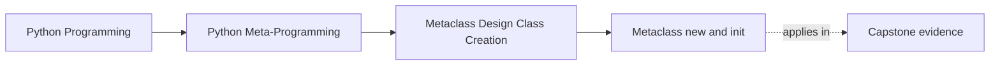
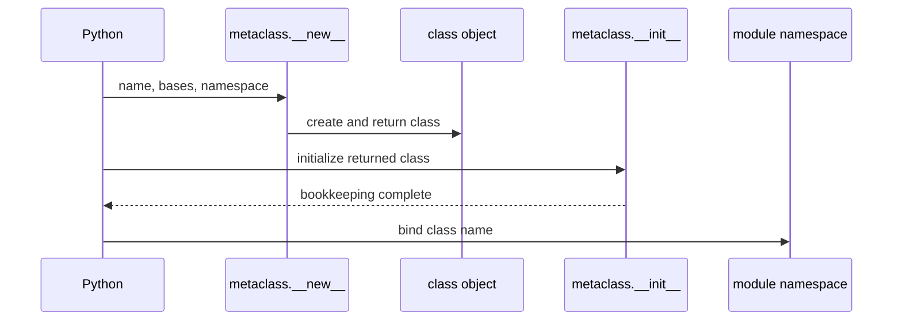

# Metaclass `__new__` and `__init__`

<!-- page-maps:start -->
## Page Maps




<!-- page-maps:end -->

Once Python selects a metaclass and executes the class body, it calls the metaclass to
produce the class object. `__new__` and `__init__` participate in that one construction
event, but they receive different forms of the object.

## Run the exact lifecycle

From the course directory:

```console
python3 -m unittest discover -s tests -p "test_class_creation_lifecycle.py" -v
python3 -m labs.class_creation
```

Inspect:

- `labs/class_creation/lifecycle.py`
- `tests/test_class_creation_lifecycle.py`
- the `lifecycle` object in the JSON packet

Predict the event list before reading it.

## The observed sequence

The packet reports:

```json
[
  "prepare:DeliveryNotice",
  "body:DeliveryNotice",
  "new:DeliveryNotice",
  "init:DeliveryNotice"
]
```

Only after those events can the surrounding scope use the bound name
`DeliveryNotice`. Constructing `DeliveryNotice()` later adds no class-creation events.

This sequence separates three objects that are often blurred:

| Moment | Primary object | What is available |
| --- | --- | --- |
| class body execution | prepared namespace | assignments as they happen |
| metaclass `__new__` | construction inputs | metaclass, name, bases, completed namespace |
| metaclass `__init__` | returned class object | finished identity, MRO, inherited attributes |

Metaclass `__init__` initializes a class object. It is not the `__init__` used to initialize
instances of that class.

## Structural work in `__new__`

The lab’s `LifecycleMeta.__new__`:

```python
def __new__(mcs, name, bases, namespace):
    events.append(f"new:{name}")
    namespace["creation_owner"] = mcs.__name__
    return super().__new__(mcs, name, bases, namespace)
```

This hook sees the completed class-body namespace before delegating to `type.__new__`. It
adds one structural attribute and returns the class object.

Typical `__new__` work includes:

- rejecting a class based on its own declarations
- transforming namespace entries before class creation
- collecting descriptors or decorated methods
- generating class attributes that belong to the class shape

The strongest reason to choose `__new__` is not “it runs first.” It is “the rule needs
construction inputs or shapes the class being returned.”

## Finished-class work in `__init__`

The lab’s metaclass `__init__`:

```python
def __init__(cls, name, bases, namespace):
    super().__init__(name, bases, namespace)
    events.append(f"init:{name}")
    registry.append(cls.__name__)
```

Here `cls` is the returned class object. Registration needs that stable identity but does
not change the class’s structural contract.

Typical `__init__` work includes:

- registering a finished class
- attaching final audit records
- checking facts that require the completed MRO
- bookkeeping that should be isolated from namespace transformation

This is a design default, not a language law. Registration can be implemented in
`__new__`, and some frameworks do so to keep all creation work atomic in one hook. The
review question is whether mixing registration with shaping makes failure, rollback, and
state ownership harder to understand.

## Failure timing

The lab includes a second metaclass that rejects a class missing `channel`:

```python
class RequiredChannelMeta(type):
    def __new__(mcs, name, bases, namespace):
        failure_events.append(f"new:{name}")
        if "channel" not in namespace:
            raise TypeError(f"{name} must declare channel")
        return super().__new__(mcs, name, bases, namespace)
```

The evidence is:

```json
{
  "events": ["new:MissingChannel"],
  "init_ran": false,
  "message": "MissingChannel must declare channel"
}
```

Because `__new__` did not return a class, metaclass `__init__` had nothing to initialize.
The surrounding scope never receives `MissingChannel`.

This gives tests a precise failure claim:

- structural validation failed
- no class was bound
- later bookkeeping did not run

## Cooperative delegation

Both hooks should normally delegate:

```python
cls = super().__new__(mcs, name, bases, namespace)
...
super().__init__(name, bases, namespace)
```

That matters when the metaclass hierarchy contains more than one implementation.
Hard-coding `type.__new__` or skipping `super().__init__` can silently bypass another
cooperative policy.

Delegation alone does not make policies compatible. It merely preserves the method
resolution route needed for compatibility.

## Capstone implementation

The incident-plugin `PluginMeta` now makes its split observable:

```text
prepare:DefinitionNamespace
  -> body:complete
  -> new:shape
  -> init:register
```

In `__new__`, it:

- collects inherited and declared fields
- collects decorated actions
- generates the visible signature
- generates `__init__` when the class did not declare one
- records structural class-creation evidence

In `__init__`, it:

- skips abstract family classes
- registers the finished concrete class
- updates the stored hook trace

Run:

```console
make -C programs/python-programming/python-meta-programming capstone-class-creation
```

The report is generated without constructing a plugin, so class-creation evidence is not
confused with instance behavior.

## Placement review

For each proposed metaclass action, complete this table:

| Question | `__new__` signal | `__init__` signal |
| --- | --- | --- |
| Does it need raw class-body entries? | strong | weak |
| Does it shape or reject the returned class? | strong | weak |
| Does it need the finished class identity or MRO? | possible | strong |
| Is it reversible registry bookkeeping? | possible but mixed | strong |
| What happens if it fails? | no class returned | class created but name not bound |

Then ask the earlier question: could a class decorator, `__init_subclass__`, or explicit
helper own the entire behavior more clearly?

## Exit check

Continue when you can:

- reproduce the exact successful hook sequence
- explain the object received by each hook
- predict why a `__new__` failure prevents `__init__`
- defend one placement using required evidence rather than “earlier” or “cleaner”
- explain the capstone’s shaping-versus-registration split

Next: [`__prepare__` and Declaration-Time Enforcement](prepare-and-declaration-time-enforcement.md).
