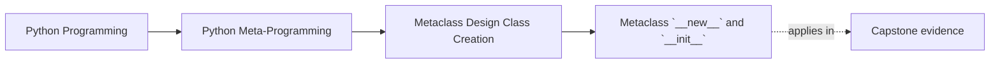

# Metaclass `__new__` and `__init__`


<!-- page-maps:start -->
## Page Maps




<!-- page-maps:end -->

After resolution comes the next design question learners usually answer too vaguely:

once the metaclass is in control, where should its work actually happen?

Many readers can repeat "`__new__` is earlier" and "`__init__` is later" without being able
to review real code honestly. This page is about the ownership boundary, not only the
order of hooks.

This core separates the two most commonly blurred hooks:

- metaclass `__new__`
- metaclass `__init__`

## The sentence to keep

Use metaclass `__new__` for structural decisions that must happen while the class is being
created, and use metaclass `__init__` for final bookkeeping or registration on the class
object after it already exists.

That split prevents a lot of vague metaclass code.

If you cannot name whether a rule changes class structure or only records the finished
class, you are not ready to place it in either hook.

For self-study, turn that into a placement test:

- does the rule need the raw namespace before the class exists?
- does the rule only need the finished class object and its final identity?
- what concrete evidence would be lost or blurred if the rule moved to the other hook?

## Evidence route for metaclass hook reviews

Work through each hook question in this order:

| Review step | What to inspect | What strong evidence looks like |
| --- | --- | --- |
| Name the rule | What is the metaclass trying to guarantee? | A structural invariant, a registry update, or another precise claim |
| Locate the earliest honest owner | Does the rule need the raw namespace or the finished class object? | The answer points clearly to `__new__` or `__init__` |
| Reject the wrong hook | What becomes harder if the hook placement is swapped? | You can name the lost input or the blurred responsibility |
| Reject the lower-power owner | Could a decorator or explicit helper still own the behavior? | A concrete reason class-creation ownership is still required |
| Audit the blast radius | What import-time or hierarchy-wide side effects follow? | Registration, mutation, or test setup costs are named directly |

## What metaclass `__new__` owns

`__new__` receives the raw ingredients for class creation:

- the metaclass
- the class name
- the base classes
- the namespace mapping

That makes it the right place for work such as:

- namespace-driven validation
- injecting or rewriting attributes before the class object exists
- structural edits that depend on the class body itself

Typical signs that `__new__` is the honest owner:

| Signal | Why it points to `__new__` |
| --- | --- |
| The rule depends on names written in the class body | The namespace is still the direct source of truth |
| The class must be rejected before it exists | `__init__` is already too late for clean refusal |
| Helpers or wrappers must be inserted as part of class construction | The class shape is still being decided |

This is still the mutability window where the construction inputs are most direct.

## What metaclass `__init__` owns

`__init__` runs after the class object has been created.

That makes it a better fit for:

- registration
- final bookkeeping
- post-creation checks that need the finished class object

Typical signs that `__init__` is the honest owner:

| Signal | Why it points to `__init__` |
| --- | --- |
| The rule needs the final class identity | Registration and bookkeeping reference the finished object |
| The MRO or inherited attributes matter in final form | The class already exists and can be inspected directly |
| The work should be easy to reverse or reset in tests | Bookkeeping surfaces can be separated from structural edits |

It is usually the wrong place for heavy structural surgery, because the class has already
been constructed.

## A compact split to keep in mind

```text
metaclass __new__
  -> shape the class

metaclass __init__
  -> record, register, or finalize the class
```

That is the practical rule most review discussions need.

Keep one hook ledger beside any metaclass you review:

| Proposed behavior | Needs raw namespace? | Needs finished class object? | Honest hook |
| --- | --- | --- | --- |
| reject missing body-defined method | yes | no | `__new__` |
| append class to registry | no | yes | `__init__` |
| your own case | fill this in | fill this in | fill this in |

## A small example

```python
class ValidatingMeta(type):
    registry = []

    def __new__(mcs, name, bases, namespace):
        has_run_here = "run" in namespace
        has_run_in_bases = any(hasattr(base, "run") for base in bases)
        if not has_run_here and not has_run_in_bases:
            raise TypeError(f"{name} must define run()")

        namespace["from_meta"] = lambda self: "ok"
        return super().__new__(mcs, name, bases, namespace)

    def __init__(cls, name, bases, namespace):
        super().__init__(name, bases, namespace)
        ValidatingMeta.registry.append(cls)


class Task(metaclass=ValidatingMeta):
    def run(self):
        return "running"
```

This example keeps the split honest:

- `__new__` enforces a structural rule and injects behavior
- `__init__` records the finished class in a registry

That is exactly the division of labor the module wants.

## What to reject before you argue about hook style

Some metaclass proposals are weak before hook placement even matters.

Reject these first:

| Weak claim | Why it is weak |
| --- | --- |
| "We can just put all metaclass logic in `__init__`." | It hides structural mutation after the class already exists |
| "We can do everything in `__new__` and avoid thinking about the split." | It mixes class-shape work with bookkeeping and global side effects |
| "The earlier hook is safer because it runs first." | Earlier is not safer; it is only more appropriate for structural ownership |
| "Hook choice is mostly style." | Hook choice changes reviewability, failure timing, and reset behavior |

## Weak answers to reject early

| Weak answer | Why it fails |
| --- | --- |
| "put validation in `__new__` because it is earlier" | earlier does not explain why namespace access is required |
| "put registration in `__init__` because it is cleaner" | cleaner is too vague unless the finished-class identity is the needed input |
| "either hook could probably work" | probably means the owner boundary is still unclear |
| "it is all metaclass code anyway" | that collapses structure and bookkeeping into one blurry surface |

## Why structural edits belong earlier

If a decision depends on the namespace before class creation finishes, `__new__` is the
honest owner.

Examples include:

- rejecting missing required methods
- rewriting definitions based on class-body declarations
- injecting class-level helpers before the resulting class is finalized

Trying to perform that kind of work later often makes the design harder to reason about.

## Why registration belongs later

Registration and bookkeeping usually need:

- the fully created class object
- its final bases and MRO
- a stable identity that other code can reference

That makes `__init__` the more natural place for:

- appending to registries
- recording metadata
- attaching class-family bookkeeping

The rule is not absolute, but it is a very strong default.

## Failure modes for hook placement

Watch for these review failures:

| Failure mode | What goes wrong |
| --- | --- |
| Structural mutation postponed into `__init__` | Reviewers must reason about a class changing after creation |
| Registration buried in `__new__` | Global side effects disappear inside structure code |
| One hook doing both jobs | The metaclass becomes harder to explain and test |
| Hook choice justified only by "convenience" | No real ownership boundary has been established |

## What this split is trying to prevent

Without a clear split, metaclass code often turns into:

- structural mutation in `__init__`
- registration side effects mixed into `__new__`
- hard-to-review code that works mostly by accident

The point of this core is not stylistic purity. It is keeping class-creation behavior
explainable.

## A warning about overusing either hook

Both hooks are high-power surfaces.

That means both still need the same questions asked first:

- does this truly belong at class-creation time?
- could a class decorator still own it honestly?
- could plain explicit code be clearer?

Choosing between `__new__` and `__init__` is not the first question. It is the second.

Before you leave this page, write one sentence beginning:

- "this rule belongs in `__new__` because..."
- "this rule belongs in `__init__` because..."

## Review rules for `__new__` versus `__init__`

When reviewing metaclass hooks, keep these questions close:

- is this work structural or post-creation?
- does it depend on the raw namespace or the finished class object?
- is registration being kept separate from namespace mutation?
- is the metaclass doing work here that a lower-power tool could still own?
- would a reviewer be able to explain the class-creation effects in one pass?

Add one more question in strong reviews:

- what exact evidence would become unavailable or less honest if this work moved to the other hook?

## What to practice from this page

Try these before moving on:

1. Put one interface or namespace validation rule in `__new__` and explain why it belongs there.
2. Add one registry append in `__init__` and explain why it belongs after class creation.
3. Write one short review note rejecting a metaclass that mutates structure in `__init__` for no clear reason.

## Exit check for this page

Before moving on, make sure you can do all of the following in plain language:

- point to one rule that truly needs raw namespace access
- point to one rule that only needs the finished class object
- explain why swapping those two rules would blur ownership
- reject at least one lower-power alternative or one misplaced hook honestly

If those feel ordinary, the next step is `__prepare__`, the one hook that can observe and
control assignments during class body execution itself.

## Continue through Module 09

- Previous: [Metaclass Resolution, Timing, and Conflicts](metaclass-resolution-timing-and-conflicts.md)
- Next: [`__prepare__` and Declaration-Time Enforcement](prepare-and-declaration-time-enforcement.md)
- Return: [Overview](index.md)
- Terms: [Glossary](glossary.md)
