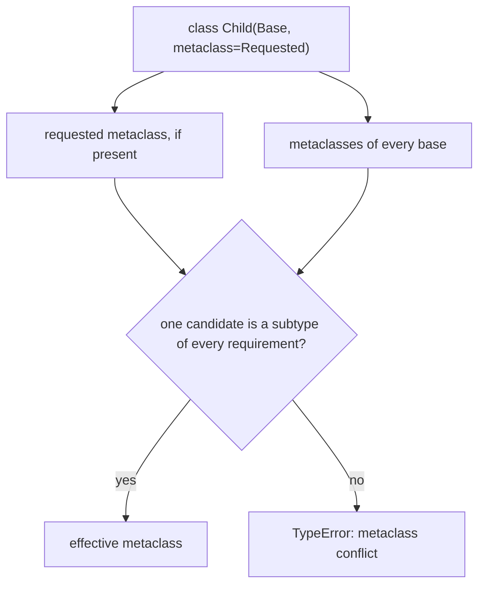

# Metaclass Resolution, Timing, and Conflicts

<!-- page-maps:start -->
## Page Maps



<!-- page-maps:end -->

Before Python executes a class body, it must choose the callable that will create the
class. A custom metaclass may be requested explicitly or inherited through the base
classes. Python still needs one compatible owner.

## Run the selection experiment

From the course directory:

```console
python3 -m unittest discover -s tests -p "test_class_creation_resolution.py" -v
python3 -m labs.class_creation
```

Open:

- `labs/class_creation/resolution.py`
- `tests/test_class_creation_resolution.py`
- the `resolution` object in the JSON packet

Before reading the output, predict:

- the metaclass of `DeliveryAudit`
- whether constructing `DeliveryAudit()` adds a metaclass creation event
- what happens when bases carry unrelated metaclasses

## Inherited selection

The lab defines a metaclass that records each class it creates:

```python
class AuditMeta(type):
    def __new__(mcs, name, bases, namespace):
        creation_events.append(f"create:{name}")
        return super().__new__(mcs, name, bases, namespace)


class AuditedBase(metaclass=AuditMeta):
    pass


class DeliveryAudit(AuditedBase):
    pass
```

`DeliveryAudit` does not spell `metaclass=AuditMeta`, but:

```python
assert type(AuditedBase) is AuditMeta
assert type(DeliveryAudit) is AuditMeta
```

The base class carries class-creation authority into its descendants. This is the first
major cost difference from an opt-in class decorator.

## Definition time is not instance time

The evidence records:

```json
{
  "events_before_instance": [
    "create:AuditedBase",
    "create:DeliveryAudit"
  ],
  "instance_creation_added_events": false
}
```

Both classes were created while their class statements executed. In normal modules, that
usually happens during import. Constructing `DeliveryAudit()` later does not rerun
metaclass `__new__`.

This distinction has practical consequences:

- global registry writes happen before application startup finishes
- metaclass exceptions can prevent a module from importing
- slow I/O in class creation becomes slow import I/O
- every descendant inherits the policy unless another compatible metaclass supersedes it

“The metaclass runs at runtime” is true but too weak for review. State “during class
definition, usually import” instead.

## The compatibility rule

For a class with bases, Python considers:

- an explicitly requested metaclass, if present
- the metaclass of every base class

The selected metaclass must be a subclass of all those candidate metaclasses. If no such
candidate is available, Python raises `TypeError`.

The lab creates two unrelated authorities:

```python
class AuditMeta(type):
    ...


class PolicyMeta(type):
    ...


class AuditedBase(metaclass=AuditMeta):
    pass


class PolicyBase(metaclass=PolicyMeta):
    pass
```

Then this fails before `Conflicted` is bound:

```python
class Conflicted(AuditedBase, PolicyBase):
    pass
```

The packet confirms a real `TypeError` containing “metaclass conflict.” Python is refusing
to guess which class-creation authority should dominate.

## A joint metaclass solves only the mechanical problem

The lab also demonstrates an explicit compatible candidate:

```python
class JointMeta(AuditMeta, PolicyMeta):
    pass


class DeliberatelyCombined(
    AuditedBase,
    PolicyBase,
    metaclass=JointMeta,
):
    pass
```

This makes construction mechanically possible because `JointMeta` is a subclass of both
candidate metaclasses.

It does not prove:

- both policies call `super()` cooperatively
- their namespace expectations agree
- their mutation order is safe
- their registration or validation semantics compose

A joint metaclass is new integration code. It requires tests for both policies together,
not merely an assertion that the class statement stopped raising.

## Failure analysis

When a conflict appears, use this route:

1. List the explicit metaclass, if any.
2. Record `type(base)` for every base.
3. State the policy owned by each candidate.
4. Ask whether both policies are truly needed in one class family.
5. Prefer removing an unnecessary authority over combining them.
6. If combination is necessary, test hook order and cooperative delegation.

Do not start by writing `class CombinedMeta(LeftMeta, RightMeta)`. That treats a design
collision as a syntax repair.

## Capstone comparison

Concrete incident plugins inherit `PluginMeta` through `PluginBase`; they do not repeat an
explicit metaclass declaration.

Run:

```console
make -C programs/python-programming/python-meta-programming capstone-class-creation
```

The report states:

```json
"metaclass_selection": "inherited from base class"
```

The capstone deliberately rejects automatic conflict resolution. If a plugin must also
inherit from a class family with another metaclass, that composition needs an explicit
design decision outside the current framework contract.

## Review exercise

Given `class Candidate(Left, Right): ...`, produce:

| Evidence | Your result |
| --- | --- |
| `type(Left)` | metaclass and owned policy |
| `type(Right)` | metaclass and owned policy |
| selected compatible candidate | exact type or “none” |
| definition-time effects | registry, mutation, validation, or none |
| lower-cost repair | remove, relocate, or combine a policy |
| combined-policy proof | focused test needed if combination remains |

## Exit check

Continue when you can:

- predict an inherited effective metaclass
- distinguish class-definition events from instance-construction events
- explain conflicts as incompatible ownership, not mysterious syntax
- state the subtype compatibility rule
- reject a joint metaclass that has no semantic composition proof

Next: [Metaclass `__new__` and `__init__`](metaclass-new-and-init.md).
