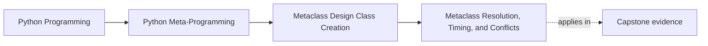

# Metaclass Resolution, Timing, and Conflicts


<!-- page-maps:start -->
## Page Maps




<!-- page-maps:end -->

Once you know that class creation is a runtime event, the next question is:

which metaclass actually controls that event?

This core answers that question and makes one practical consequence unavoidable:

metaclass work runs at definition time, which usually means import time.

This page matters because learners often understand the conflict error before they
understand the ownership collision behind it. A missed-class learner needs a route for
proving where the effective metaclass comes from, when it runs, and why a joint
metaclass is a semantic escalation rather than a repair macro.

## The sentence to keep

Python resolves one effective metaclass for the class being created, runs its class
creation logic at definition time, and raises conflicts when multiple inheritance brings
incompatible metaclass owners together.

That one sentence explains most “why did this metaclass run?” questions.

Keep one more sentence beside it:

> a metaclass conflict is Python refusing to guess between competing class-creation authorities.

## Timing comes first

Before talking about conflict rules, keep the timing clear:

metaclass work runs when the class is defined, not when instances are created.

In ordinary code that usually means:

- module import time
- class statement execution time

That matters because any heavy work, I/O, or global mutation performed by a metaclass now
happens before objects are ever instantiated.

## Where the effective metaclass comes from

There are two broad routes:

- an explicit `metaclass=...` on the class statement
- an implicit metaclass derived from the base classes

Python then needs one effective metaclass that is compatible with the bases involved.

That is why metaclass selection is not only a syntax detail. It is a multiple-inheritance
rule.

Use this table before trusting a class statement with metaclass behavior:

| Pressure | Review question |
| --- | --- |
| explicit `metaclass=...` | what class-creation authority is being requested directly? |
| inherited metaclass | what authority is arriving through the bases? |
| definition time | what code runs during import or class statement execution? |
| multiple inheritance | can one coherent effective metaclass honestly own the combined rule set? |

## A compact mental model

```text
explicit metaclass, if present
  -> must be compatible with the metaclasses of the bases

no explicit metaclass
  -> Python derives the effective metaclass from the bases

no compatible common metaclass
  -> metaclass conflict
```

That is the review-level model most people need.

## Evidence route for metaclass resolution reviews

Use this route whenever a class seems to have metaclass behavior "from nowhere":

| Evidence step | What it proves |
| --- | --- |
| inspect the class statement for an explicit metaclass | shows whether the owner was requested directly |
| inspect each base class metaclass | shows inherited class-creation authorities |
| identify the resolved effective metaclass | shows who actually owns class creation |
| inspect one definition-time side effect | shows what work happens before instances ever exist |
| test one multiple-inheritance case | shows whether the ownership story still composes |

## A small metaclass example

```python
class TaggedMeta(type):
    def __new__(mcs, name, bases, namespace):
        namespace["tag"] = f"created by {mcs.__name__}"
        return super().__new__(mcs, name, bases, namespace)


class Base(metaclass=TaggedMeta):
    pass


class Child(Base):
    pass


print(Base.tag)   # created by TaggedMeta
print(Child.tag)  # created by TaggedMeta
```

This example shows two useful facts:

- metaclass effects are inherited through the class hierarchy
- subclasses often keep the same metaclass implicitly

That “infectious” behavior is exactly why metaclasses need stronger review discipline.

Use this inheritance table when the blast radius feels understated:

| Behavior | Why it matters |
| --- | --- |
| subclasses inherit the metaclass implicitly | a one-time decision becomes family-wide class-creation policy |
| definition-time work repeats for every subclass | import-time cost and side effects scale with the hierarchy |
| registry or validation behavior becomes automatic | lower-power opt-in alternatives may no longer be available |

## Why conflicts happen

Conflicts appear when multiple bases carry metaclasses that do not fit into one compatible
hierarchy.

For example:

```python
class MetaA(type):
    pass


class MetaB(type):
    pass


class A(metaclass=MetaA):
    pass


class B(metaclass=MetaB):
    pass


try:
    class Bad(A, B):
        pass
except TypeError as exc:
    print("Expected:", exc)
```

The conflict is not Python being fussy. It is Python telling you that two different
class-creation owners are being combined without one clear higher-level owner.

That is the sentence to keep in review notes:

"the error is a signal that ownership is ambiguous, not only that syntax is invalid."

## Why “just combine them” is not always the answer

You can sometimes write a joint metaclass:

```python
class MetaAB(MetaA, MetaB):
    pass
```

But this is only safe when the underlying behaviors truly compose.

That means a joint metaclass is:

- a semantic design decision
- not a mechanical repair step

If the two metaclasses want incompatible timing, validation, or registration behavior, a
joint metaclass may make the code worse rather than better.

## Common overclaims to reject

Reject these descriptions when they appear in review:

| Overclaim | Better replacement |
| --- | --- |
| "the metaclass only runs once" | "the metaclass runs each time the class statement executes, usually at import time" |
| "a joint metaclass fixes the conflict" | "a joint metaclass is only valid if the underlying authorities truly compose" |
| "the subclass just inherits the behavior" | "the subclass inherits the same class-creation authority and therefore the same blast radius" |
| "it is only a type-system issue" | "it is a class-creation ownership issue with inheritance consequences" |

## Import-time effects are part of the design

Because resolution happens at definition time, every metaclass decision also carries an
import-time design choice.

Questions that matter immediately include:

- does this metaclass mutate global registries?
- does it do expensive scanning or I/O?
- does class definition order now affect behavior?

If those questions are not answered, the metaclass is not yet review-ready.

Use this import-time checklist before approving a metaclass:

- name one global state mutation, if any
- name one expensive operation, if any
- say whether class definition order changes the outcome
- say how tests or reloads avoid accumulating stale effects

## What this core is really trying to teach

The point is not merely to memorize conflict errors.

The point is to understand that metaclasses are:

- inherited
- definition-time
- hierarchy-shaping

Those three facts are enough to explain most of their risk surface.

## Failure modes for resolution and conflict design

These are the mistakes this page is trying to prevent:

| Failure mode | Why it weakens the design | Repair move |
| --- | --- | --- |
| treating explicit `metaclass=` as isolated to one class | the hierarchy-wide effect gets underestimated | inspect subclass behavior and import-time repetition |
| resolving a conflict by combining authorities mechanically | incompatible semantics get hidden inside one metaclass | justify the composition in domain terms or refuse it |
| ignoring definition-time blast radius | import-time cost becomes invisible to reviewers | document the side effects and reset surfaces explicitly |
| explaining conflicts only with the error text | the ownership lesson never becomes clear | restate the error as a class-creation authority collision |

## Review rules for resolution and conflicts

When reviewing metaclass selection, keep these questions close:

- where is the effective metaclass coming from?
- what work does it do at class-definition time?
- are multiple bases introducing incompatible metaclass owners?
- if a joint metaclass is proposed, do the underlying behaviors really compose?
- would a lower-power tool avoid the import-time and inheritance consequences entirely?
- what exact lower-power owner did you reject before accepting this family-wide authority?

## Exit check for this page

Before moving on, make sure you can do all of these:

- name the effective metaclass for one example and say where it came from
- explain why the work runs at definition time rather than at instance creation
- describe one metaclass conflict as an ownership collision
- say when a joint metaclass is semantically justified and when it is not

## What to practice from this page

Try these before moving on:

1. Build one tiny metaclass that adds a marker attribute and show that subclasses inherit the metaclass implicitly.
2. Trigger one metaclass conflict on purpose and explain it in ownership language instead of only error-message language.
3. Write one short review note rejecting a “just combine the metaclasses” fix as semantically unsafe.

If those feel ordinary, the next step is to separate structural work in metaclass
`__new__` from post-creation bookkeeping in metaclass `__init__`.

## Continue through Module 09

- Previous: [Manual Class Creation with `type(...)`](manual-class-creation-with-type.md)
- Next: [Metaclass `__new__` and `__init__`](metaclass-new-and-init.md)
- Return: [Overview](index.md)
- Terms: [Glossary](glossary.md)
