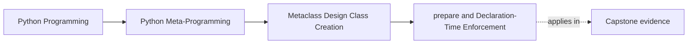
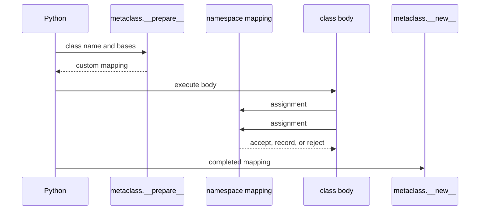

# `__prepare__` and Declaration-Time Enforcement

<!-- page-maps:start -->
## Page Maps




<!-- page-maps:end -->

Most class rules can inspect the completed namespace in metaclass `__new__`. Use
`__prepare__` only when the important fact exists while assignments are happening and
would be lost from that completed view.

## The disappearing fact

An ordinary class body can assign the same name twice:

```python
class PlainPolicy:
    channel = "console"
    channel = "webhook"
```

After creation:

```python
assert PlainPolicy.channel == "webhook"
assert vars(PlainPolicy)["channel"] == "webhook"
```

Final inspection cannot prove that `"console"` was ever assigned. If duplicate
declarations are invalid in a small declarative class language, the enforcement boundary
must observe assignment, not merely the final class.

## Run the namespace experiment

From the course directory:

```console
python3 -m unittest discover -s tests -p "test_class_creation_namespace.py" -v
python3 -m labs.class_creation
```

Inspect:

- `labs/class_creation/namespace.py`
- `tests/test_class_creation_namespace.py`
- the `declaration_namespace` object in the JSON packet

## The custom mapping

The lab implements a `dict` subclass with one narrow policy:

```python
class DeclarationNamespace(dict[str, object]):
    def __init__(self) -> None:
        super().__init__()
        self.public_names: list[str] = []

    def __setitem__(self, key: str, value: object) -> None:
        if not key.startswith("__"):
            if key in self:
                raise TypeError(f"duplicate public declaration: {key}")
            self.public_names.append(key)
        super().__setitem__(key, value)
```

The metaclass selects it:

```python
class DeclarationMeta(type):
    @classmethod
    def __prepare__(mcs, name, bases):
        return DeclarationNamespace()
```

Python executes the class body using that object as its local namespace. Every assignment
therefore passes through `__setitem__`.

## The successful route

For:

```python
class DeliveryPolicy(metaclass=DeclarationMeta):
    channel = "console"
    attempts = 3

    def deliver(self):
        return "delivered"
```

the custom mapping records:

```json
"public_declaration_order": [
  "channel",
  "attempts",
  "deliver"
]
```

`DeclarationMeta.__new__` copies that fact onto the created class as
`__declaration_order__`.

Modern dictionaries already preserve insertion order. Order alone is therefore not a
good reason to add this custom namespace. The educational value is the assignment event
and the duplicate rule, not recreating ordinary dictionary behavior.

## The failure route

This class never becomes bound:

```python
class DuplicatePolicy(metaclass=DeclarationMeta):
    channel = "console"
    channel = "webhook"
```

The second assignment raises:

```text
TypeError: duplicate public declaration: channel
```

The packet records `"class_bound": false`. Neither metaclass `__new__` nor `__init__` can
repair the class later because body execution did not complete.

This is a stronger and more precise claim than “`__prepare__` validates classes.” It
validates a declaration event before a class exists.

## Keep the mapping compatible with class execution

The class body writes implementation details such as:

- `__module__`
- `__qualname__`
- annotations
- compiler-created cells in some class bodies

The lab allows repeated dunder assignments and delegates normal storage to `dict`.
Production custom mappings must avoid blocking Python’s own class-building protocol.

The narrower the policy, the easier this is to review.

## When `__prepare__` is overreach

Do not use it merely to:

- read the final annotations
- collect descriptors from the completed namespace
- preserve ordinary declaration order
- add methods after class creation
- register the finished class

Those facts remain available to later hooks or lower-power owners.

Use this decision test:

| Question | If yes |
| --- | --- |
| Does the rule concern an individual assignment event? | `__prepare__` may be justified |
| Is the fact absent from the final namespace? | preserve it during class-body execution |
| Can `__new__` inspect the same fact reliably? | stop at `__new__` |
| Can a class decorator work after creation? | stop at the decorator |

## Capstone comparison

The incident-plugin `DefinitionNamespace` is intentionally narrower than the lab mapping.
It rejects duplicate assignments only when either the previous or new value is:

- a `Field` descriptor
- a function marked as a plugin action

Ordinary helper names may still be reassigned. The framework protects declarations that
feed generated public contracts without pretending to be a general-purpose linting
language.

The `capstone-class-creation` report exposes:

```json
"namespace_type": "DefinitionNamespace"
```

and lists the public names received by `PluginMeta.__new__`. That provides evidence of the
prepared namespace without constructing the plugin.

## Review exercise

For a proposed custom class namespace, write:

1. The exact assignment-time event to preserve.
2. The exact information missing from `vars(created_class)`.
3. The smallest mapping behavior needed.
4. One Python-generated name the mapping must tolerate.
5. The failure timing and whether the class name becomes bound.
6. Why a later hook or class decorator cannot own the rule.

If item 2 is blank, remove `__prepare__`.

## Exit check

Continue when you can:

- explain why a duplicate assignment disappears from final inspection
- trace assignments through the mapping returned by `__prepare__`
- predict that a mapping failure prevents class creation
- reject ordinary declaration order as sufficient justification
- compare the broad lab rule with the capstone’s tracked-member-only rule

Next: [Metaclass Boundaries and Class-Creation Ownership](metaclass-boundaries-and-class-creation-ownership.md).
