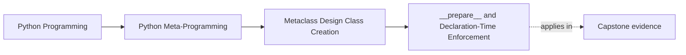

# `__prepare__` and Declaration-Time Enforcement


<!-- page-maps:start -->
## Page Maps




<!-- page-maps:end -->

This core covers the one metaclass hook that feels unusual for a very good reason:

it can act before the class body has finished executing.

That makes it unique in the whole class-creation pipeline.

It also makes it the hook learners overclaim most easily. Many designs say "we need
`__prepare__`" when they really mean "we like that it feels advanced." This page is about
the much narrower case where declaration-time evidence would otherwise disappear.

## The sentence to keep

`__prepare__` is the only metaclass hook that can supply the namespace mapping used during
class body execution, which makes it the only place where declaration-time assignment rules
can be enforced directly.

That is why it exists.

If you cannot name the fact that vanishes after the class body runs, you probably do not
need `__prepare__`.

For self-study, turn that into a direct proof test:

- what exact assignment-time fact am I trying to keep?
- where would that fact disappear if I waited for `__new__`?
- what narrower hook or owner would be enough if the fact survived?

## Evidence route for `__prepare__` reviews

Work through the hook in this order:

| Review step | What to inspect | What strong evidence looks like |
| --- | --- | --- |
| Name the fact | What is being captured during class-body execution? | Duplicate writes, declaration order, or another assignment-time fact |
| Prove later loss | What would be gone by the time `__new__` runs? | The answer names information that ordinary final namespaces do not preserve |
| Inspect the mapping | What behavior does the custom mapping add? | The mapping is small, explicit, and tied to the rule |
| Reject the ordinary dict | Why is final namespace order or final values insufficient? | A concrete limit of post-hoc validation is stated |
| Reject stronger behavior | What is intentionally not handled here? | The mapping is not trying to become a whole framework |

## Why `__prepare__` is different

Most metaclass hooks see the class only after the body has already executed or after the
class object has already been created.

`__prepare__` is different because it decides:

- what mapping receives class-body assignments
- what behavior that mapping has while assignments happen

That means it can observe or reject things that later hooks can only discover after the
fact.

Keep the ownership sentence strict:

- `__prepare__` owns assignment-time facts
- `__new__` owns structural decisions using the finished namespace
- `__init__` owns post-creation bookkeeping

## A compact mental model

```text
metaclass resolution
  -> __prepare__ creates namespace mapping
  -> class body writes into that mapping
  -> __new__ receives the finished namespace
```

This is the real reason `__prepare__` matters.

## Declaration-time claims that do and do not justify the hook

| Claim | Is `__prepare__` justified? | Why |
| --- | --- | --- |
| "We must reject duplicate class-body assignments." | Yes, often | The duplicate event happens while assignments are made |
| "We need declaration order plus extra write metadata." | Yes, sometimes | Final namespace order alone may be too weak |
| "We want to validate final required methods." | Usually no | `__new__` can inspect the finished namespace clearly |
| "We want a registry of finished classes." | No | That is post-creation bookkeeping, not assignment-time control |

## Declaration-time proof card

Use this card before approving a `__prepare__` design:

| Question | Strong answer shape |
| --- | --- |
| what event matters during assignment? | duplicate write, order capture, or another named class-body fact |
| what later view is too weak? | final namespace lacks the intermediate event |
| what behavior does the mapping add? | one narrow rule with readable failure behavior |
| what does the mapping refuse to do? | it does not become a general framework or hidden policy engine |

## A duplicate-assignment example

```python
class NoDupesMeta(type):
    class NoDupesDict(dict):
        def __setitem__(self, key, value):
            is_dunder = key.startswith("__") and key.endswith("__")
            if key in self and not is_dunder:
                raise ValueError(f"duplicate assignment to {key!r}")
            super().__setitem__(key, value)

    @classmethod
    def __prepare__(mcs, name, bases, **kwargs):
        return NoDupesMeta.NoDupesDict()


class OK(metaclass=NoDupesMeta):
    x = 1
    y = 2
```

This works because the class body is writing into a custom mapping, not into an ordinary
plain dictionary.

The key review point is not "custom mapping equals sophistication." The key point is that
the duplicate write can be rejected when it happens instead of reconstructed later.

## What later hooks cannot do as cleanly

Suppose the class body assigns:

```python
x = 1
x = 2
```

By the time `__new__` sees the namespace, only the final value remains unless the mapping
has already recorded the duplicate event.

That is the heart of declaration-time enforcement:

some facts exist only while the class body is still running.

That is the refusal test for this hook:

- if the fact survives cleanly into the final namespace, prefer a later hook
- if the fact disappears during assignment, `__prepare__` becomes much more honest

## What custom namespace mappings can enforce

With care, a `__prepare__` mapping can do things like:

- reject duplicate assignments
- record declaration order
- capture extra metadata during assignment
- trace or audit what the class body writes

Those are all genuinely different from post-hoc validation.

## Failure modes for `__prepare__` designs

Watch for these review failures:

| Failure mode | What goes wrong |
| --- | --- |
| Using `__prepare__` for final-shape validation | The hook is stronger than the problem requires |
| Returning a mapping with broad surprising behavior | Class-body execution becomes harder to predict |
| Recording everything "just in case" | The mapping becomes a meta framework instead of a narrow teaching surface |
| Failing to explain what later hooks would miss | The hook choice becomes ornamental rather than necessary |

## Weak answers to reject early

| Weak answer | Why it fails |
| --- | --- |
| "we need `__prepare__` because it is the earliest hook" | earliest is not the same as necessary |
| "the custom dict gives us more control" | more control does not name the vanished fact |
| "we might want declaration metadata later" | later is not a present justification |
| "the mapping can enforce lots of rules at once" | lots of rules usually means the surface is getting too broad to review cleanly |

## Why this hook should still stay narrow

`__prepare__` is powerful, but it is also easy to overuse.

If the rule can be checked after class creation just as clearly, then a custom namespace
mapping may be unnecessary.

The honest use case is:

- this fact matters specifically during declaration
- and it cannot be reconstructed cleanly later

That keeps the hook justified.

Before you leave this page, write one sentence beginning:

- "this fact would be lost later because..."
- "a later hook would still be enough if..."

## A declaration-order sketch

Another classic use is to keep assignment order visible:

```python
class TracingMeta(type):
    class TrackingDict(dict):
        def __init__(self):
            super().__init__()
            self.order = []

        def __setitem__(self, key, value):
            self.order.append(key)
            super().__setitem__(key, value)

    @classmethod
    def __prepare__(mcs, name, bases, **kwargs):
        return TracingMeta.TrackingDict()
```

This is a good reminder that `__prepare__` is about the namespace mapping itself, not only
about metaclass validation.

## Why modern ordered dict behavior does not remove the lesson

Modern Python preserves class-body definition order in ordinary dictionaries, which is very
useful.

But `__prepare__` still matters because:

- it can enforce rules during assignment
- it can capture richer metadata than final order alone
- it can expose behaviors ordinary dictionaries do not provide

So the point of the hook is not “ordered class dictionaries exist.” The point is control
over declaration-time semantics.

## Import-time and readability boundaries

Because `__prepare__` changes the mapping used by class statements, strong reviews should
also ask:

- can another reader understand the mapping behavior from one page of code?
- does the custom mapping preserve ordinary expectations for class-body execution?
- will failures during assignment be easy to diagnose during import?

Those questions keep the hook inspectable instead of mystical.

## What this core makes clear

The point is not “always customize the class namespace.”

The boundary is:

- there is one hook that can see class-body writes as they happen
- that hook exists for declaration-time rules
- if you use it, you should be able to name exactly what later hooks would miss

That is the discipline Module 09 wants.

## Review rules for `__prepare__`

When reviewing a metaclass that uses `__prepare__`, keep these questions close:

- what class-body fact is being captured or enforced during assignment?
- could the same rule be checked just as clearly in `__new__` instead?
- is the custom mapping small and inspectable?
- does the mapping preserve the behaviors the rest of the class body expects?
- is the design using `__prepare__` because it is necessary, or just because it is exotic?

Add one more strong review question:

- what exact evidence would be lost if this design used an ordinary namespace and waited for `__new__`?

## What to practice from this page

Try these before moving on:

1. Build one custom mapping that rejects duplicate non-dunder assignments.
2. Build one mapping that records definition order and stores it on the class later.
3. Write one short review note explaining why a proposed `__prepare__` hook is unnecessary because later validation would be just as clear.

## Exit check for this page

Before moving on, make sure you can do all of the following without hand-waving:

- name one declaration-time fact that later hooks cannot recover honestly
- name one proposed `__prepare__` use that should be rejected as overreach
- explain the mapping behavior in plain language
- separate assignment-time control from post-creation validation and bookkeeping

If those feel ordinary, the next step is the module's design page: when metaclass power is
truly justified and when lower-power tools should still win.

## Continue through Module 09

- Previous: [Metaclass `__new__` and `__init__`](metaclass-new-and-init.md)
- Next: [Metaclass Boundaries and Class-Creation Ownership](metaclass-boundaries-and-class-creation-ownership.md)
- Return: [Overview](index.md)
- Terms: [Glossary](glossary.md)
