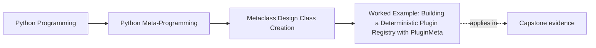
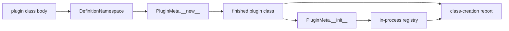

# Worked Example: Building a Deterministic Plugin Registry with `PluginMeta`

<!-- page-maps:start -->
## Page Maps




<!-- page-maps:end -->

This worked example begins by rejecting its own tempting simplification:

> Automatic registration alone is not enough to justify `PluginMeta`.

`__init_subclass__` can register completed subclasses. The metaclass becomes the smallest
honest owner only when the plugin family also needs a declaration-time namespace and
generated class structure.

## Start with the executable registry model

Run:

```console
cd programs/python-programming/python-meta-programming
python3 -m unittest discover -s tests -p "test_class_creation_registry.py" -v
python3 -m labs.class_creation
```

Open:

- `labs/class_creation/registry.py`
- `tests/test_class_creation_registry.py`
- the `registry` object in the JSON packet

The lab separates two responsibilities:

| Responsibility | Owner |
| --- | --- |
| decide whether a concrete class participates automatically | class-family hook |
| store classes, reject duplicate keys, sort names, resolve entries, reset state | `PluginRegistry` |

Its hook trace is:

```text
new:ConsolePlugin:shape
init:ConsolePlugin:bookkeeping
register:delivery:console
```

The trace is useful, but the packet includes a deliberate non-claim:

```text
registration alone does not prove a metaclass is smaller than __init_subclass__
```

That sentence prevents a mechanism demonstration from becoming a design recommendation.

## The extra pressure that earns `PluginMeta`

The incident-plugin class family is a declaration-driven API:

```python
class ConsoleNotifier(DeliveryPlugin):
    plugin_name = "console"

    prefix = StringField(default="[incident]", description="Output prefix")
    stream = ChoiceField(("stdout", "stderr"), default="stdout")

    @action("Render an incident notification.")
    def deliver(self, *, title: str, severity: str, summary: str) -> str:
        ...
```

From that one class body, the framework must:

- reject duplicate tracked field or action names while assignments happen
- combine inherited and declared fields
- combine inherited and declared actions
- generate a constructor signature
- generate an initializer when none is declared
- attach inspectable creation evidence
- register every concrete plugin

The first requirement cannot be recovered by `__init_subclass__`, because overwritten
assignments are absent from the finished class. That combined invariant crosses the
metaclass threshold.

## Trace the shipped implementation

Read `capstone/src/incident_plugins/framework.py` in this order:

1. `DefinitionNamespace`
2. `ClassCreationSpec`
3. `PluginMeta.__prepare__`
4. `PluginMeta.__new__`
5. `PluginMeta.__init__`
6. `_register_plugin`
7. `inspect_plugin_class_creation`

Do not start by reading every helper. Follow the ownership sequence.

### `__prepare__`: preserve tracked assignment events

`DefinitionNamespace` rejects a repeated name when either value is a `Field` or decorated
action. It does not reject all repeated helper names.

That scope protects declarations feeding the generated public contract while leaving
ordinary Python class-body behavior mostly intact.

Focused proof:

```console
cd capstone
PYTHONPATH=src ../../../../artifacts/venv/python-programming/python-meta-programming/capstone/bin/python \
  -m pytest -q tests/test_runtime.py -k definition_namespace
```

The tests prove:

- a duplicate field fails during class-body execution
- the failed class is not registered
- an ordinary helper may still be replaced

### `__new__`: shape the class

`PluginMeta.__new__` delegates to `type.__new__`, then:

- copies inherited field and action order
- overlays local declarations
- generates `__signature__`
- installs a generated `__init__` when appropriate
- stores `ClassCreationSpec`
- derives group and plugin name for concrete classes

These are structural consequences visible on the returned class.

### `__init__`: register the finished class

Metaclass `__init__` receives the returned class:

```python
if creation.abstract:
    ...
    return
_register_plugin(cls)
```

Abstract family classes opt out. Concrete classes register by `(group, plugin_name)`.
Registration failure prevents the class statement from binding the new class name, while
the existing registry entry remains intact.

The registry exposes sorted names, so caller-visible ordering does not depend on import
order.

## Inspect without constructing

From the repository root:

```console
make -C programs/python-programming/python-meta-programming capstone-class-creation
```

For `ConsoleNotifier`, the report shows:

```json
{
  "class_name": "ConsoleNotifier",
  "metaclass_selection": "inherited from base class",
  "class_creation": {
    "namespace_type": "DefinitionNamespace",
    "base_classes": ["DeliveryPlugin"],
    "declared_fields": ["prefix", "stream", "uppercase_severity"],
    "declared_actions": ["deliver"],
    "generated_init": true,
    "hook_trace": [
      "prepare:DefinitionNamespace",
      "body:complete",
      "new:shape",
      "init:register"
    ]
  },
  "registered": true,
  "constructed": false,
  "executed": false
}
```

This is class-creation evidence. It does not call the generated initializer or an action.

## Before and after the escalation

| Earlier owner | What it could honestly provide | Pressure still missing |
| --- | --- | --- |
| explicit registry helper | clear opt-in registration | automatic family rule |
| class decorator | post-creation transformation and registration | forgotten opt-in remains possible |
| `__init_subclass__` | automatic registration of completed subclasses | overwritten tracked declarations are already lost |
| `PluginMeta` | prepared namespace plus generated family contract | accepted import and conflict costs |

The metaclass is not “better” than the earlier owners. It is more expensive and preserves
one required fact they cannot.

## Failure routes

### Duplicate tracked declaration

The custom namespace raises before class creation completes. No class is bound and no
registry entry is created.

### Duplicate plugin key

`PluginRegistry` rejects the second `(group, plugin_name)` entry. The original class
remains resolvable.

### Explicit initializer

When a plugin declares `__init__`, the metaclass records `generated_init: false`. It does
not silently replace authored construction behavior.

### Metaclass conflict

The framework does not combine `PluginMeta` with unrelated metaclasses automatically.
Such integration requires an explicit compatible metaclass and combined-policy tests.

## What remains outside the class-creation system

`PluginMeta` does not own:

- package discovery
- network or filesystem I/O
- plugin enabling and deployment policy
- cross-process registry coordination
- reload reconciliation
- runtime action execution

Those omissions keep import deterministic and the class-creation report honest.

## Review packet

After running the example, write:

1. The assignment-time fact that earns `__prepare__`.
2. The class-shape work owned by `__new__`.
3. The finished-class bookkeeping owned by `__init__`.
4. The mutable state owned by the registry.
5. One failure that prevents class binding.
6. One lower-power design that would work if duplicate tracking were removed.
7. One stronger service needed if package discovery were added.

## Exit check

The example is complete when you can explain:

- why the lab registry alone does not justify a metaclass
- which combined capstone pressure does justify `PluginMeta`
- how the four hook-trace entries map to source
- why registry reset is ordinary operational support
- what the class-creation report proves without constructing a plugin
- which production concerns remain deliberately absent

Next: [Exercises](exercises.md).
