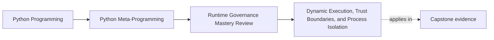

# Dynamic Execution, Trust Boundaries, and Process Isolation


<!-- page-maps:start -->
## Page Maps




<!-- page-maps:end -->

Module 10 begins with the mechanism that most often tempts developers into making claims
the runtime cannot honestly support.

That mechanism is dynamic execution.

This page fails if a reader leaves thinking the right trick is to narrow globals more
carefully. The teaching target is stricter: decide when in-process execution is acceptable,
when it is not, and what honest replacement owns the problem instead.

## The sentence to keep

`compile`, `eval`, and `exec` are only defensible when the input is trusted and the review
story stays honest about process boundaries, observability, and fallback designs.

Everything else on this page hangs from that sentence.

If the sentence gets softened into "safe enough with careful restrictions," the review
boundary has already been lost.

For self-study, turn that sentence into a direct refusal test:

- who actually controls the source text?
- what boundary exists outside the current process?
- what smaller owner would still solve the problem if programmability were narrowed?

## Evidence route for dynamic execution reviews

Use this route before approving `compile`, `eval`, or `exec`:

| Review step | What to inspect | What strong evidence looks like |
| --- | --- | --- |
| Name the input owner | Who writes or controls the source text? | Trusted internal authorship, or an explicit hostile-input designation |
| Name the real boundary | What protection exists outside the current interpreter? | Process isolation, operating-system controls, or an explicit admission that none exists |
| Reject lower-power alternatives | What data-driven or explicit-dispatch model was considered first? | A concrete simpler owner was compared and either accepted or rejected for named reasons |
| Inspect runtime scope | Is this expression-only, statement execution, or code generation on a hot path? | Timing, returned values, and state mutation scope are explicit |
| Reject overclaim | What is intentionally not promised? | The design does not imply in-process sandboxing or semantic validation it cannot prove |

## The only honest security line

If the input is untrusted, do not run it with `eval` or `exec` inside the current Python
process.

Not with restricted globals.
Not with a tiny builtins dictionary.
Not with a partial AST filter that claims to be a sandbox.

If the trust boundary is real, the protection boundary must be real too. That means
separate-process isolation, not wishful thinking about a namespace mapping.

Keep one refusal sentence ready:

if the source is untrusted and still runs in the current process, the design is already on
the wrong side of the boundary.

## What the runtime primitives actually do

The core pieces are mechanical:

- `compile(source_or_ast, filename, mode)` produces a code object
- `eval(code, globals, locals)` evaluates an expression and returns a value
- `exec(code, globals, locals)` executes statements and returns `None`

Those are powerful but limited facts. They do not imply safety.

## What each primitive really buys you

| Primitive | Honest use | Immediate review concern |
| --- | --- | --- |
| `compile(..., "eval")` | Turn a trusted expression or AST into a code object once | Whether the expression should have been data instead |
| `eval(...)` | Compute a value from trusted source inside a named context | Whether the names imply false safety claims |
| `compile(..., "exec")` / `exec(...)` | Execute trusted statements with wider state effects | Why explicit code or configuration did not remain the clearer owner |

## `globals` and `locals` are execution context, not a sandbox

Reviewers often see a narrowed `globals` mapping and assume the risk has been handled.

That assumption is wrong.

The mappings control names. They do not create a process boundary, a syscall boundary, or
an honest promise against hostile input.

One detail matters enough to remember precisely:

- if `globals` does not define `__builtins__`, Python may insert it for you

That means controlled execution should always set `__builtins__` explicitly even for
trusted internal inputs.

That is an execution-hygiene rule, not a security approval.

## A narrow, honest internal use

This is the sort of case the runtime can support honestly: a trusted internal expression
language evaluated against a controlled name set.

```python
co = compile("x * 2 + 1", "<trusted-expression>", "eval")

globals_ = {"__builtins__": {}, "x": 10}
result = eval(co, globals_, {})

print(result)  # 21
```

This example is not "safe for attackers." It is simply narrow and explicit for trusted
configuration that the team owns.

## Honest claims versus overclaims

| Honest claim | Overclaim to reject |
| --- | --- |
| "This evaluates a trusted internal expression against a small explicit name set." | "This safely executes user formulas in process." |
| "This removes accidental access to builtins for a trusted DSL." | "This sandboxes hostile code." |
| "This syntax filter narrows what trusted authors may write." | "This AST filter makes code execution secure." |

## Trust-boundary worksheet

Fill this out before you approve any runtime-generated code path:

| Question | Strong answer shape |
| --- | --- |
| who authored the source? | trusted internal team, partially trusted admins, or hostile users |
| what does the current process still share? | memory, globals, files, network, or all of them |
| what lower-power owner was checked first? | explicit dispatch, data format, tiny parser, or out-of-process worker |
| what claim is explicitly refused? | no in-process sandboxing or hostile-input safety promise |

## Compiling statements is a different kind of power

`exec` changes state rather than returning a single expression value.

That wider surface means the review cost is higher immediately:

```python
co = compile("x = 42\ny = x * 2", "<trusted-statements>", "exec")

globals_ = {"__builtins__": {}}
locals_ = {}

exec(co, globals_, locals_)

print(locals_["y"])  # 84
```

Once statements enter the design, reviewers should ask why ordinary Python code or a
declarative config format did not stay the clearer owner.

That question should be answered before the design is admired for flexibility.

## AST filtering is about narrowing syntax, not creating safety

Parsing expressions into an AST and rejecting forbidden nodes can be useful for a tiny
internal DSL. It does not convert untrusted code execution into a secure design.

```python
import ast

ALLOWED = (
    ast.Expression,
    ast.BinOp,
    ast.UnaryOp,
    ast.Add,
    ast.Sub,
    ast.Mult,
    ast.Div,
    ast.Pow,
    ast.USub,
    ast.UAdd,
    ast.Constant,
    ast.Name,
    ast.Load,
)


def evaluate_expression(expr: str, names: dict[str, object]) -> object:
    tree = ast.parse(expr, mode="eval")
    for node in ast.walk(tree):
        if not isinstance(node, ALLOWED):
            raise ValueError(f"forbidden syntax: {type(node).__name__}")
    return eval(compile(tree, "<expression-dsl>", "eval"), {"__builtins__": {}, **names}, {})
```

That pattern can prevent accidental complexity. It does not justify the sentence "we
safely execute user code in-process."

## Failure modes to name explicitly

Watch for these common failures:

| Failure mode | What goes wrong |
| --- | --- |
| Restricted globals treated as a hostile-input defense | The review story promises protection the process cannot enforce |
| AST filtering sold as sandboxing | Syntax narrowing is confused with execution isolation |
| `exec` used for configuration convenience | Ordinary code and data become harder to inspect and test |
| Dynamic compilation repeated on hot paths | The mechanism becomes both risky and needlessly expensive |
| Security language left vague | Reviewers cannot tell where trust actually stops |

## Weak answers to reject early

| Weak answer | Why it fails |
| --- | --- |
| "the globals are locked down, so it should be fine" | name control is not a process boundary |
| "the AST filter removes dangerous constructs" | removing syntax does not create hostile-input safety in process |
| "the code is internal for now" | for now is not a trust classification |
| "we can sandbox it better later" | later is not a present review boundary |

## Strong alternatives are usually less magical

Before approving dynamic execution, compare it against lower-power options:

- data plus normal code, such as JSON or TOML driving explicit dispatch
- callables selected from a trusted registry
- a small parser or interpreter for the exact operations you support
- out-of-process execution when the input boundary is genuinely hostile

The right alternative is often less impressive and more maintainable. That is a benefit,
not a loss.

## Alternative-owner table

| Pressure | Lower-power owner to try first |
| --- | --- |
| simple formulas over trusted fields | explicit expression parser or tiny DSL |
| dynamic behavior chosen from known operations | registry plus explicit dispatch |
| user configuration with finite options | data format plus normal program logic |
| genuinely hostile programmable input | separate-process execution with real controls |

## What process isolation changes

Separate-process execution does not make arbitrary code morally harmless. It does change
the ownership story:

- the current process no longer shares memory and globals with the code being evaluated
- operating-system controls can restrict filesystem, network, and process access
- timeouts, cleanup, and logging become explicit operational concerns

That is the first honest place where "sandboxing" language can start to mean something.

Even there, the review still owes timeouts, cleanup, logging, and failure collection. Real
boundaries reduce risk; they do not remove operational work.

Before you leave this page, write one sentence beginning:

- "the strongest thing this design can honestly promise is..."
- "the first lower-power replacement to compare is..."

## Review rules for dynamic execution

When `compile`, `eval`, or `exec` appear in code review, ask these questions first:

- where does the input come from, and who controls it?
- why can this not be represented as data plus explicit program logic?
- is `__builtins__` set explicitly?
- is compilation happening once or inside a hot path?
- what evidence shows forbidden syntax and failure cases are tested?
- if the input is not fully trusted, where is the separate-process boundary?

Add one more final question:

- what exact sentence describes the strongest thing this mechanism can honestly promise, without using the word "safe" loosely?

If those answers feel vague, the design is not ready.

## What this page makes clear

The point is not "never use dynamic execution under any circumstance."

The boundary is:

- dynamic execution is a review and operations problem before it is a Python trick
- namespace control is weaker than many designs pretend
- real trust boundaries require real isolation boundaries

That judgment matters more than memorizing the function signatures.

## What to practice from this page

Try these before moving on:

1. Rewrite one `eval`-style idea as explicit data plus normal code.
2. Build one tiny trusted-expression evaluator and name exactly what it does not promise.
3. Write one sentence explaining why restricted globals are not a sandbox.

## Exit check for this page

Before moving on, make sure you can do all of the following:

- reject one in-process hostile-input design in a single sentence
- distinguish execution hygiene from security boundary claims
- name one lower-power alternative for expression-style configuration
- explain why process isolation changes the review story and restricted globals do not

If those feel ordinary, the next step is interface governance: which runtime contracts can
be named honestly with ABCs, protocols, and `__subclasshook__`.

## Continue through Module 10

- Previous: [Overview](index.md)
- Next: [Interface Contracts with ABCs, Protocols, and `__subclasshook__`](interface-contracts-with-abcs-protocols-and-subclasshook.md)
- Practice: [Exercises](exercises.md)
- Terms: [Glossary](glossary.md)
