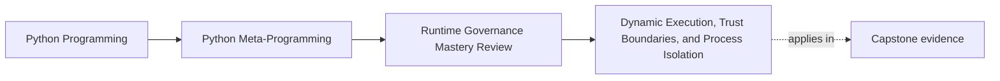
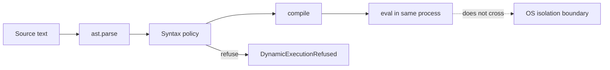
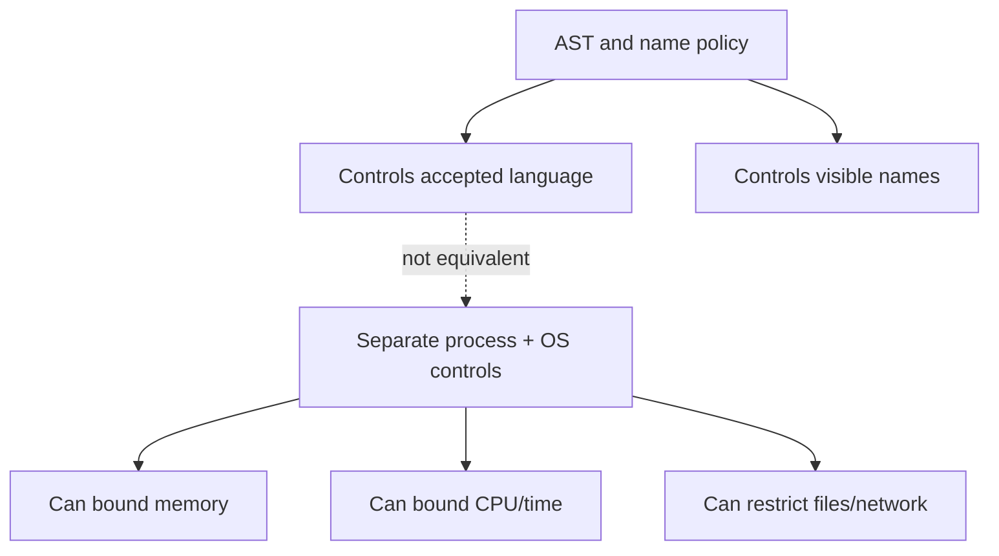

# Dynamic Execution, Trust Boundaries, and Process Isolation

<!-- page-maps:start -->
## Page Maps




<!-- page-maps:end -->

The first governance problem is not how to call `eval`. It is how to stop a narrow
execution feature from acquiring a false security story.

This core uses a real evaluator because the boundary is easier to understand when you can
run it, make a prediction, and inspect the refusal. Its accepted case is intentionally
small: trusted, internal, bounded arithmetic. The evaluator is not a sandbox.

## Begin with the pressure, not the primitive

Assume an internal report template needs arithmetic such as `6 * 7 + 1`. There are at
least four designs:

| Design | Expressive power | Likely owner |
| --- | --- | --- |
| predefined operation names | lowest | explicit dispatch table |
| arithmetic parser/interpreter | low | purpose-built expression module |
| validated Python expression | higher | tightly owned internal runtime |
| arbitrary Python source | highest | isolated execution service, if truly required |

The Module 10 lab demonstrates the third design so you can review its limits. It does not
argue that the third design is automatically preferable to the first two.

## Trace the executable implementation

Open `labs/runtime_governance/dynamic.py`. The public operation is:

```python
def evaluate_arithmetic(source: str) -> int | float:
    """Evaluate one bounded internal expression; this is not a sandbox."""

    if len(source) > 120:
        raise DynamicExecutionRefused("arithmetic source exceeds 120 characters")
    try:
        tree = ast.parse(source, mode="eval")
    except SyntaxError as error:
        raise DynamicExecutionRefused("arithmetic source is invalid") from error
    _validate_arithmetic(tree)
    code = compile(tree, "<arithmetic-policy>", "eval")
    result = eval(code, {"__builtins__": {}}, {})
    if isinstance(result, bool) or not isinstance(result, (int, float)):
        raise DynamicExecutionRefused("arithmetic result must be int or float")
    return result
```

There are four distinct moments:

1. the string is length-checked;
2. `ast.parse(..., mode="eval")` builds an expression tree without executing it;
3. `_validate_arithmetic` rejects nodes outside the language;
4. `compile` creates a code object and `eval` executes it in the current process.

Do not collapse parsing and execution into one mental event. A refusal during validation
means the source did not reach `eval`.

## The syntax policy is a language definition

The allowlist accepts numeric constants and a small set of unary and binary operators. It
does not accept names, calls, attribute access, containers, comprehensions, comparisons,
or booleans.

```python
_ALLOWED_NODES = (
    ast.Expression,
    ast.BinOp,
    ast.UnaryOp,
    ast.Constant,
    ast.Add,
    ast.Sub,
    ast.Mult,
    ast.Div,
    ast.FloorDiv,
    ast.Mod,
    ast.USub,
    ast.UAdd,
)
```

Notice what is absent:

- `ast.Name`, so there is no variable lookup;
- `ast.Call`, so functions cannot be called;
- `ast.Attribute`, so object traversal is refused;
- `ast.Pow`, so exponentiation is outside the published language.

Validation also rejects `bool`, even though `bool` is a subclass of `int`. That explicit
check protects the domain contract: arithmetic constants mean numbers, not truth values
that happen to participate in arithmetic.

## Run the accepted and refused routes

From the course root:

```console
python - <<'PY'
from labs.runtime_governance.dynamic import evaluate_arithmetic

print(evaluate_arithmetic("6 * 7 + 1"))
print(evaluate_arithmetic("__import__('os').getcwd()"))
PY
```

Expected behavior:

```text
43
Traceback (most recent call last):
  ...
labs.runtime_governance.dynamic.DynamicExecutionRefused:
syntax is outside the arithmetic policy: Call
```

The exact traceback location may differ, but the failure type and refusal reason are part
of the contract. The call is refused during AST validation; `__import__` is not executed.

For stable JSON instead, run:

```console
make runtime-governance-lab
```

Inspect `dynamic_execution.accepted`, `dynamic_execution.refused`, and
`dynamic_execution.trust_boundary`.

## What the controls prove

| Control | Supported claim |
| --- | --- |
| source-length limit | this route refuses inputs longer than its published bound |
| AST allowlist | only the named syntax enters compilation |
| numeric-constant checks | string, collection, boolean, and oversized literal constants are refused |
| explicit filename | tracebacks can identify the generated code owner |
| empty `__builtins__` | accidental builtin name lookup is unavailable |
| result-type check | the public result remains `int | float` |

These are meaningful controls. None of them creates an operating-system boundary.

## What the controls do not prove

The code object still runs inside the application interpreter. It shares:

- the process's CPU and memory;
- the interpreter and its failure domain;
- the process lifetime;
- any capabilities reachable through an allowed object if the language later grows.

An empty builtin mapping controls name resolution. An AST allowlist controls accepted
syntax. Neither controls operating-system resources. Calling either one a sandbox changes
a precise implementation fact into a false security claim.



## When a process boundary becomes the owner

If source is adversarial, tenant-authored, or otherwise outside the application's trust
domain, refuse in-process execution. A serious isolated design must answer questions this
lab deliberately does not:

- Which operating-system identity runs the worker?
- What filesystem and network access exists?
- What CPU, memory, and wall-clock limits are enforced?
- How is the process terminated?
- What input and result formats cross the boundary?
- What audit record survives a worker crash?
- How are workers replaced after executing unknown code?

"Use a subprocess" is not itself a complete isolation design. It is the point where a
different owner and a different proof suite become necessary.

## Failure routes are teaching evidence

Read `tests/test_runtime_governance_dynamic.py`. Its cases distinguish different
contracts:

- accepted arithmetic returns the expected number;
- calls, names, booleans, and non-numeric constants are refused;
- long source and large literals are refused;
- the evidence packet labels both empty builtins and AST validation as non-sandboxes.

These tests prove the published narrow language and honest report. They do not prove
resistance to every adversarial resource pattern, because that is not this component's
claim.

## Compare alternatives before approval

Use this review table:

| Pressure | First owner to try | Escalate only when... |
| --- | --- | --- |
| choose one known calculation | explicit function registry | operations cannot be enumerated honestly |
| combine arithmetic values | small parser or internal expression model | Python expression semantics are a real requirement |
| store ordinary configuration | JSON, TOML, or typed Python data | configuration must genuinely be programmable |
| execute adversarial programs | isolated service | a declarative or bounded language cannot meet the requirement |

The lower-power comparison must be concrete. "A DSL would be too much work" is not enough;
state which required expression the lower-power model cannot represent.

## Capstone transfer: a deliberate rejection

The incident-plugin runtime parses configuration values as data and validates them through
field descriptors. It does not use `eval` or `exec` for configuration.

Run:

```console
make capstone-governance
```

The first rejected power is `eval or exec for plugin configuration`; the selected
alternative is explicit scalar parsing and field validation. This is not a missing
feature. Configuration has no code-execution requirement, so a lower-power owner is the
correct design.

## Review checkpoint

Before continuing, write a four-sentence decision:

1. who controls the expression text;
2. what syntax the lab accepts;
3. what boundary the lab does not provide;
4. which owner should handle adversarial input.

Then run:

```console
python -m unittest discover -s tests -p "test_runtime_governance_dynamic.py" -v
```

You are ready for the next core when your explanation distinguishes syntax validation,
execution context, and process isolation without using the word "safe" by itself.
