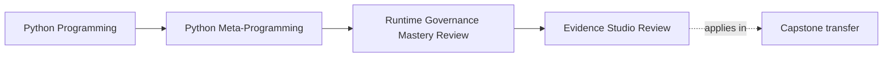
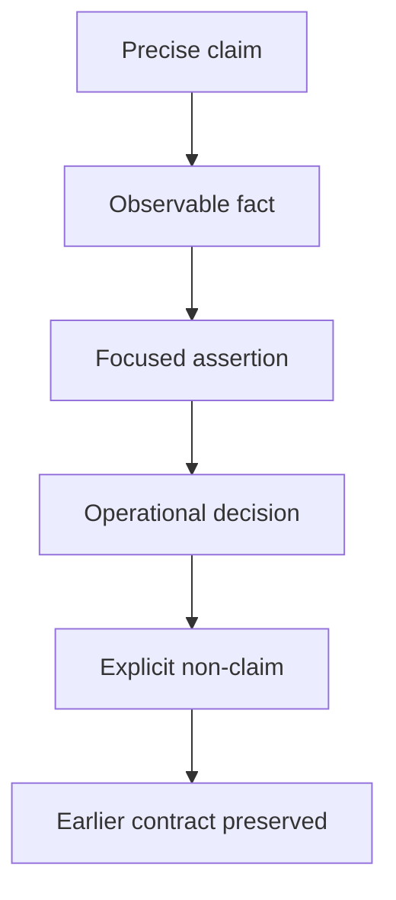

# Exercise Answers: Runtime Governance Evidence Studio Review

<!-- page-maps:start -->
## Page Maps




<!-- page-maps:end -->

Use these answers to review your reasoning, not merely your final outcome. A different
implementation can be strong when it preserves the same boundary and produces equally
specific evidence.

For each brief, this key shows:

- the governing reasoning;
- one defensible implementation or review route;
- a common wrong turn;
- what the result proves;
- what it does not prove;
- the capstone consequence.

## Review 1: Syntax refusal is not arithmetic failure

### Reasoning

The syntax policy owns which expressions may reach evaluation. Division is allowed
syntax. `1 / 0` therefore passes validation and fails when the arithmetic executes.

`DynamicExecutionRefused` should represent invalid source or policy refusal. Converting
every runtime exception into that type would erase the distinction the exercise asks you
to preserve.

### Defensible focused test

```python
import unittest

from labs.runtime_governance.dynamic import (
    DynamicExecutionRefused,
    evaluate_arithmetic,
)


class ArithmeticFailureBoundaryTests(unittest.TestCase):
    def test_policy_and_arithmetic_failures_remain_distinct(self) -> None:
        self.assertEqual(evaluate_arithmetic("6 * 7 + 1"), 43)

        with self.assertRaises(DynamicExecutionRefused):
            evaluate_arithmetic("__import__('os').getcwd()")

        with self.assertRaises(ZeroDivisionError):
            evaluate_arithmetic("1 / 0")
```

The prediction should have been written before running: accepted result, policy refusal,
then arithmetic failure.

### Common wrong turn

```python
try:
    return eval(...)
except Exception as error:
    raise DynamicExecutionRefused("unsafe expression") from error
```

This makes operational arithmetic errors look like policy decisions and adds the vague
word "unsafe" without an isolation boundary.

### What it proves

- calls are rejected before execution;
- division belongs to the accepted language;
- a zero denominator can fail during execution;
- the public error categories remain distinguishable.

### What it does not prove

- adversarial resource isolation;
- a total arithmetic function for every accepted expression;
- that AST validation or empty builtins is a sandbox.

### Capstone consequence

The capstone avoids this entire execution category for configuration. Its governance
report rejects `eval` and `exec` and selects scalar parsing plus descriptor validation.

## Review 2: Presence is weaker than call compatibility

### Reasoning

The runtime protocol check asks whether a `deliver` attribute exists. Explicit binding
asks whether arguments fit a callable's signature. Static checking can compare the
candidate against the structural protocol before runtime. These are three different
decisions.

### Defensible evidence

```python
import inspect

from labs.runtime_governance.interfaces import DeliveryProtocol


class WrongSignature:
    def deliver(self) -> str:
        return "delivered"


candidate = WrongSignature()

assert isinstance(candidate, DeliveryProtocol)

signature = inspect.signature(candidate.deliver)
try:
    signature.bind("incident")
except TypeError as error:
    binding_failure = str(error)
else:
    raise AssertionError("wrong-signature candidate unexpectedly accepted a message")

assert "too many positional arguments" in binding_failure
```

The method is never called. `inspect.signature` observes the bound callable's empty
parameter list, and `bind` proves that the proposed message argument cannot fit.

### Common wrong turn

Checking `callable(candidate.deliver)` adds only another shallow fact. It still does not
prove that the callable accepts a message or returns a string.

### What it proves

- runtime protocol presence can accept a wrong signature;
- explicit binding can reject a particular proposed call without invocation;
- runtime presence and runtime call validation need different claims.

### What it does not prove

- that every compatible signature satisfies `DeliveryProtocol` statically;
- that a bound call would deliver anything correctly;
- return-value or side-effect behavior.

### Capstone consequence

The capstone's `bind-action` route uses its stored `inspect.Signature` for this exact
runtime question. The governance report rejects a runtime-checkable protocol as signature
enforcement and assigns static compatibility to the type checker.

## Review 3: Nested restoration is a stack, not isolation

### Reasoning

Each context captures the state present at its own entry. The inner context therefore
captures the outer replacement as its original. Its `finally` restores the outer layer;
the outer `finally` later restores the real descriptor.

### Defensible focused test

```python
import inspect
import unittest

from labs.runtime_governance.patching import scoped_attribute_patch


class NestedPatchTests(unittest.TestCase):
    def test_inner_failure_restores_each_owned_layer(self) -> None:
        class Renderer:
            @staticmethod
            def render(message: str) -> str:
                return f"original:{message}"

        def outer(message: str) -> str:
            return f"outer:{message}"

        def inner(message: str) -> str:
            return f"inner:{message}"

        original = inspect.getattr_static(Renderer, "render")

        with scoped_attribute_patch(Renderer, "render", outer):
            self.assertEqual(Renderer.render("incident"), "outer:incident")
            outer_identity = inspect.getattr_static(Renderer, "render")

            with self.assertRaises(RuntimeError):
                with scoped_attribute_patch(Renderer, "render", inner):
                    self.assertEqual(Renderer.render("incident"), "inner:incident")
                    raise RuntimeError("force inner rollback")

            self.assertIs(
                inspect.getattr_static(Renderer, "render"),
                outer_identity,
            )
            self.assertEqual(Renderer.render("incident"), "outer:incident")

        self.assertIs(inspect.getattr_static(Renderer, "render"), original)
        self.assertEqual(Renderer.render("incident"), "original:incident")
```

### Decision

`Constrain`: nested use is mechanically reversible in one ordinary control flow, but
every layer mutates a shared owner visible to other code while active.

### Common wrong turn

Passing this test and changing `concurrency_safe` to `True`. Nesting demonstrates
last-in/first-out restoration, not mutual exclusion or task-local state.

### What it proves

- the inner exception restores the outer replacement;
- the outer exit restores the exact original static descriptor;
- restoration follows nested context ownership.

### What it does not prove

- safe observation by other threads or async tasks;
- cleanup after process termination;
- rollback of mutations performed by a replacement;
- restoration of aliases cached elsewhere.

### Capstone consequence

The application does not adopt monkey patching as an extension mechanism. It selects
explicit owners and rejects application patching; a focused test helper remains a
constrained technique, not a runtime architecture.

## Review 4: Hook cleanup owns finder and cache state

### Reasoning

An import is resolved through `sys.meta_path` only when its name is absent from
`sys.modules`. Complete rollback must therefore restore both integration surfaces.

### Defensible evidence

```python
import importlib
import sys

from labs.runtime_governance.tooling import installed_virtual_module


name = "_bijux_studio_virtual"

assert name not in sys.modules

with installed_virtual_module(name, {"status": "studio"}) as finder:
    assert finder in sys.meta_path
    assert name not in sys.modules
    assert finder.find_spec("_bijux_studio_unrelated") is None

    module = importlib.import_module(name)

    assert module.status == "studio"
    assert name in sys.modules
    assert finder.events == [
        f"find:{name}",
        f"create:{name}",
        f"exec:{name}",
    ]

assert finder not in sys.meta_path
assert name not in sys.modules

try:
    importlib.import_module(name)
except ModuleNotFoundError:
    pass
else:
    raise AssertionError("virtual module remained available after cleanup")
```

The resulting table is:

| Moment | Finder | Cache | Evidence |
| --- | --- | --- | --- |
| before | absent | absent | unique name has no owner |
| installed before import | present | absent | exact name can be claimed |
| installed after import | present | present | ordered `find`, `create`, `exec` |
| after | absent | absent | import raises `ModuleNotFoundError` |

### Common wrong turn

Asserting only that the finder disappeared from `sys.meta_path`. The cached module could
still make the feature appear active while bypassing every finder.

### What it proves

- exact-name integration;
- ignored unrelated name;
- expected import lifecycle;
- removal of this finder and the module it owns;
- restored no-hook behavior.

### What it does not prove

- safe composition with arbitrary finders;
- predictable behavior under concurrent imports;
- application-grade plugin discovery;
- cleanup after a process crash.

### Capstone consequence

The capstone uses ordinary imports and rejects application hooks and AST rewriting.
Plugin discovery remains a separate explicit boundary rather than becoming metaclass or
import machinery.

## Review 5: Reload reconciliation has the wrong owner

### Reasoning

Reload is not just another class-creation event. Old class objects and instances can remain
alive while a module creates new class objects. Registry replacement, duplicate policy,
in-flight references, and migration semantics are process-lifecycle concerns.

### Defensible decision

```text
Pressure:
Developers and long-running processes need an explicit way to replace loaded plugin
definitions after source or deployment configuration changes.

Proposed mechanism:
PluginMeta automatically reconciles registry entries during module reload.

Decision:
reject

Selected owner:
explicit development reloader or process lifecycle that clears state, reloads/imports
known modules, validates the resulting manifest, and replaces the process when identity
cannot remain coherent

Lower-power comparison:
restart/rebuild is predictable and preserves one class generation per process; an
explicit tooling reloader can be constrained to development when restart cost matters

Blast radius:
registry identity, old class objects, existing instances, cached constructors, duplicate
handling, action history, and callers holding direct class references

Observability:
before/after registry manifests, class identities, source module, reload generation, and
explicit replacement decisions

Rollback:
discard the attempted generation and replace the development process; do not pretend that
putting the old class back in the registry rewinds existing objects

Proof:
tests for duplicate names, old/new class identity, existing instances, failed reload,
manifest differences, registry reset, and process-replacement fallback

Escalation signal:
measured restart cost prevents the development or deployment workflow from meeting its
requirements, and an explicit reloader protocol has published identity semantics

Non-claim:
metaclass registration alone cannot reconcile arbitrary live object graphs
```

### Common wrong turn

Approving the proposal because `PluginMeta` already owns registration. Registration of a
new completed class does not imply ownership of old objects, module caches, deployment
lifecycle, or migration.

### What it proves

This decision record does not prove code behavior by itself. It demonstrates that the
proposal fails the ownership gate and supplies the proof required if a different owner is
built.

### What it does not prove

- that restart is acceptable for every deployment;
- that reload is impossible;
- that a future explicit reloader could never earn constrained approval.

### Capstone consequence

The class-creation report already rejects reload reconciliation and keeps
`PluginMeta.clear_registry` explicit. That reset is test and process-state control, not
live-instance migration.

## Review 6: Capstone packet connects policy to proof

### Reasoning

The packet should make a review repeatable. Start with governance, select one mechanism
report, inspect registry state, then invoke deliberately. Every conclusion must point to
source and proof.

### Defensible route

```console
make capstone-governance
make capstone-class-creation
make inspect
make capstone-trace
```

The inspection bundle should include:

```text
governance.json
class-creation.json
registry.json
bundle-manifest.json
route.txt
```

A concise claim-to-proof table could be:

| Decision | Exact evidence | Source | Proof | Non-claim |
| --- | --- | --- | --- | --- |
| approve `PluginMeta` | hook trace ends `init:register`; constructed/executed false | `framework.py` | namespace and class-creation tests | no package discovery or reload reconciliation |
| constrain registry | delivery plugins are sorted; rollback names `PluginMeta.clear_registry` | `framework.py` | ordering, duplicate, and reset tests | no cross-process consistency |
| reject application import hooks | governance alternative says ordinary imports and external tooling | `governance.py` | governance and CLI tests | does not prohibit bounded tooling experiments |

After those facts are recorded, the trace supplies deliberate execution evidence:
configuration, result, and one action-history entry.

### Common wrong turn

Running only `make capstone-trace` and concluding that the metaclass, descriptors, and
registry are well governed because one plugin action succeeded.

### What it proves

- the governance route is observational;
- class-creation facts are inspectable without an instance;
- the registry has a published reset owner;
- the bundle saves the governance report in its manifest;
- deliberate execution remains separate from inspection.

### What it does not prove

- production throughput or availability;
- hostile plugin isolation;
- distributed discovery;
- universal correctness of future plugins;
- governance quality beyond the claims actually inspected.

## Final self-review

Across all six briefs, your evidence should follow this shape:



If any answer ends at "the test passed," it is incomplete. Name the assertion, the claim
it supports, and the boundary it leaves unproved.
