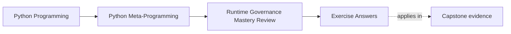

# Exercise Answers

<!-- page-maps:start -->
## Page Maps

<!-- page-maps:end -->

Use this page after attempting the exercises yourself. The point is not to match one
phrase perfectly. The point is to compare your reasoning against answers that keep trust
boundaries, interface claims, operational control, and escalation policy honest.

Treat these answers as reasoning checkpoints, not as one-line solutions. The strongest
answers always show where the claim stops, what lower-power owner was considered first, and
what observation or reset surface keeps the design governable.

## How to review your own answers against this page

For each exercise, check whether your answer includes:

| Checkpoint | What a strong answer shows |
| --- | --- |
| Named boundary | Trust, interface, or operational boundary is stated explicitly |
| Named lower-power comparison | A smaller owner was considered before escalation |
| Named review surface | Observation, reset, disable, or audit surface is visible |
| Named overclaim | One sentence that would mislead reviewers is rejected |
| Named operational cost | Blast radius, overhead, or process-wide effect is not hidden |

## Answer 1: Reject one unsafe dynamic execution idea

Example answer:

- input comes from end users through a configurable formula field
- that input is untrusted, so in-process `eval` is rejected immediately
- the replacement is either a tiny explicit expression language or a separate-process execution model

Good conclusion:

Restricted globals do not solve the real problem. The trust boundary requires a stronger
design boundary than a namespace dictionary.

Reasoning checkpoint:

- if your answer does not name the false safety claim directly, the rejection is still too soft

## Answer 2: Compare one ABC and one protocol honestly

Example answer:

- use an ABC when incomplete implementations should fail at instantiation time
- use a protocol when structural compatibility matters most to static analysis
- only use `@runtime_checkable` when a shallow runtime filter is actually helpful

Good conclusion:

Neither surface proves full behavior. The review story should say exactly whether the
contract is nominal, structural, static, or shallow runtime-only.

Reasoning checkpoint:

- your answer should still name one behavioral guarantee that lives outside the interface declaration

## Answer 3: Add a reversal path to one dynamic mechanism

Example answer:

- a registry gains `clear()` or `clear(group)` support
- a patch becomes a context-managed patch that restores the original symbol on exit
- the cleanup prevents test bleed and incident-time confusion about current global state

Good conclusion:

Reversibility is part of the mechanism's design, not an optional improvement for later.

Reasoning checkpoint:

- the best answers also say why the patch or registry blast radius is now acceptable

## Answer 4: Review one import hook or AST transform proposal

Example answer:

- the proposal is rejected for application plugin discovery because explicit imports or entry points are clearer
- if the proposal is kept at all, it must be framed as tooling-grade instrumentation
- cleanup, ordering, reload, and location preservation become first-class review questions

Good conclusion:

The strongest import-hook approvals solve global instrumentation problems, not local
application architecture convenience.

Reasoning checkpoint:

- a strong answer also explains what "no-hook mode" means and why the system should remain understandable there

## Answer 5: Defend or reject one escalation

Example answer:

- a metaclass is approved only because the invariant belongs to class creation for every concrete subclass
- a decorator or helper is preferred if opt-in registration is enough
- the approval note must mention observability, reset hooks, and performance evidence where relevant

Good conclusion:

Escalation is justified by ownership and timing, not by the desire to reduce visible
boilerplate.

Reasoning checkpoint:

- if your answer cannot be restated as a real approval or rejection note, the decision is still too vague

## Answer 6: Review the capstone runtime as Module 10 evidence

Example answer:

- observational surfaces such as `manifest`, `registry`, and `signatures` earn trust before invocation
- the metaclass is justified because deterministic registration belongs to class definition time
- an import-hook-based discovery layer would be rejected as making the runtime less explicit and harder to review

Good conclusion:

The capstone is defensible because it keeps runtime facts inspectable and rejects extra
power it does not need.

Reasoning checkpoint:

- your answer should also explain why observational commands deserve to come before invocation surfaces

## Answer 7: Design one audit trail for a dynamic mechanism

Example answer:

Suppose a plugin registry runtime adds:

- a manifest snapshot listing registered plugins
- registration timestamps or sequence numbers
- a test-visible counter for load or reset events

Good conclusion:

An audit trail answers questions such as "what was active at failure time?" and "did a
test or import path leave hidden global state behind?" Reviewable runtime systems make
those questions cheap to answer.

Reasoning checkpoint:

- the audit surface should stay separate from business behavior instead of silently triggering it

## Answer 8: Write one explicit rejection rule

Example answer:

Mechanism class:

- import hooks or AST transforms in ordinary application startup

Rejection rule:

- reject unless the problem is truly tooling-grade or infrastructure-grade, and unless reset, ordering, and location-preservation evidence is part of the design review

Good conclusion:

The rejection is triggered by missing ownership and missing operational proof, not by a
general dislike of powerful mechanisms.

Reasoning checkpoint:

- strong answers also name the smaller design that should replace the rejected one

## Answer 9: Compare honest runtime claims with overstated claims

Example answer:

Honest description:

- "This registry makes plugin membership inspectable and resettable during tests."

Overstated description:

- "This runtime manages plugins safely and automatically."

Good conclusion:

The second version is misleading because words such as "safely" and "automatically"
suggest broader lifecycle, trust, and recovery guarantees than the mechanism actually
proves.

Reasoning checkpoint:

- the honest version should be specific enough that another engineer could review scope without guessing

## Answer 10: Produce a runtime-governance packet

The packet is strong when another learner can answer:

- which mechanism is under review
- which trust boundary constrains it
- which audit, reset, or disable surfaces keep it governable
- which explicit rule would cause the design to be rejected

Repair move if your packet is weak:

- rewrite each item so it begins with the boundary, lower-power comparison, or review surface instead of with the mechanism name

## What strong Module 10 answers have in common

Across the whole set, strong answers share the same habits:

- they stop security claims at the real enforceable boundary
- they keep interface promises smaller than the mechanism's aura
- they demand reset, disable, and cleanup paths for dynamic behavior
- they distinguish application design from tooling-grade runtime control
- they justify power with ownership, timing, and proof surfaces
- they make audit and rejection rules explicit
- they leave behind a packet another learner can review without guessing

If an answer still sounds impressed by the mechanism itself, revise it until the judgment
sounds operational instead.

## Exit check for the answer key

Before leaving this page, make sure your answers now do all of the following:

- stop every claim at the real enforceable boundary
- reject at least one overclaim explicitly
- name at least one observation or reset surface where relevant
- leave another reviewer enough evidence to disagree with your judgment for concrete reasons

## Continue through Module 10

- Previous: [Exercises](exercises.md)
- Next: [Glossary](glossary.md)
- Return: [Overview](index.md)
