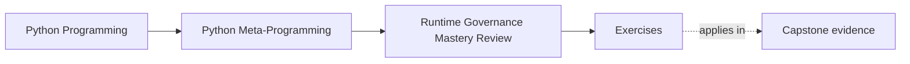

# Exercises

<!-- page-maps:start -->
## Page Maps

<!-- page-maps:end -->

Use these after reading the five core lessons and the worked example. The goal is not to
collect more advanced mechanisms. The goal is to make trust boundaries, interface claims,
observability rules, hook boundaries, and escalation decisions explicit.

Each exercise asks for three things:

- the runtime pressure or design you are reviewing
- the governance decision you made
- the evidence or reasoning that makes that decision defensible

For every exercise from 2 onward, add one more line:

- the strongest lower-power owner or refusal rule you checked first before approving any escalation

Treat the ten exercises as one full lab day on runtime governance and review.

Do them in order:

- Exercises 1-3 establish trust boundaries, interface honesty, and reversibility
- Exercises 4-6 separate tooling-grade escalation from application defaults and review the capstone runtime
- Exercises 7-8 extend that discipline into audit trails and rejection criteria
- Exercises 9-10 package the whole course into a reviewable runtime-governance packet

Keep one runtime-governance table while you work:

| Runtime pressure or mechanism | Trust boundary | Lowest honest owner | Reset or observation surface | Governance judgment |
| --- | --- | --- | --- | --- |

## Evidence discipline for the whole exercise set

Do not hand in answers that stop at "this seems unsafe" or "this seems elegant."

Across the set, your answers should name:

- where the real boundary sits
- what lower-power owner was considered first
- what observation, reset, or disable surface keeps the design reviewable
- what sentence would overstate the mechanism if left unchecked

## Exercise 1: Reject one unsafe dynamic execution idea

Take one proposed `eval`, `exec`, or code-generation design.

What to hand in:

- where the input comes from
- whether the input is trusted, partially trusted, or untrusted
- the lower-power or isolated replacement you chose
- one sentence naming the exact false safety claim you are rejecting

## Exercise 2: Compare one ABC and one protocol honestly

Choose one interface shape that could be expressed either nominally or structurally.

What to hand in:

- which part of the contract is runtime-enforced and which part is static only
- whether `@runtime_checkable` adds useful value here or only false confidence
- one sentence explaining why your chosen surface is the clearest owner
- one sentence naming which behavioral guarantee still requires tests outside the interface surface

## Exercise 3: Add a reversal path to one dynamic mechanism

Take one registry, wrapper, or patching design and make it operationally reversible.

What to hand in:

- the reset hook, disable path, or context manager you added
- one failure mode that cleanup now prevents
- one explanation of how the runtime fact remains observable after the change
- one sentence explaining why the patch or registry blast radius is now acceptable

## Exercise 4: Review one import hook or AST transform proposal

Choose one proposal that changes import behavior or rewrites code.

What to hand in:

- whether the problem is tooling-grade or application-grade
- one lower-power alternative you considered first
- one explanation of the cleanup, ordering, or location-preservation risk
- one sentence explaining what "no-hook mode" should mean for this design

## Exercise 5: Defend or reject one escalation

Take one design that uses a decorator, descriptor, metaclass, import hook, or dynamic
execution path and review it against the runtime power ladder.

What to hand in:

- the lower-power mechanism you compared first
- the ownership reason that made you approve or reject escalation
- one note on observability, reversibility, or performance evidence
- one approval sentence or rejection sentence you would be willing to leave in a real review

## Exercise 6: Review the capstone runtime as Module 10 evidence

Use the worked example and the capstone proof route as a case study.

What to hand in:

- one observational surface that earns trust before invocation
- one mechanism the capstone uses responsibly
- one higher-power change you would reject as making the runtime less reviewable
- one sentence explaining why inspect-first behavior matters in this runtime

## Midday self-check

Before moving into the final four exercises, make sure you can already answer these
questions clearly:

- where the real trust boundary sits for dynamic execution or generated behavior
- why interface language must stay smaller than what ABCs, protocols, or runtime checks can actually prove
- what reset, disable, or observation path keeps a dynamic mechanism operationally honest
- when an escalation belongs to tooling or infrastructure instead of ordinary application design

If you cannot answer those four questions in plain language, return to Exercises 1-6 and
make the trust boundary, reset surface, and rejected lower-power alternative more explicit
before continuing.

Do not continue if your notes still rely on words such as "automatic," "clean," or
"flexible" without naming the runtime cost they hide.

## Exercise 7: Design one audit trail for a dynamic mechanism

Choose one registry, patch, plugin runtime, or dynamic dispatch mechanism and make its
history easier to inspect after the fact.

What to hand in:

- the mechanism
- one audit surface such as logs, counters, manifests, or explicit state snapshots
- one explanation of what incident or debugging question that audit trail would answer
- one sentence explaining how the audit trail stays separate from the business behavior itself

## Exercise 8: Write one explicit rejection rule

Choose one high-power runtime idea and define a concrete review rule for when it should be
rejected.

What to hand in:

- the mechanism class you are reviewing
- the rejection rule
- one explanation of which missing evidence or ownership signal triggers the rejection
- one sentence naming the smaller design that should be used instead when the rule fires

## Exercise 9: Compare honest runtime claims with overstated claims

Choose one governance-sensitive runtime design and write both an honest description and an
overstated description of what it guarantees.

What to hand in:

- the honest description
- the overstated description
- one explanation of which words make the overstated version misleading
- one sentence rewriting the honest version so a teammate could review the scope without guessing

## Exercise 10: Produce a runtime-governance packet

Assemble:

- one runtime-governance table
- one dynamic mechanism with a reset or disable path
- one trust-boundary judgment for dynamic execution, import control, or plugin registration
- one rejection rule explaining when a higher-power design should be refused

The packet is strong when another learner can use it to answer:

- what mechanism is being governed
- what evidence keeps it reviewable
- when the design should be accepted, constrained, or rejected
- what lower-power owner was rejected and why

## Mastery standard for this exercise set

Across all six answers, the module wants the same habits:

- you name trust boundaries honestly
- you keep interface claims smaller than the mechanism's reputation
- you require reset and disable paths for dynamic behavior
- you distinguish tooling-grade escalation from application defaults
- you justify power with ownership and evidence rather than taste

Across all ten answers, add two more habits:

- you make audit and rejection criteria explicit instead of implied
- you leave behind a runtime-governance packet another learner could review without guessing

## Exit check for the exercise set

Before leaving this page, make sure your packet does all of the following:

- rejects at least three escalations explicitly
- names at least one reset, disable, or no-hook surface where relevant
- stops security, interface, and runtime claims at the real enforceable boundary
- leaves another learner enough evidence to agree or disagree with your governance call for concrete reasons

If an answer still sounds like "the runtime can do it, so the design is fine," keep going.

## Continue through Module 10

- Previous: [Worked Example: Reviewing a Plugin Runtime for Observability and Control](worked-example-reviewing-a-plugin-runtime-for-observability-and-control.md)
- Next: [Exercise Answers](exercise-answers.md)
- Return: [Overview](index.md)
- Terms: [Glossary](glossary.md)
