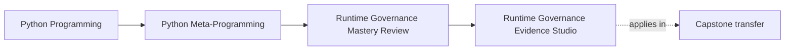

# Exercises: Runtime Governance Evidence Studio

<!-- page-maps:start -->
## Page Maps




<!-- page-maps:end -->

This studio is the assessed learning surface for Module 10. You will not receive credit
for naming a preferred mechanism without runnable evidence and a statement of what that
evidence does not prove.

Complete the briefs in order. Each one preserves an earlier contract and adds a new review
skill. Work from `programs/python-programming/python-meta-programming`.

## Studio setup

Establish the baseline:

```console
make runtime-governance-lab
make runtime-governance-lab-test
make capstone-governance
```

Save your review notes beside your working copy, not inside source code comments. If you
edit the lab or tests, keep the changes small enough that another learner can review the
causal link.

Every submission must contain:

```text
Pressure:
Mechanism or claim under review:
Prediction:
Observed evidence:
Decision:
What the evidence proves:
What the evidence does not prove:
Preserved contract:
```

## Brief 1: Separate syntax refusal from execution failure

### Starting context

`evaluate_arithmetic` refuses syntax outside its AST policy. Accepted arithmetic can still
fail during evaluation—for example, division by zero.

### Objective

Produce a test and a review note that distinguish:

- policy refusal before `eval`;
- an arithmetic exception from accepted syntax;
- hostile-input isolation, which this function does not own.

### Constraints

- Do not describe the evaluator as a sandbox.
- Do not catch every `Exception` and convert it into
  `DynamicExecutionRefused`.
- Keep `DynamicExecutionRefused` for source or syntax policy failures.
- Use at least one accepted expression, one forbidden call, and one zero-division case.

### Expected evidence

- `evaluate_arithmetic("6 * 7 + 1") == 43`;
- the import call raises `DynamicExecutionRefused`;
- `evaluate_arithmetic("1 / 0")` raises `ZeroDivisionError`;
- your note explains why the third case crossed the syntax gate but not an isolation
  boundary.

### Acceptance checks

```console
python -m unittest discover -s tests -p "test_runtime_governance_dynamic.py" -v
```

Add your focused test to that route or run it separately and record the exact command.

### Preserved contract

All existing syntax, source-length, constant-bound, and non-sandbox evidence must remain
true.

## Brief 2: Demonstrate interface-claim mismatch

### Starting context

`DeliveryProtocol` is runtime-checkable, while the capstone uses explicit signature
binding for proposed action calls.

### Objective

Build one small example where a wrong-signature object passes the runtime protocol check
but fails an explicit `inspect.Signature.bind` attempt.

### Constraints

- Do not invoke the candidate method.
- Do not use `hasattr` as signature validation.
- Keep static checking and runtime checking as separate claims.
- Your review note must choose an owner for development-time compatibility and an owner
  for runtime argument validation.

### Expected evidence

- runtime protocol presence check returns `True`;
- binding a required message argument against the candidate signature fails or exposes
  the incompatibility;
- the note says what neither check proves about delivery behavior.

### Acceptance checks

```console
python -m unittest discover -s tests -p "test_runtime_governance_interfaces.py" -v
make capstone-bind-action
```

### Preserved contract

ABCs still block incomplete instance construction, and the subclass hook must not execute
instance fallback.

## Brief 3: Prove nested rollback without inflating the claim

### Starting context

`scoped_attribute_patch` restores an existing attribute and removes an introduced one. A
caller may nest two scopes over the same owner.

### Objective

Write a focused test showing this state sequence:

```text
original → outer replacement → inner replacement → outer replacement → original
```

Then decide whether the result justifies approving nested use.

### Constraints

- Compare stored identities with `inspect.getattr_static` where appropriate.
- Force the inner scope to exit through an exception.
- Do not add locking or claim concurrency safety.
- Do not suppress the inner exception merely to make the test pass; catch it at the
  deliberate test boundary.

### Expected evidence

- each transition is asserted;
- the inner exception restores the outer replacement;
- final exit restores the exact original identity;
- the review outcome is `constrain`, with shared visibility named as the reason.

### Acceptance checks

```console
python -m unittest discover -s tests -p "test_runtime_governance_patching.py" -v
```

### Preserved contract

Normal rollback, exception rollback, absent-attribute removal, and dunder refusal still
pass.

## Brief 4: Audit complete import-hook cleanup

### Starting context

The virtual-module context mutates both `sys.meta_path` and `sys.modules`. Removing only
one would leave altered process state.

### Objective

Create an evidence table for four moments:

1. before installation;
2. inside the context before import;
3. inside after import;
4. after cleanup.

Include finder presence, cache presence, event sequence, and import result.

### Constraints

- Use a unique exact module name.
- Prove an unrelated module name is ignored.
- After cleanup, attempt the virtual import again and record `ModuleNotFoundError`.
- Do not leave a finder or virtual module in process state after the test.
- Do not reuse a real installed module name.

### Expected evidence

Your table should make these transitions visible:

| Moment | Finder | Cached module | Expected behavior |
| --- | --- | --- | --- |
| before | absent | absent | virtual import unavailable |
| installed, not imported | present | absent | next exact import can be claimed |
| installed, imported | present | present | `find`, `create`, `exec` recorded |
| after | absent | absent | virtual import unavailable again |

### Acceptance checks

```console
python -m unittest discover -s tests -p "test_runtime_governance_tooling.py" -v
```

### Preserved contract

The AST transform still reports exact replacement count and preserves unmatched
constants.

## Brief 5: Review a reload proposal

### Starting context

A teammate proposes adding automatic module reload reconciliation to `PluginMeta` so the
registry "just stays current" during development and long-running processes.

### Objective

Write a complete `GovernanceDecision`-shaped review for the proposal. Choose approve,
constrain, or reject and defend it through all five review gates.

### Constraints

- The pressure must not say "we need metaclass reload support."
- Compare at least one explicit process-lifecycle or discovery owner.
- Name object identity, duplicate registration, and existing instances in the blast
  radius.
- Provide a rollback/refusal route and focused proof plan.
- State the evidence that would justify reopening the decision.

### Expected evidence

A strong submission is likely to reject metaclass-owned reload reconciliation and select
an explicit process lifecycle or development-tooling boundary. A different outcome must
show an enforceable scope and stronger proof.

### Acceptance checks

Validate that your decision contains every field represented by
`GovernanceDecision`, then run:

```console
python -m unittest discover -s tests -p "test_runtime_governance_selection.py" -v
```

### Preserved contract

The existing decision packet must still contain one approve, two constrain, and three
reject outcomes unless you intentionally change the published curriculum and update its
proof.

## Brief 6: Publish a capstone governance packet

### Starting context

The capstone exposes `governance`, `field-system`, `action-wrapper`, `class-creation`,
`registry`, `bind-action`, and saved inspection bundles.

### Objective

Audit one approved mechanism, the constrained registry, and one rejected power. Produce a
packet another learner can review without hearing your explanation.

### Constraints

- Begin with non-constructing commands.
- For each decision, identify source owner, timing, public-surface consequence,
  observation route, rollback/refusal, focused test, and non-claim.
- Include at least one exact JSON value from each observation route.
- Invoke a plugin only after the non-constructing evidence is recorded.
- Do not claim that passing tests proves production security or performance.

### Expected evidence

At minimum, your packet contains:

```text
governance.json or governance command output
one mechanism-specific JSON report
one registry observation
one deliberate trace
one claim-to-proof table
one final approve/constrain/reject summary
```

### Acceptance checks

```console
make capstone-governance
make inspect
make capstone-trace
```

Confirm that the inspection bundle contains `governance.json` and
`bundle-manifest.json`, and that `governance.json` says `constructed: false` and
`executed: false`.

### Preserved contract

All inspection commands remain observational. Plugin construction and action execution
occur only in the deliberate trace route.

## Submission review

Use this matrix before opening the answers:

| Criterion | Not yet | Ready |
| --- | --- | --- |
| prediction precedes observation | result is narrated after the fact | prediction is written before execution |
| code and test align | test checks a nearby implementation detail | assertion proves the review claim |
| failure is differentiated | every failure becomes one generic error | policy, runtime, and isolation boundaries remain distinct |
| decision is operational | outcome uses taste words | owner, timing, radius, observation, rollback, and proof are explicit |
| non-claim is precise | "not production ready" | exact unproved behavior is named |
| earlier behavior is preserved | only the new case passes | the focused regression route remains green |
| capstone transfer is earned | capstone is mentioned generically | source, command, JSON fact, and test are connected |

Only then use [Exercise Answers](exercise-answers.md). The answer key is a review model,
not text to copy into your packet.
