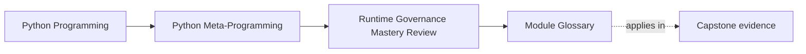

# Module Glossary

<!-- page-maps:start -->
## Page Maps

<!-- page-maps:end -->

This glossary belongs to **Module 10: Runtime Governance and Mastery Review** in **Python Metaprogramming**.
It keeps the language of this directory stable so the same ideas keep the same names
across core lessons, the worked example, practice, review, and capstone proof.

## How to use this glossary

Read the directory index first, then return here whenever a page, command, or review
discussion starts to feel more vague than the course intends. The goal is stable language,
not extra theory.

The most important test for this glossary is practical: if two reviewers use the same
word but mean different governance claims, this module has not done its job yet.

Use the glossary in both directions:

- when you read a page, use it to decode what the runtime mechanism is actually claiming
- when you write a review note, use it to catch words that sound careful but hide the real boundary or control surface

## Terms in this directory

| Term | Meaning in this directory |
| --- | --- |
| Approval gate | The point in review where a mechanism must justify its ownership, observability, and reversal story before it is accepted. |
| Blast radius | The scope of collateral impact when dynamic behavior fails or surprises reviewers. |
| Dynamic execution | Running runtime-generated code through `compile`, `eval`, or `exec`. |
| Evidence route | A repeatable sequence of review questions used to prove why one owner is honest and another is not. |
| Escalation boundary | The point where a higher-power mechanism must prove that a lower-power tool cannot own the problem honestly. |
| Feature flag | A configuration switch that can disable or narrow a dynamic behavior during tests, rollout, or incident response. |
| Hook ordering risk | The uncertainty introduced when import hooks or other global mechanisms behave differently depending on installation order. |
| Honest claim | A runtime or interface description that stops at what the mechanism can really prove. |
| In-process trust boundary | The limit of what the current Python process can honestly protect without stronger isolation. |
| Interface claim | The actual promise made by an ABC, protocol, or virtual subclass rule, as distinct from the reputation of the mechanism. |
| Lowest-power choice | The least invasive mechanism that still owns the behavior at the right timing and scope. |
| Observational surface | A command, manifest, or API that reveals runtime facts without triggering the business behavior under inspection. |
| Operational honesty | The discipline of describing what a runtime mechanism really guarantees about safety, timing, visibility, and rollback. |
| Overclaim | A description that assigns more safety, lifecycle control, or semantic proof to a mechanism than it actually owns. |
| Process isolation | A separate runtime boundary used when hostile input or risky execution must not share memory and globals with the current process. |
| Refusal sentence | A concise rejection reason such as "this is application wiring, not a tooling-grade import problem." |
| Reset hook | An explicit function or method that restores shared runtime state to a known baseline. |
| Restricted-globals fallacy | The false belief that narrowing `globals` or `__builtins__` makes in-process dynamic execution safe against untrusted input. |
| Reversibility | The ability to turn dynamic behavior off, undo it, or restore baseline state cleanly. |
| Runtime power ladder | The ordered view of mechanisms by blast radius and review cost, from explicit code up to import hooks and dynamic execution. |
| Shallow runtime check | A runtime interface check that verifies visible structure only and does not prove semantics or deep behavioral correctness. |
| Tooling-grade mechanism | A mechanism that may be justified for instrumentation, tracing, or analysis even when it would be a poor default for application code. |
| Virtual subclassing | Structural acceptance of a type by an ABC through `__subclasshook__` rather than through nominal inheritance. |

## Terms that must trigger a proof step

In this module, these words should never remain slogans.

| If you use this term | You must also prove... |
| --- | --- |
| trust boundary | who controls the input and what boundary actually exists outside the current process |
| lowest-power choice | which smaller owner was checked first and what it lost |
| observational surface | what runtime fact can be learned without triggering business behavior |
| reversibility | what exact call, flag, or context restores baseline behavior |
| tooling-grade mechanism | what process-wide problem makes global semantics the honest owner |
| honest claim | what the mechanism can prove now and what larger promise it still refuses |

## Confusing pairs to keep separate

| Pair | Difference that matters in this module |
| --- | --- |
| In-process trust boundary vs process isolation | The first marks what the current interpreter can honestly control; the second introduces a real separate protection boundary. |
| Honest claim vs overclaim | An honest claim names the exact scope; an overclaim borrows guarantees the mechanism never proved. |
| Observational surface vs operational command | One exposes runtime facts without side effects; the other performs behavior and therefore changes the review posture. |
| Lowest-power choice vs weakest implementation | Lower power often means better ownership and lower blast radius, not lower engineering quality. |
| Approval gate vs feature flag | An approval gate is a review decision point; a feature flag is an operational control surface after approval. |

## Translation table for sloppy wording

| Sloppy wording | Stronger wording for this module |
| --- | --- |
| "the runtime handles it automatically" | "the runtime changes one named surface and exposes one named observation or reset path" |
| "this should be safe enough" | "the claim stops at this specific trust boundary and refuses stronger safety language" |
| "the hook is just tooling" | "the hook changes process-wide behavior for this named instrumentation problem" |
| "the registry can be cleared" | "the registry exposes this exact reset hook and baseline path" |
| "the lower-power option was too manual" | "the lower-power option lost this specific timing, scope, or evidence requirement" |

## Review prompts this vocabulary should unlock

When using these terms, another learner should be able to answer:

- where does the claim stop?
- what lower-power owner was checked first?
- what observation, reset, or disable surface keeps the mechanism governable?
- what exact refusal sentence would reject the design if the evidence were missing?

If the vocabulary does not help answer those four questions, return to the lesson pages and
make the governance language sharper.

## Fast vocabulary drills

Use these when the module starts sounding familiar but still feels fuzzy:

| Prompt | Short answer shape to expect |
| --- | --- |
| where does the claim stop? | one real boundary, not a mood word |
| what smaller owner was tested first? | one explicit lower-power mechanism and its limit |
| what keeps the mechanism governable? | one audit, reset, disable, or observation surface |
| what overclaim must be rejected? | one broader promise the mechanism does not truly own |

## Keep the module connected

- Return to [Overview](index.md) for the full module route.
- Use [Exercises](exercises.md) and [Exercise Answers](exercise-answers.md) to pressure-test the vocabulary.
