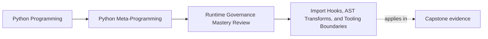

# Import Hooks, AST Transforms, and Tooling Boundaries


<!-- page-maps:start -->
## Page Maps




<!-- page-maps:end -->

Import hooks and AST transforms sit near the edge of what ordinary application code can
justify responsibly.

That does not make them illegitimate. It means they need a much stronger explanation than
"Python lets us do it."

This page fails if readers leave thinking the main lesson is "clean up your hook in a
finally block." The deeper lesson is owner selection: process-wide mechanisms must solve
process-wide problems, not ordinary application wiring problems in a more dramatic way.

## The sentence to keep

Import hooks and AST transforms are usually tooling mechanisms, not application defaults,
because they change global semantics and raise the cost of reasoning about every import.

That is the governance center of gravity for this page.

If the design claim could be rewritten as "we wanted it to be automatic," the mechanism is
probably already too strong.

For self-study, turn that sentence into a tooling-grade test:

- what process-wide problem is being solved?
- what explicit-import, registry, or build-time alternative was checked first?
- how does the system behave with the hook or transform disabled entirely?

## Evidence route for hooks and transforms

Use this route before approving an import hook or AST rewrite:

| Review step | What to inspect | What strong evidence looks like |
| --- | --- | --- |
| Name the owner | Is this tooling-grade, infrastructure-grade, or just application convenience? | One of those is chosen explicitly |
| Name the process-wide change | What imports, modules, or code paths are altered once the mechanism is enabled? | Global semantics are named concretely |
| Reject lower-power alternatives | What explicit-import, registry, or build-time option was considered first? | A simpler owner was rejected for a specific reason |
| Inspect reversibility | How is the hook disabled, removed, or bypassed? | Cleanup and no-hook operation are documented |
| Preserve evidence | How do tracebacks, source locations, reload paths, and ordering stay inspectable? | Location-preservation and ordering rules are explicit |

## Why the review bar jumps so sharply

These mechanisms widen blast radius immediately:

- they can affect many imports instead of one local object
- they are order-sensitive
- they complicate reloading and cache invalidation
- they can confuse debuggers, profilers, and editors if source locations drift

In other words, they are powerful precisely where ordinary code wants predictability.

## Honest approval language versus overclaim

| Honest claim | Overclaim to reject |
| --- | --- |
| "This hook instruments imports for tracing during one controlled process lifetime." | "This gives us seamless plugin discovery with no architectural cost." |
| "This AST transform rewrites one syntax pattern while preserving source locations." | "This lets us upgrade application behavior automatically everywhere." |

## Import hooks change the process-wide import story

Python import machinery can be customized through `sys.meta_path`.

That is real and sometimes useful, especially for tooling:

- tracing
- coverage
- instrumentation
- controlled virtual modules

But the consequence is equally real:

- you are no longer reviewing one module
- you are reviewing altered import behavior for the process

That should make reviewers slower, not more impressed.

Keep the practical rule visible:

when import behavior changes globally, the burden of proof rises globally too.

## A tiny reversible virtual-module example

```python
import sys
import types
from importlib.machinery import ModuleSpec


class VirtualFinder:
    def find_spec(self, fullname, path=None, target=None):
        if fullname == "virtual_mod":
            return ModuleSpec(fullname, VirtualLoader())
        return None


class VirtualLoader:
    def create_module(self, spec):
        return types.ModuleType(spec.name)

    def exec_module(self, module):
        module.answer = 42


finder = VirtualFinder()
sys.meta_path.insert(0, finder)
try:
    import virtual_mod
    print(virtual_mod.answer)  # 42
finally:
    sys.meta_path.remove(finder)
```

The important part is not the trick. It is the cleanup.

Without the reversible lifetime, even a bounded example encourages the wrong instinct.

## Hook-lifetime checklist

For any import hook, another engineer should be able to answer:

- when is it installed?
- when is it removed?
- what imports happened before installation?
- what happens if it is installed twice?
- how does the system behave with no hook at all?

Keep one no-hook worksheet beside every import-time mechanism:

| Question | Strong answer shape |
| --- | --- |
| what still works with no hook? | core application logic or baseline program behavior |
| what capability disappears? | tracing, instrumentation, rewrite, or discovery convenience |
| what evidence stays available? | source locations, fallback startup path, or explicit import behavior |
| what cleanup restores baseline? | finder removal, cache reset, or disabled pipeline path |

## AST transforms can preserve shape or quietly destroy evidence

AST rewriting is another mechanism that looks delightful in demos and expensive in
maintenance.

It can be justified for tooling, code generation, or tightly scoped experiments. It must
still preserve debugging evidence.

```python
import ast


class SquareCall(ast.NodeTransformer):
    def visit_Call(self, node):
        self.generic_visit(node)
        if isinstance(node.func, ast.Name) and node.func.id == "square" and len(node.args) == 1:
            argument = node.args[0]
            rewritten = ast.BinOp(left=argument, op=ast.Mult(), right=argument)
            return ast.copy_location(rewritten, node)
        return node
```

And after rewriting:

```python
tree = ast.parse("def f(x): return square(x) + 1")
tree = SquareCall().visit(tree)
ast.fix_missing_locations(tree)
```

Two functions matter here for governance:

- `ast.copy_location(...)`
- `ast.fix_missing_locations(...)`

Without them, tracebacks and tooling often become much harder to trust.

That makes location preservation part of correctness, not an optional nicety for better
debugger screenshots.

## Tooling-grade problems are the honest home

These mechanisms are strongest when the problem is already meta-level:

- code coverage
- tracing
- static-to-runtime instrumentation
- educational or experimental transformation pipelines

They are weakest when used to avoid explicit application architecture.

Common weak justification:

- "we wanted automatic plugin discovery without explicit imports"

Common stronger justification:

- "we are building instrumentation that must see modules as they load"

The difference is not cleverness. It is whether global import semantics are really the
natural owner of the problem.

## Tooling-grade examples versus application-grade drift

| Pressure | Honest owner | Why |
| --- | --- | --- |
| coverage or tracing across many imports | import hook or instrumentation layer | the problem is already process-wide |
| code rewrite for controlled educational analysis | AST transform pipeline | the source transformation itself is the product |
| plugin discovery in one app package | explicit imports, registries, or entry points | global import mutation is stronger than the need |
| startup convenience for local modules | explicit startup wiring | the problem is architecture, not import machinery |

## Application code usually has clearer alternatives

Before approving import machinery changes, compare them against lower-power options:

- explicit imports
- package entry points
- build-time code generation
- decorators or registries
- configuration files and explicit startup wiring

If one of those keeps the behavior visible, it usually wins.

That win matters even when the lower-power design is more repetitive. Repetition is often
cheaper than invisible global semantics.

## Weak answers to reject early

| Weak answer | Why it fails |
| --- | --- |
| "the hook makes startup seamless" | seamless hides global semantics and ordering cost |
| "the transform only rewrites a tiny pattern" | tiny does not excuse lost locations or hidden import-time behavior |
| "we can remove the hook later if needed" | later is not a present cleanup story |
| "the app needs automatic discovery" | automatic discovery is not yet a tooling-grade justification |

## "No-hook mode" is a real design requirement

One of the best governance tests is simple:

can the system still run correctly with the hook disabled?

For many legitimate tooling cases, the answer should be yes:

- coverage disabled still runs the program
- tracing disabled still runs the program
- AST instrumentation disabled still leaves the core logic intact

If the application cannot function without the import trick, the trick may be owning too
much of the design.

Before you leave this page, write one sentence beginning:

- "this mechanism is tooling-grade because..."
- "no-hook mode here means..."

## Failure modes to name explicitly

Watch for these:

| Failure mode | What goes wrong |
| --- | --- |
| hook introduced for local application convenience | process-wide cost is paid for a local problem |
| no-hook mode breaks core application behavior | the import mechanism owns too much architecture |
| rewritten AST loses source locations | tracebacks and tooling evidence become less trustworthy |
| ordering assumptions stay implicit | behavior changes across startup paths and tests |
| cleanup is missing or partial | later tests or modules inherit altered semantics |

## Reloading and ordering are not side notes

Import hooks are sensitive to timing:

- what imports happened before the hook was installed?
- what order are multiple hooks evaluated in?
- what state survives module reloads?
- how are caches invalidated?

These are not obscure corner cases. They are part of the primary ownership cost.

## Review rules for hooks and transforms

When reviewing import hooks or AST transforms, ask these questions:

- is this solving a tooling problem or an application-architecture problem?
- what is the disable path?
- how are cleanup, ordering, and reload behavior tested?
- are source locations preserved after transformation?
- what lower-power alternative was rejected, and why?
- what process-wide behavior changes once this hook is enabled?

Add one more final question:

- what sentence explains why this is a tooling problem rather than an application-structure problem?

If the answer to the last question is fuzzy, the design is not yet governable.

## What this page makes clear

The point is not "never touch import machinery."

The boundary is:

- global semantics demand global responsibility
- tooling can justify powers that ordinary application code usually cannot
- reversibility and evidence preservation matter even more at the highest-power layer

That is why Module 10 treats this topic as a boundary review, not a celebration.

## What to practice from this page

Try these before moving on:

1. Write down one import-hook idea that should become explicit imports instead.
2. Add a disable path and cleanup step to one hook design.
3. Explain why location preservation is part of correctness for AST transforms.

## Exit check for this page

Before moving on, make sure you can do all of the following:

- reject one application-grade import-hook idea in favor of explicit structure
- explain why no-hook mode is part of good design, not optional polish
- name one source-location surface that must survive AST rewriting
- describe one concrete process-wide behavior change a hook introduces

If those feel ordinary, the next step is to bring the full module together into an
approval standard: how to choose the lowest-power mechanism and defend escalation only
when the evidence is strong enough.

## Continue through Module 10

- Previous: [Observability, Reversibility, and Monkey-Patching Boundaries](observability-reversibility-and-monkey-patching-boundaries.md)
- Next: [Mechanism Selection, Review Gates, and Escalation Boundaries](mechanism-selection-review-gates-and-escalation-boundaries.md)
- Practice: [Exercises](exercises.md)
- Terms: [Glossary](glossary.md)
