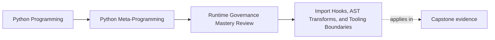
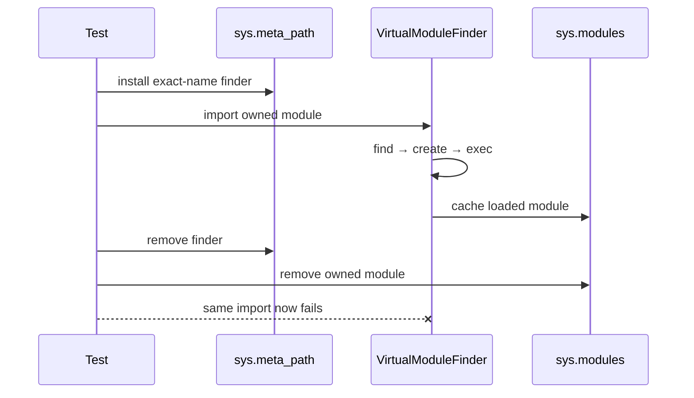
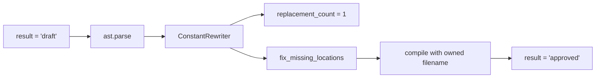

# Import Hooks, AST Transforms, and Tooling Boundaries

<!-- page-maps:start -->
## Page Maps




<!-- page-maps:end -->

Import hooks and AST transforms sit near the top of Python's runtime-power ladder. They
can be excellent tools when the problem genuinely belongs to import integration,
compilation, instrumentation, or source analysis. In ordinary application wiring, they
often hide ownership that explicit imports and functions would preserve.

This core teaches two experiments:

- a finder/loader that owns one exact virtual module for one context;
- an AST transformer that replaces one exact trusted constant and reports the count.

Both are executable. Both are constrained to tooling. Neither is proposed for the
incident-plugin application's runtime behavior.

## Why the review bar rises

An application function changes behavior when someone calls it. A finder inserted into
`sys.meta_path` participates in imports throughout the process while installed. An AST
transform changes code before execution, so the source a reviewer reads is not exactly the
code object that runs.

| Mechanism | Hidden surface |
| --- | --- |
| meta-path finder | process-wide import resolution order |
| loader | module creation and execution |
| `sys.modules` cache | future imports may bypass the finder |
| AST transformer | executed structure may differ from source |
| `compile` / `exec` | transformed code executes in the current process |

The mechanism may target one name or one constant, but the integration point is still
powerful. Governance must describe both the narrow match and the broad hook point.

## A finder and loader with one owner

Open `labs/runtime_governance/tooling.py`. `VirtualModuleFinder` implements both
`MetaPathFinder` and `Loader`:

```python
class VirtualModuleFinder(MetaPathFinder, Loader):
    def find_spec(
        self,
        fullname: str,
        path: object = None,
        target: ModuleType | None = None,
    ) -> ModuleSpec | None:
        if fullname != self.module_name:
            return None
        self.events.append(f"find:{fullname}")
        return ModuleSpec(fullname, self)

    def create_module(self, spec: ModuleSpec) -> ModuleType | None:
        self.events.append(f"create:{spec.name}")
        return None

    def exec_module(self, module: ModuleType) -> None:
        self.events.append(f"exec:{module.__name__}")
        module.__dict__.update(self.attributes)
```

The exact-name condition is essential. For every name it does not own, `find_spec` returns
`None` and normal import resolution continues.

Returning `None` from `create_module` has a different meaning: use Python's default module
creation. `exec_module` then populates that module. Keep these two `None` results separate:

- `find_spec -> None`: this finder declines the import;
- `create_module -> None`: this loader accepts default module allocation.

## Lifetime requires cache cleanup too

Removing the finder is not enough. Once imported, the module lives in `sys.modules`;
another import may return the cached object without consulting finders.

The context manager owns both surfaces:

```python
@contextmanager
def installed_virtual_module(module_name, attributes):
    if module_name in sys.modules:
        raise RuntimeError(f"module already loaded: {module_name}")
    finder = VirtualModuleFinder(module_name, attributes)
    sys.meta_path.insert(0, finder)
    try:
        yield finder
    finally:
        if finder in sys.meta_path:
            sys.meta_path.remove(finder)
        loaded = sys.modules.get(module_name)
        if loaded is not None and loaded.__loader__ is finder:
            sys.modules.pop(module_name, None)
```

The cleanup removes the module only if this finder loaded it. That identity check prevents
the helper from deleting a module now owned by someone else.

The precondition also refuses a module name already present in the cache. Silently
replacing an existing module would make ownership ambiguous.

## No-hook mode is part of the contract

Inside the context, importing `_bijux_runtime_governance_virtual` yields a virtual module
and records:

```text
find:_bijux_runtime_governance_virtual
create:_bijux_runtime_governance_virtual
exec:_bijux_runtime_governance_virtual
```

After exit:

```text
hook_present_after_scope = false
module_cached_after_scope = false
no_hook_failure = "ModuleNotFoundError"
```

The final import failure proves something important: the experiment did not quietly make
the application depend on the hook after its published lifetime.

No-hook mode should be tested whenever the design claims a hook is optional. Otherwise
"optional" may mean only that setup code has a flag while downstream behavior still
requires the altered import semantics.

## The AST transform has a different owner

The second experiment operates on trusted static source:

```python
class ConstantRewriter(ast.NodeTransformer):
    def __init__(self, old: str, new: str) -> None:
        self.old = old
        self.new = new
        self.replacements = 0

    def visit_Constant(self, node: ast.Constant) -> ast.AST:
        if node.value == self.old:
            self.replacements += 1
            return ast.copy_location(ast.Constant(self.new), node)
        return node
```

`rewrite_constant` parses in statement mode, visits the tree, fixes location metadata,
compiles under the explicit filename `<constant-rewriter>`, executes, and returns both the
result and replacement count.



The count is provenance. A transformer that silently matches zero nodes could appear to
succeed while doing nothing. A transformer that unexpectedly matches many nodes could
change more code than the proposal described.

## Source locations are operational evidence

`ast.copy_location` preserves location from the replaced node.
`ast.fix_missing_locations` fills required metadata on generated nodes.
The explicit compile filename gives tracebacks an owner.

These details do not prove semantic equivalence, but omitting them makes debugging
transformed code materially worse.

A serious transform should also consider:

- whether `ast.unparse` output is retained for review;
- whether before/after trees or hashes are recorded;
- whether exact replacement counts are asserted;
- how Python-version AST changes are tested;
- whether line mappings remain useful to debuggers and coverage tools.

## This transform is not a dynamic-execution exception

`rewrite_constant` eventually calls `exec` in the current process. Its source is trusted
and fixed by the experiment. Empty builtins does not make it suitable for untrusted input.

The dynamic-execution lesson still applies. An AST transform changes source shape; it does
not create process isolation.

## Tooling-grade and application-grade pressures

| Pressure | Tooling mechanism may be earned | Ordinary application alternative |
| --- | --- | --- |
| test Python's import integration | exact-name temporary finder | direct loader call if import semantics are irrelevant |
| collect coverage or rewrite compiled templates | observable AST transform | ordinary function composition |
| analyze or lint source without execution | AST visitor | explicit domain model |
| select application plugins | usually no | explicit configuration and discovery adapter |
| change one application constant | no | parameter, configuration, or function |
| make imports look seamless | no | ordinary explicit import |

The word "seamless" is a warning in review. Hidden integration cost is often being
presented as ergonomics.

## Run the evidence

From the course root:

```console
make runtime-governance-lab
python -m unittest discover -s tests -p "test_runtime_governance_tooling.py" -v
```

The tests prove:

- the exact virtual name loads with ordered events;
- unrelated imports are ignored;
- finder and owned cache entry are removed;
- no-hook import fails;
- the constant replacement and count are visible;
- the packet refuses application and untrusted-source approval.

They do not prove that arbitrary import-hook composition is order-independent or that a
source transform preserves arbitrary program semantics.

## Failure routes to review

| Failure route | Required response |
| --- | --- |
| finder claims names it does not own | narrow matching or reject the hook |
| cleanup removes only `sys.meta_path` entry | remove the owned cache entry too |
| cleanup deletes any same-named module | check loader identity before removal |
| transform matches zero or too many nodes | assert an expected replacement count |
| generated locations are absent | copy and repair location metadata |
| application requires the tooling hook | provide and test no-hook behavior, or redesign |
| transformed source is untrusted | refuse in-process execution |

## Capstone transfer: ordinary imports stay ordinary

The incident-plugin runtime rejects application import hooks and AST rewriting. Its plugin
classes are imported normally. Registration happens for already imported class
definitions; discovery remains an explicit external concern.

Run:

```console
make capstone-class-creation
make capstone-governance
```

The class-creation report rejects package discovery as a metaclass power. The governance
report rejects application hooks and transforms and selects ordinary imports plus tooling
outside the application process.

This separation prevents a class definition, an import policy, and deployment discovery
from becoming one invisible lifecycle.

## Review checkpoint

Explain why each pair differs:

- exact-name matching versus local blast radius;
- finder removal versus complete hook cleanup;
- source-location preservation versus semantic equivalence;
- empty builtins versus process isolation;
- a tooling experiment versus an application extension architecture.

You are ready for mechanism selection when you can approve this lab as constrained tooling
while rejecting the same primitives for the capstone application.
