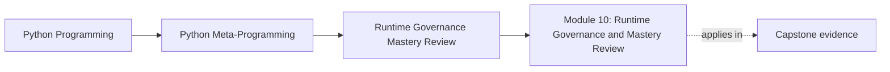
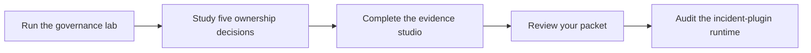
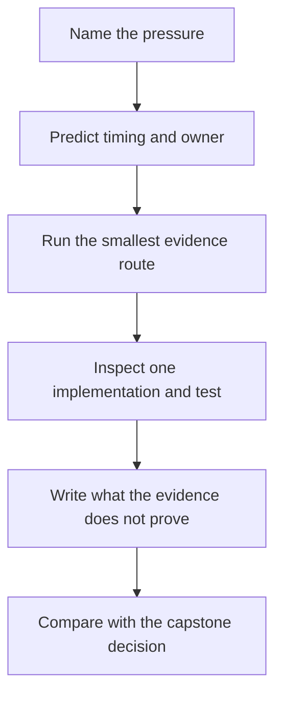

# Module 10: Runtime Governance and Mastery Review

<!-- page-maps:start -->
## Page Maps




<!-- page-maps:end -->

Module 10 is the course's engineering-judgment practicum. You have already learned how
Python observes, wraps, describes, and creates runtime objects. Now you must decide when
those powers earn their maintenance cost.

The course material and its executable lab are the primary learning product. The
incident-plugin capstone is a transfer environment: it lets you test the judgment learned
here against a larger runtime, but it does not replace the lesson, exercises, or answer
review.

## The learning problem

Metaprogramming failures rarely begin with invalid syntax. They begin with a claim that is
larger than the mechanism can support:

- an AST allowlist is described as a sandbox;
- a runtime protocol check is described as signature validation;
- a `finally` block is described as universal rollback;
- an import hook is described as local because it matches one module;
- a metaclass is approved because it removes boilerplate, without naming class-creation
  ownership.

This module replaces those claims with evidence. For every mechanism, you will name:

1. the design pressure;
2. the smallest honest owner;
3. execution timing and blast radius;
4. an observation route;
5. rollback or refusal behavior;
6. the proof and its limits.

## Prerequisites

Before starting, you should be able to:

- read a traceback and a focused unit test;
- explain attribute lookup, descriptors, decorators, and class creation;
- distinguish class definition from instance construction;
- run commands from `programs/python-programming/python-meta-programming`;
- read JSON as evidence rather than as application output.

If class creation timing is still uncertain, revisit
[Module 09](../module-09-class-creation-and-metaclass-architecture/index.md). If descriptor
ownership is uncertain, revisit
[Module 08](../module-08-descriptor-systems-and-framework-design/index.md).

## Start with executable evidence

From the course root, run:

```console
make runtime-governance-lab
make runtime-governance-lab-test
```

The first command prints one deterministic JSON packet. The second runs the focused tests
behind its claims. The packet has five top-level surfaces:

| Evidence key | Question it answers |
| --- | --- |
| `dynamic_execution` | Which syntax is accepted, what is refused, and why is this not a sandbox? |
| `interface_contracts` | Which claims belong to ABCs, protocols, and `__subclasshook__`? |
| `reversible_patching` | What changes inside the patch scope, and what identity returns afterward? |
| `tooling_boundaries` | What does a hook or transform own, and does no-hook mode still work? |
| `mechanism_selection` | Why was each proposed power approved, constrained, or rejected? |

Do not merely check that the commands pass. Pick one claim and locate all three parts:

- the implementation under `labs/runtime_governance/`;
- the focused test under `tests/test_runtime_governance_*.py`;
- the learner-facing explanation in this module.

That triangle—lesson, code, proof—is the basic unit of study.

## The five-core progression

Read the cores in order. Each introduces a stricter review question.

| Core | New question | Observable learner work |
| --- | --- | --- |
| [Dynamic Execution](dynamic-execution-trust-boundaries-and-process-isolation.md) | Where does syntax narrowing stop and isolation begin? | Classify an accepted expression and a refused hostile-input design. |
| [Interface Contracts](interface-contracts-with-abcs-protocols-and-subclasshook.md) | What does each interface mechanism actually prove? | Match nominal, static structural, and shallow runtime claims to owners. |
| [Observability and Reversibility](observability-reversibility-and-monkey-patching-boundaries.md) | Can another engineer see and undo the runtime change? | Prove restoration after both success and failure. |
| [Tooling Boundaries](import-hooks-ast-transforms-and-tooling-boundaries.md) | Does process-wide power belong in the application at all? | Record hook events, cleanup, no-hook behavior, and transform provenance. |
| [Mechanism Selection](mechanism-selection-review-gates-and-escalation-boundaries.md) | Has a higher-power mechanism earned approval? | Publish a decision with lower-power comparison, blast radius, rollback, and proof. |

The sequence matters. You cannot make a defensible mechanism choice before you can size
the trust claim, contract claim, rollback claim, and process-wide effects.

## Study loop for each core

Use the same deliberate loop without turning the pages into a mechanical template:



Stop after `predict` and write down what you expect. If you run first, it is easy to
mistake recognition for understanding.

## What the lab deliberately does not claim

The lab is small so that runtime causality remains traceable. Its boundaries are part of
the lesson:

- the arithmetic evaluator accepts bounded internal arithmetic; it is not safe for
  adversarial source;
- `@runtime_checkable` checks attribute presence, not compatible signatures;
- the scoped patch restores ordinary Python state, but other threads may observe the
  replacement and a process crash cannot execute cleanup;
- the import hook exists for a tooling experiment, not application discovery;
- the AST transform operates on trusted static source and reports its replacement count;
- the decision report is review evidence, not an automated security verdict.

Any answer that removes these limits has weakened the design.

## Independent-study route

Use these blocks if you are studying without an instructor.

| Block | Work | Move forward when... |
| --- | --- | --- |
| orient | run both lab commands and inspect the JSON keys | you can map every key to one source file and one test file |
| explain | study the five cores in order | you can state one honest claim and one non-claim per mechanism |
| apply | read the [worked example](worked-example-reviewing-a-plugin-runtime-for-observability-and-control.md) | you can explain why the capstone rejects powers it could technically implement |
| practice | complete the [evidence studio](exercises.md) without the answers open | every decision includes runnable evidence and a preserved earlier contract |
| review | use the [answer key](exercise-answers.md) as a review rubric | you can identify both a wrong turn and the exact proof limit |
| transfer | run `make capstone-governance` | you can defend or challenge each capstone decision from evidence |

If you return after a long break, rerun the two lab commands and reconstruct the
lesson-code-proof triangle for one key. Do not restart by rereading every page passively.

## The capstone transfer

Only after the course lab is understood, run:

```console
make capstone-governance
```

The command is observational: it does not construct or execute a plugin. Its report
documents the shipped runtime's decisions:

- decorators, descriptors, `PluginMeta`, and inspection routes are approved for named
  owners;
- the process-global registry is constrained by deterministic ordering and reset
  discipline;
- runtime evaluation, application monkey patching, application import hooks, package
  discovery during class creation, and automatic metaclass-conflict repair are rejected.

Then use `make inspect` or `make capstone-tour` when you need the larger evidence bundle.
The capstone supports transfer by making real consequences inspectable; it is not a
substitute for doing the course exercises.

## Mastery standard

You are ready to finish the course when you can review an unfamiliar dynamic proposal and
produce all of the following without relying on mechanism prestige:

- a pressure statement that does not presuppose the implementation;
- an owner and timing trace;
- a lower-power comparison;
- a public-surface and blast-radius statement;
- an observation and rollback plan;
- focused proof;
- a precise statement of what remains unproved;
- an approve, constrain, or reject decision.

The strongest final answer may be rejection. Mastery is not using every mechanism. It is
knowing exactly which power the problem deserves.
