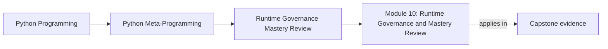

# Module 10: Runtime Governance and Mastery Review

<!-- page-maps:start -->
## Page Maps

<!-- page-maps:end -->

Module 10 closes the mechanism ladder by turning it into engineering judgment. The goal is
not to add one last collection of dangerous tricks. The goal is to decide which powers are
defensible, which ones belong only to tooling or exceptional cases, and how a reviewer can
ask for evidence instead of admiring cleverness.

This module is weakest when it is read as a tour of dangerous mechanisms. It becomes
useful only when it is read as a decision course: what to approve, what to constrain, what
to reject, and what evidence those calls require.

This module now uses the same ten-file learning surface as the deep-dive series and the
other strong metaprogramming modules: overview, five core lessons, worked example,
exercises, answer key, and glossary.

## What this module is for

By the end of Module 10, you should be able to explain five things clearly:

- why `eval` and `exec` must be governed by trust boundaries and real isolation claims
- what ABCs, protocols, and `__subclasshook__` can and cannot promise honestly
- how dynamic behavior stays observable, reversible, and testable
- why import hooks and AST transforms usually belong to tooling-grade problems
- how to choose the lowest-power mechanism and justify escalation only when ownership demands it

## One-day study route for a missed-class learner

Treat this module like a review practicum, not a final tour of runtime tricks.

| Study block | What to produce before moving on |
| --- | --- |
| overview plus dynamic-execution page | one trust-boundary note naming who controls the input, what boundary really exists, and which lower-power owner was rejected first |
| interface plus observability pages | one contract note and one rollback note showing what the mechanism proves and how baseline state returns |
| import-hooks plus mechanism-selection pages | one escalation worksheet naming the first simpler owner and the first operational cost of going higher-power |
| worked example | one runtime-governance packet naming chosen powers, refused stronger powers, observational surfaces, and reset surfaces |
| exercises plus answers | one review packet another learner could use to approve, constrain, or reject a dynamic design without hearing you explain it live |

If you cannot produce the artifact for a block, do not move on because the prose sounded
reasonable. Module 10 gets weak when judgment language feels familiar before evidence
becomes concrete.

## The review route through the module

Use the module in this order when you are reviewing a dynamic design:

| If the design pressure starts with... | Read this first | Then ask... |
| --- | --- | --- |
| untrusted expressions, generated code, or "safe eval" claims | [Dynamic Execution, Trust Boundaries, and Process Isolation](dynamic-execution-trust-boundaries-and-process-isolation.md) | where is the real process boundary, and what lower-power model was rejected? |
| interface language, duck typing, or runtime capability checks | [Interface Contracts with ABCs, Protocols, and `__subclasshook__`](interface-contracts-with-abcs-protocols-and-subclasshook.md) | what is nominal, structural, shallow, or truly behavioral here? |
| wrappers, registries, flags, patches, or tracing layers | [Observability, Reversibility, and Monkey-Patching Boundaries](observability-reversibility-and-monkey-patching-boundaries.md) | what stays visible, what resets cleanly, and what hot path pays the cost? |
| import machinery, code rewriting, or "automatic discovery" | [Import Hooks, AST Transforms, and Tooling Boundaries](import-hooks-ast-transforms-and-tooling-boundaries.md) | is this tooling-grade, and how does it preserve cleanup and evidence? |
| a final choice between two or more mechanisms | [Mechanism Selection, Review Gates, and Escalation Boundaries](mechanism-selection-review-gates-and-escalation-boundaries.md) | what is the lowest-power honest owner, and what proves escalation is earned? |

## Weak answers to reject early

Do not let the module collapse into any of these:

| Weak answer | Why it fails |
| --- | --- |
| "The runtime can enforce it automatically." | Automation is not ownership, observability, or reversibility. |
| "We restricted globals, so it is safe enough." | Namespace control is not a real hostile-input boundary. |
| "The protocol or ABC proves the contract." | Interface surfaces do not prove deep behavior by themselves. |
| "The import hook is worth it because it feels seamless." | Seamlessness is often hidden blast radius in disguise. |
| "The wrapper is tiny, so rollback does not matter." | Small dynamic surfaces still need visibility and cleanup. |

## Fast diagnostic for runtime-governance overreach

Use this table before you accept a design as "still worth the dynamic power."

| If you notice... | Pause and ask... | Likely outcome |
| --- | --- | --- |
| safety language grows faster than the real boundary | what exact process or operational boundary exists outside the current interpreter? | the claim is probably overreaching |
| interface language sounds stronger than tests | what behavior still lives outside the contract surface? | the interface claim is too large |
| patches or registries change state silently | what reset or observation surface proves current runtime state? | the design is not reviewable enough yet |
| import-time or process-wide behavior is justified with convenience | is this tooling-grade, or is ordinary application wiring being dressed up? | escalation is probably too strong |
| no one can write a clean rejection sentence | what lower-power owner was actually compared first? | the selection process is still under-argued |

## Keep these pages open

- [Mastery Map](../module-00-orientation/mastery-map.md)
- [Boundary Review Prompts](../reference/boundary-review-prompts.md)
- [Review Checklist](../reference/review-checklist.md)
- [Capstone Proof Guide](../capstone/capstone-proof-guide.md)

## The ten files in this module

1. Overview (`index.md`)
2. [Dynamic Execution, Trust Boundaries, and Process Isolation](dynamic-execution-trust-boundaries-and-process-isolation.md)
3. [Interface Contracts with ABCs, Protocols, and `__subclasshook__`](interface-contracts-with-abcs-protocols-and-subclasshook.md)
4. [Observability, Reversibility, and Monkey-Patching Boundaries](observability-reversibility-and-monkey-patching-boundaries.md)
5. [Import Hooks, AST Transforms, and Tooling Boundaries](import-hooks-ast-transforms-and-tooling-boundaries.md)
6. [Mechanism Selection, Review Gates, and Escalation Boundaries](mechanism-selection-review-gates-and-escalation-boundaries.md)
7. [Worked Example: Reviewing a Plugin Runtime for Observability and Control](worked-example-reviewing-a-plugin-runtime-for-observability-and-control.md)
8. [Exercises](exercises.md)
9. [Exercise Answers](exercise-answers.md)
10. [Glossary](glossary.md)

## How to use the file set

| If you need to... | Start here |
| --- | --- |
| draw the hard line around `compile`, `eval`, and `exec` | [Dynamic Execution, Trust Boundaries, and Process Isolation](dynamic-execution-trust-boundaries-and-process-isolation.md) |
| compare runtime interfaces without overstating what they prove | [Interface Contracts with ABCs, Protocols, and `__subclasshook__`](interface-contracts-with-abcs-protocols-and-subclasshook.md) |
| keep wrappers, registries, and patches observable and reversible | [Observability, Reversibility, and Monkey-Patching Boundaries](observability-reversibility-and-monkey-patching-boundaries.md) |
| judge whether import machinery changes belong to tooling or ordinary app design | [Import Hooks, AST Transforms, and Tooling Boundaries](import-hooks-ast-transforms-and-tooling-boundaries.md) |
| decide whether a higher-power mechanism truly earns approval | [Mechanism Selection, Review Gates, and Escalation Boundaries](mechanism-selection-review-gates-and-escalation-boundaries.md) |
| see those decisions applied to one real runtime | [Worked Example: Reviewing a Plugin Runtime for Observability and Control](worked-example-reviewing-a-plugin-runtime-for-observability-and-control.md) |
| pressure-test your review habits before closing the course | [Exercises](exercises.md) |
| compare your reasoning against a reference answer | [Exercise Answers](exercise-answers.md) |
| stabilize the governance vocabulary used in this directory | [Glossary](glossary.md) |

## Evidence packet to build while you learn

Keep one packet beside the module as you work:

| Surface | What to record |
| --- | --- |
| trust boundary notes | where safety claims stop and where real isolation begins |
| contract notes | what each interface surface proves and what it does not |
| reset and disable notes | how registries, wrappers, hooks, or patches restore baseline state |
| escalation notes | which lower-power owner was rejected first and why |
| review notes | one explicit rejection rule and one explicit approval rule |

Use one more quality bar on the packet:

- another learner should be able to point to one stopped safety claim, one reset surface, and one rejected lower-power owner without needing your verbal context

## The running question

Carry this question through every page:

> Which runtime powers are still defensible once debugging cost, observability, reversibility, and team trust become the real review criteria?

Strong Module 10 answers usually mention one or more of these:

- trust boundaries that stop at what the process can really enforce
- interface claims sized to the actual strength of the mechanism
- explicit cleanup, reset, and disable paths
- tooling-grade powers rejected for ordinary application behavior
- an escalation decision defended by timing and ownership rather than taste

Carry one more question through every page:

> If this mechanism fails at runtime, what evidence would let another engineer explain the failure quickly and restore baseline behavior safely?

Add one final course-closing question:

> if I removed the mechanism name from the discussion, would I still be able to explain the trust boundary, the reset path, and the reason a lower-power owner was rejected?

## Learning outcomes

By the end of this module, you should be able to:

- review high-power runtime code with operational standards rather than aesthetic ones
- separate trusted internal metaprogramming from unsafe in-process code execution claims
- demand observability, reversibility, and proof surfaces before approving runtime magic
- compare decorators, descriptors, metaclasses, and import hooks through ownership and blast radius
- explain why the capstone stays defensible because its public review surfaces remain observational

## Exit standard

Do not leave the course until all of these are true:

- you can name one higher-power mechanism you would reject and why a lower-power one still owns the problem
- you can explain why restricted globals are not a security boundary
- you can distinguish shallow interface checks from real behavioral proof
- you can point to one reset, cleanup, or disable surface that makes a dynamic design reviewable
- you can name one explicit rejection rule for a higher-power mechanism and one approval rule that still stays narrow

When those feel ordinary, Module 10 has done its job and the course can end with judgment
instead of with one more pile of mechanisms.
