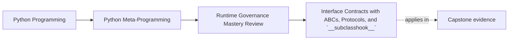

# Interface Contracts with ABCs, Protocols, and `__subclasshook__`


<!-- page-maps:start -->
## Page Maps




<!-- page-maps:end -->

Once dynamic execution boundaries are clear, the next governance question is smaller but
equally important:

what does a runtime "interface" actually promise?

Python gives several ways to name an interface, but those ways do not all guarantee the
same thing.

This page is weakest when readers remember only the syntax. The real teaching target is
claim sizing: what a contract surface can honestly promise, what it cannot, and what other
evidence must still carry the design.

## The sentence to keep

ABCs, protocols, and `__subclasshook__` are useful only when the code review story stays
honest about whether the contract is nominal, structural, static, shallow, or truly
behavioral.

That sentence is the whole page in miniature.

If the surrounding review language is larger than those five words, the contract claim is
probably already drifting.

For self-study, turn that sentence into a contract-sizing test:

- is the claim nominal, structural, shallow runtime, or truly behavioral?
- what behavior still lives outside this interface surface?
- what test or documentation evidence must still carry that behavior?

## Evidence route for interface-contract reviews

Use this route before accepting an interface surface:

| Review step | What to inspect | What strong evidence looks like |
| --- | --- | --- |
| Name the contract shape | Is this nominal, structural, static, shallow runtime, or behavioral? | One category is chosen explicitly instead of blended together |
| Match the owner to the need | Does the design need runtime instantiation failure, flexible static typing, or a tiny structural hook? | ABC, protocol, or `__subclasshook__` is chosen for a specific reason |
| Reject overclaim | What does this surface not prove? | Behavior, performance, cleanup, or resource semantics are left to tests and docs |
| Inspect the runtime cost | Is this check shallow, awkward, or likely to be mistaken for certification? | The limits of runtime checks are named directly |
| Name the missing evidence | What still has to be tested elsewhere? | Semantic invariants and failure cases are still covered outside the interface |

## ABCs name a runtime contract with real but narrow force

`abc.ABC` plus `@abstractmethod` can prevent instantiation of incomplete subclasses.

That is a real runtime guardrail:

```python
from abc import ABC, abstractmethod


class Drawable(ABC):
    @abstractmethod
    def draw(self) -> str:
        ...


class Circle(Drawable):
    def draw(self) -> str:
        return "circle"


print(Circle().draw())  # circle
```

And the failure mode is precise too:

```python
try:
    Drawable()
except TypeError as exc:
    print("expected:", exc)
```

This is useful, but it is not a full semantic proof. An ABC can require the presence of a
method. It does not guarantee the method behaves well.

## Honest ABC claims versus overclaims

| Honest ABC claim | Overclaim to reject |
| --- | --- |
| "Incomplete subclasses cannot be instantiated." | "All subclasses conform correctly to the full design contract." |
| "This runtime family owns one named method boundary." | "Inheritance proves the behavior is safe, efficient, or correct." |

## Protocols are primarily for static structural typing

`typing.Protocol` shines when you want structural compatibility checked by type checkers.

That is the key idea to keep. Runtime use is secondary.

```python
from typing import Protocol


class SupportsClose(Protocol):
    def close(self) -> None:
        ...
```

This says "objects with a compatible `close()` method fit this contract" for static
analysis. That is valuable because it keeps interfaces flexible without forcing
inheritance.

The governance trap is pretending that a protocol automatically proves runtime behavior.
It does not.

## When protocols are the right owner

Protocols are strongest when:

| Pressure | Why a protocol can be honest |
| --- | --- |
| callers care about a small capability shape | structural typing avoids artificial inheritance |
| implementations come from multiple unrelated libraries | nominal coupling would add friction without stronger proof |
| the strongest value comes from static analysis | runtime certification is not the real goal |

## `@runtime_checkable` is shallow on purpose

Protocols can opt into runtime checks:

```python
from typing import Protocol, runtime_checkable


@runtime_checkable
class SupportsClose(Protocol):
    def close(self) -> None:
        ...


class FileLike:
    def close(self) -> None:
        print("closed")


print(isinstance(FileLike(), SupportsClose))  # True
print(isinstance(123, SupportsClose))         # False
```

That can be useful at API boundaries, but the check stays shallow:

- it does not prove semantic invariants
- it does not deeply validate signatures the way reviewers often imagine
- it does not replace real tests

In other words, runtime-checkable protocols are for light structural filtering, not for
strong runtime certification.

That last sentence should appear in review notes more often than "it passed `isinstance`."

## `__subclasshook__` should stay boring

An abstract base class can declare virtual subclassing rules with `__subclasshook__`.

```python
from abc import ABC


class HasLen(ABC):
    @classmethod
    def __subclasshook__(cls, candidate):
        if hasattr(candidate, "__len__") and callable(getattr(candidate, "__len__", None)):
            return True
        return NotImplemented
```

That hook is defensible only when it stays simple enough to inspect quickly.

Strong uses usually look like:

- a small attribute presence check
- maybe one callable check
- `NotImplemented` for everything else

Before you leave this page, write one sentence beginning:

- "this interface surface proves..."
- "this interface surface still cannot prove..."

Weak uses try to smuggle business meaning into a structural shortcut.

## `__subclasshook__` refusal rules

Reject a hook when it tries to do any of these:

| Weak hook move | Why it should be rejected |
| --- | --- |
| infer semantic safety from method presence | structure is being confused with behavior |
| encode business policy in a type shortcut | runtime meaning becomes hidden in an inspection trick |
| grow beyond a trivial attribute or callable check | the hook stops being quickly reviewable |
| return `True` too eagerly instead of `NotImplemented` | unrelated types are pulled into the contract surface |

## The governance boundary is about claims, not syntax

The same interface surface can be either honest or misleading depending on the claim that
surrounds it.

Honest claim:

- "objects passing this protocol check have a `close()` method we can call"

Misleading claim:

- "objects passing this protocol check are valid resources with correct cleanup semantics"

The difference is not technical cleverness. It is whether the language overstates what the
mechanism actually proves.

## Contract-surface comparison table

| Mechanism | Strongest honest promise | Common misunderstanding |
| --- | --- | --- |
| ABC | incomplete subclasses fail clearly at runtime | behavior is now fully guaranteed |
| Protocol | static structural compatibility can be expressed cleanly | runtime use is equivalent to semantic validation |
| `@runtime_checkable` protocol | shallow runtime shape filtering is available | `isinstance` now proves the object is a good resource or adapter |
| `__subclasshook__` | a tiny structural concession can be encoded in one ABC | business semantics can be inferred from a few attributes |

## Interface-claim worksheet

Use this worksheet before you approve any runtime interface story:

| Question | Strong answer shape |
| --- | --- |
| what kind of contract is this? | nominal, structural, shallow runtime, or behavioral |
| what does the surface prove directly? | missing method rejection, static compatibility, or tiny attribute presence check |
| what does it not prove? | cleanup, performance, resource safety, or domain semantics |
| what other evidence is still required? | tests, docs, invariants, or incident checks |

## When to pick each tool

Use an ABC when:

- the interface is part of the runtime design
- incomplete subclasses should fail clearly
- nominal ownership through inheritance is acceptable

Use a protocol when:

- structural compatibility matters more than inheritance
- the strongest value comes from static analysis
- you want flexible caller-side typing without base-class coupling

Use `__subclasshook__` when:

- an ABC needs a tiny structural concession
- the logic is trivial enough to stay reviewable
- you are willing to return `NotImplemented` instead of forcing cleverness

## What these tools do not replace

None of them replaces:

- behavioral tests
- performance evidence
- documentation of side effects
- review judgment about ownership and abstraction cost

## Weak answers to reject early

| Weak answer | Why it fails |
| --- | --- |
| "the ABC proves the implementation is correct" | method presence is not semantic correctness |
| "the protocol tells us the object is safe to use" | structure is smaller than resource or behavioral safety |
| "runtime_checkable gives us a real runtime contract" | the runtime check is intentionally shallow |
| "the subclass hook is enough for our domain rule" | domain rules usually exceed tiny structural shortcuts |

That matters in Module 10 because interface syntax can make a design look more disciplined
than it really is.

## Failure modes to name explicitly

Watch for these:

| Failure mode | What goes wrong |
| --- | --- |
| interface name used as a substitute for tests | semantic gaps stay hidden behind nice type language |
| protocol runtime check treated as certification | shallow structure is mistaken for behavioral safety |
| ABC inheritance chosen where structure was enough | coupling increases without stronger proof |
| `__subclasshook__` turned into a clever mini-policy engine | review cost rises while guarantees stay weak |

## Review rules for interface contracts

When reviewing ABCs, protocols, or virtual subclass hooks, ask these questions:

- is the interface stable enough to deserve a name?
- does this design need runtime enforcement, static structural typing, or both?
- is the protocol check being asked to prove more than it can?
- does `__subclasshook__` stay trivial and default to `NotImplemented`?
- are semantic guarantees tested somewhere other than the interface declaration itself?

Add one more strong review question:

- what exact sentence would overstate this contract surface if it appeared in docs or a PR description?

If the answer to the last question is "not really," the interface surface is doing too much
reputational work.

## What this page makes clear

The point is not "choose the fanciest contract surface."

The boundary is:

- nominal and structural contracts solve different problems
- runtime checks are often weaker than their names suggest
- governance begins when we stop overstating what an interface declaration proves

That is the habit that carries into the rest of the module.

## What to practice from this page

Try these before moving on:

1. Write one example where an ABC is clearer than a protocol.
2. Write one example where a protocol is better because inheritance would be artificial.
3. Reject one `__subclasshook__` idea that tries to smuggle business semantics into a structural check.

## Exit check for this page

Before moving on, make sure you can do all of the following:

- name what an ABC, protocol, and `__subclasshook__` each prove at their strongest
- reject one overstated contract sentence for each of those surfaces
- point to one behavioral guarantee that still requires tests
- explain why a shallow runtime check is useful without pretending it is certification

If those feel ordinary, the next step is to ask what happens after the interface exists:
how to preserve observability, reversibility, and test control when runtime behavior
becomes magical.

## Continue through Module 10

- Previous: [Dynamic Execution, Trust Boundaries, and Process Isolation](dynamic-execution-trust-boundaries-and-process-isolation.md)
- Next: [Observability, Reversibility, and Monkey-Patching Boundaries](observability-reversibility-and-monkey-patching-boundaries.md)
- Practice: [Exercises](exercises.md)
- Terms: [Glossary](glossary.md)
