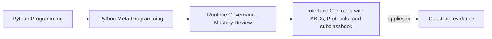
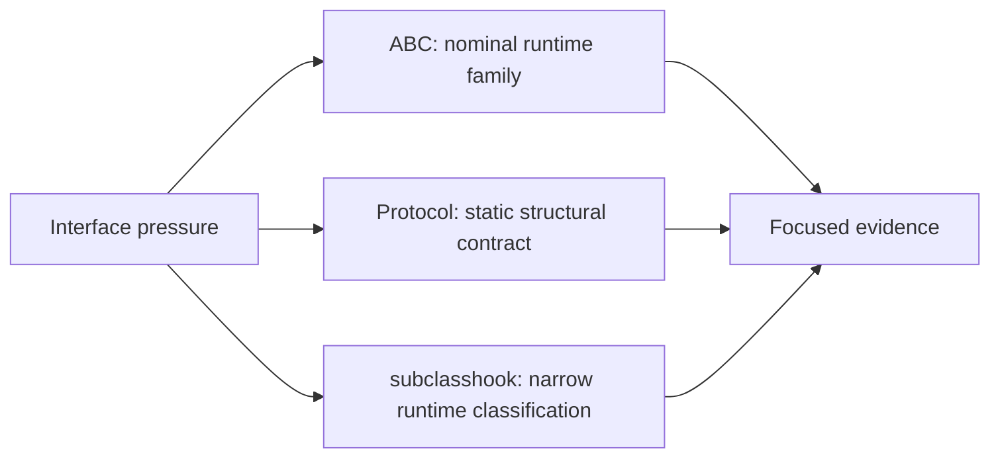
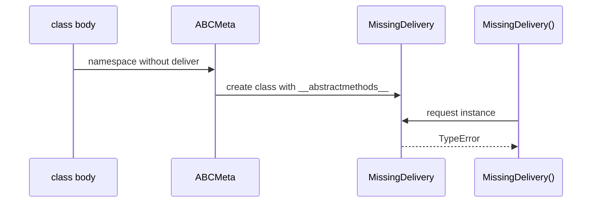

# Interface Contracts with ABCs, Protocols, and `__subclasshook__`

<!-- page-maps:start -->
## Page Maps




<!-- page-maps:end -->

Python offers several tools that look like "interface enforcement." They do not enforce
the same thing. Good governance starts by shrinking the claim to match the mechanism.

This core asks you to distinguish three questions:

- May an incomplete nominal subclass be instantiated?
- Does a statically checked consumer accept an object with a compatible shape?
- Should a runtime class be classified by one shallow, inspectable feature?

An ABC, a protocol, and `__subclasshook__` can answer those questions respectively. None
proves that an implementation behaves correctly.

## Predict before running

Consider a class with a `deliver` attribute whose callable takes no message:

```python
class WrongSignature:
    def deliver(self) -> str:
        return "delivered"
```

Predict these results:

1. Does `isinstance(WrongSignature(), DeliveryProtocol)` pass?
2. Would a static type checker accept `WrongSignature` where `DeliveryProtocol` is
   required?
3. Can the runtime check prove what `deliver("incident")` returns?

The answers are: yes, normally no, and no. The rest of the page explains why.

## ABCs own nominal instantiation rules

The lab defines:

```python
class DeliveryABC(ABC):
    """Runtime nominal contract for constructed delivery adapters."""

    @abstractmethod
    def deliver(self, message: str) -> str:
        """Deliver one message."""
```

Then it creates an incomplete subclass:

```python
class MissingDelivery(DeliveryABC):
    pass
```

Class creation succeeds. Instance construction does not:

```text
TypeError: Can't instantiate abstract class MissingDelivery
with abstract method deliver
```

That timing detail matters. `@abstractmethod` does not reject the `class` statement. The
ABC machinery records unresolved abstract methods and `ABCMeta.__call__` prevents
construction.



The honest claim is:

> Nominal subclasses of `DeliveryABC` cannot be instantiated while `deliver` remains
> abstract.

The ABC does not prove a correct signature, return type, side effect, or delivery result.
A concrete subclass can implement `deliver` badly and still instantiate.

## Protocols own static structural relationships

The lab's protocol is:

```python
@runtime_checkable
class DeliveryProtocol(Protocol):
    """Static structural contract with shallow runtime presence checks."""

    def deliver(self, message: str) -> str: ...
```

A static type checker can compare callable signatures and report that `WrongSignature`
does not satisfy the protocol. This is the protocol's strongest role: expressing a
consumer-facing structural contract without requiring inheritance.

That improves architecture:

- implementations do not need to inherit from an application-owned base class;
- consumers can depend on the capability they use;
- adapters from other packages can participate structurally;
- signature incompatibility can be reported before runtime.

The proof belongs to the configured static checker. A prose statement that "the protocol
checks the signature" is incomplete unless the static checking route actually runs.

## `@runtime_checkable` is intentionally shallow

At runtime:

```python
isinstance(WrongSignature(), DeliveryProtocol)  # True
```

The runtime check sees a `deliver` attribute. It does not perform the static type
checker's signature analysis. It does not call the method, inspect its result, or prove
its behavior.

Use runtime-checkable protocols only when shallow presence is the decision you need. If
you need to validate a call before execution, bind arguments against a known signature or
publish an explicit runtime validation subset.

| Claim | Runtime protocol check | Static protocol check |
| --- | --- | --- |
| named attribute exists | yes | yes |
| callable parameters are compatible | no | yes, within checker support |
| return annotation is compatible | no | yes, within checker support |
| implementation returns the promised value | no | no |
| side effects obey the domain contract | no | no |

The final two rows require executable behavioral proof.

## `__subclasshook__` owns narrow classification

The third lab type recognizes classes whose class dictionaries define `preview`:

```python
class PreviewCapable(ABC):
    @classmethod
    def __subclasshook__(cls, candidate: type[object]) -> bool:
        if cls is PreviewCapable:
            return any("preview" in vars(base) for base in candidate.__mro__)
        return NotImplemented
```

This hook is deliberately boring:

- it applies only when the queried ABC is exactly `PreviewCapable`;
- it searches static dictionaries along the candidate's MRO;
- it does not instantiate the candidate;
- it does not invoke descriptors or `__getattr__`;
- it returns `NotImplemented` when another class owns the classification.

Compare two candidates:

```python
class StaticPreview:
    def preview(self) -> str:
        return "preview"


class DynamicPreview:
    def __getattr__(self, name: str) -> object:
        if name == "preview":
            return lambda: "preview"
        raise AttributeError(name)
```

`issubclass(StaticPreview, PreviewCapable)` is true.
`issubclass(DynamicPreview, PreviewCapable)` is false.
The dynamic fallback is not executed.

That is a feature. Classification remains deterministic and avoids running candidate
behavior during a question about class relationships.

## `False` and `NotImplemented` carry different ownership

Inside a subclass hook:

- `True` says the hook recognizes the candidate;
- `False` says the hook actively rejects the candidate;
- `NotImplemented` delegates to normal ABC machinery.

Returning `False` for every unfamiliar situation can suppress legitimate nominal or
registered relationships. The lab delegates when `cls` is not the exact owner and makes
one narrow decision otherwise.

## Choose by the decision you need

| Design pressure | Suitable owner | Do not overclaim |
| --- | --- | --- |
| prevent incomplete members of one runtime family from constructing | ABC | method correctness |
| describe a structural consumer contract during development | Protocol + static checker | runtime enforcement |
| ask one shallow runtime capability question | `@runtime_checkable` protocol | signature compatibility |
| classify classes by stable class-dictionary evidence | narrow `__subclasshook__` | arbitrary behavioral conformance |
| validate actual arguments before a call | `inspect.Signature.bind` or explicit validator | return behavior |
| prove delivery semantics | focused behavioral tests | general interface conformance |

The phrase "enforce the interface" is too vague for review. Replace it with the exact row
you intend.

## Run the evidence route

From the course root:

```console
make runtime-governance-lab
python -m unittest discover -s tests -p "test_runtime_governance_interfaces.py" -v
```

Inspect these packet values:

```text
interface_contracts.abc.incomplete_class_created = true
interface_contracts.abc.incomplete_instance_created = false
interface_contracts.protocol.wrong_signature_passes_runtime_check = true
interface_contracts.subclass_hook.static_preview_matches = true
interface_contracts.subclass_hook.dynamic_preview_matches = false
interface_contracts.subclass_hook.instance_fallback_executed = false
```

The tests prove those runtime observations. They do not replace a static checker run, so
the packet names the static type checker as the owner of signature compatibility instead
of pretending to demonstrate it dynamically.

## Failure cases to recognize

| Failure | Why it misleads |
| --- | --- |
| claiming an ABC validates signatures | abstractness and signature compatibility are separate concerns |
| using `isinstance` with a protocol as call validation | presence can pass while invocation fails |
| executing `hasattr(instance, name)` inside classification | custom lookup may run arbitrary candidate behavior |
| returning `False` when the hook does not own the question | normal ABC relationships may be suppressed |
| treating any interface declaration as behavioral proof | names and annotations do not prove outcomes |

## Capstone transfer: explicit binding wins

The incident-plugin runtime needs to answer a concrete runtime question: can these supplied
keyword arguments bind to this registered action? It uses stored `inspect.Signature`
objects and an explicit binding route rather than a runtime protocol check.

Run:

```console
make capstone-bind-action
make capstone-governance
```

The governance report rejects `runtime-checkable Protocol` for runtime signature
enforcement. The lower-power owners are a static type checker for development-time
relationships and explicit call binding for runtime arguments.

This is a direct application of the lesson: use a mechanism whose observable behavior
matches the question.

## Review checkpoint

For each sentence, replace the blank with one precise phrase:

- An ABC in this lab proves ______.
- A static protocol check can report ______.
- A runtime-checkable protocol observes ______.
- The subclass hook classifies using ______.
- None of these mechanisms proves ______.

You are ready to continue when your answers mention timing and evidence, not simply
"nominal versus structural."
