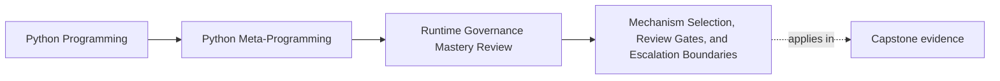

# Mechanism Selection, Review Gates, and Escalation Boundaries


<!-- page-maps:start -->
## Page Maps




<!-- page-maps:end -->

The earlier pages in this module each protect one danger zone. This page turns those
lessons into a repeatable approval standard.

That matters because good governance is not just knowing that a mechanism is risky. It is
knowing what should be chosen instead, and what evidence earns an escalation.

This page is the course-wide decision surface. If it reads like a recap, it is too weak.
It should leave readers able to approve, constrain, or reject a mechanism with explicit
review language instead of personal taste.

## The sentence to keep

Choose the lowest-power mechanism that solves the problem, and only escalate when the
higher-power tool owns something the lower-power tools cannot own honestly.

That sentence is the review gate for the whole course.

If the escalation story cannot say what the lower-power owner failed to own, the gate has
not been passed.

For self-study, turn that sentence into a selection test:

- what is the narrowest plausible owner here?
- what exact timing, scope, or process-wide need makes that owner insufficient?
- what new operational cost appears when the mechanism escalates?

## Evidence route for escalation decisions

Use this route whenever two or more mechanisms could solve the same problem:

| Review step | What to inspect | What strong evidence looks like |
| --- | --- | --- |
| Name the pressure | What exact runtime or design need is being solved? | One invariant, timing need, or operational pressure is named clearly |
| Start at the bottom | What is the lowest-power plausible owner? | Explicit code, wrapper, descriptor, decorator, or other narrower tool is considered first |
| Prove insufficiency | What concrete requirement does the lower-power tool lose? | Timing, hierarchy scope, process-wide instrumentation, or another specific need is named |
| Audit operational cost | What observability, reset, performance, or global-semantics cost appears after escalation? | Blast radius is explicit |
| Write the decision sentence | What exact approval or rejection sentence belongs in review? | The decision is operational and narrow, not aesthetic |

## The runtime power ladder is about blast radius

The ladder in this course is not about prestige. It is about how widely a mechanism can
change runtime behavior.

From lower power to higher power:

1. explicit code and ordinary objects
2. wrappers and decorators
3. descriptors and attribute-level control
4. metaclasses and class-creation hooks
5. import hooks, AST transforms, and dynamic execution with global consequences

Each step upward raises the review cost because the mechanism becomes harder to see,
harder to reverse, or harder to scope.

## Power ladder in approval language

| Mechanism tier | What approval should sound like |
| --- | --- |
| explicit code and ordinary objects | "The behavior is local, visible, and does not need runtime indirection." |
| wrappers and decorators | "Definition-time or call-time change stays attached to one symbol." |
| descriptors and attribute-level control | "One attribute path owns the invariant more honestly than scattered call sites." |
| metaclasses and class-creation hooks | "The rule belongs to class creation or every subclass in the family." |
| import hooks, AST transforms, dynamic execution | "The problem is already process-wide or trusted-meta enough to justify global cost." |

## What escalation should sound like

Weak escalation language:

- "this is more elegant"
- "this avoids boilerplate"
- "the runtime can enforce it automatically"

Stronger escalation language:

- "this must happen during class creation before subclasses exist"
- "this behavior belongs to one attribute access point rather than a method"
- "this instrumentation must see imports as they happen"
- "this trusted expression language cannot be modeled as simple data without losing the needed semantics"

The difference is ownership, not enthusiasm.

## Weak justifications to reject immediately

Reject escalation language built on these:

- "more elegant"
- "less boilerplate"
- "the runtime can handle it"
- "it feels more automatic"
- "we can centralize everything there"

None of those tells a reviewer why the narrower owner failed.

## Plugin systems make the ladder concrete

Plugin architectures are a good governance test because several mechanisms can plausibly
solve them.

Default choice:

- decorator-based registration

Escalation case:

- metaclass-based registration when a class hierarchy must enforce registration for every
  concrete subclass with no opt-out

Usually reject:

- import-hook-based plugin discovery for ordinary application behavior

The point is not that decorators are always morally pure. The point is that they usually
keep registration more explicit, local, and testable.

## Selection table with refusal surfaces

| Need | First honest choice | Escalate only if... | Refusal surface |
| --- | --- | --- | --- |
| explicit opt-in registration | decorator | every concrete subclass must register at class definition time | reject import-time discovery for ordinary app code |
| per-field validation or conversion | descriptor or property | no lower surface can keep attribute ownership coherent | reject metaclass escalation if only one field rule exists |
| hierarchy-wide class-creation rule | metaclass | the rule truly belongs to class creation | reject decorator-only solutions if they lose family-wide timing |
| process-wide import instrumentation | import hook | the problem is already tooling-grade and global | reject hook use for local startup convenience |
| user-controlled expressions | data or out-of-process execution | semantics genuinely require programmable behavior | reject in-process hostile execution claims |

## A small selection table

| Need | First honest choice | Why it stays governable |
| --- | --- | --- |
| explicit opt-in registration | decorator | definition-time change stays visible at one symbol |
| per-field validation or conversion | descriptor or property | ownership sits on one attribute path |
| hierarchy-wide class-creation rule | metaclass | the hook matches the timing of the invariant |
| process-wide import instrumentation | import hook | the problem is already process-wide |
| user-controlled expressions | data or out-of-process execution | trust boundary remains honest |

Selection is clearer when the table names the owner, not just the mechanism.

## Review gates for escalation

Before approving a higher-power design, reviewers should be able to point to all of these:

- the lower-power alternative that was considered first
- the specific ownership reason that made it insufficient
- the observability plan
- the reset, disable, or rollback path
- the test surface for failure cases
- the performance story if the mechanism sits on a hot path

Keep one escalation worksheet beside every high-power proposal:

| Question | Strong answer shape |
| --- | --- |
| what lower-power owner was checked first? | explicit code, wrapper, descriptor, decorator, or another named smaller owner |
| what did it lose? | one concrete timing, scope, or ownership fact |
| what new cost appears after escalation? | import-time mutation, hot-path overhead, reset burden, or hidden semantics |
| what sentence approves or rejects the change? | one operational note another reviewer could repeat |

If any one of those is missing, the escalation case is not finished.

## Approval note template

Strong approval notes usually sound like this:

- "We considered `<lower-power owner>` first and rejected it because it cannot own `<named timing or scope>`."
- "Escalation to `<mechanism>` is accepted because the invariant belongs to `<owner boundary>`."
- "The resulting blast radius is controlled through `<observation/reset/disable surface>`."
- "The decision does not imply `<overclaim>`."

## Lower-power rejection is a sign of strength

One of the best outcomes in Module 10 is a clean rejection.

Examples:

- reject `exec` because configuration data plus explicit dispatch is clearer
- reject a metaclass because a decorator or helper registers classes honestly enough
- reject a protocol runtime check because unit tests and a small adapter do the job more clearly
- reject an import hook because explicit imports keep startup behavior visible

The course is doing its job when the review answer is often "do less."

That is not conservatism for its own sake. It is refusal to pay runtime cost without a
clear owner.

## Weak escalation language to reject early

| Weak line | Why it fails |
| --- | --- |
| "this keeps things cleaner" | cleaner does not name what the smaller owner lost |
| "the runtime can manage it for us" | manage is not a timing or scope argument |
| "we may need the power later" | later is not a present escalation reason |
| "it centralizes the design" | centralization alone says nothing about blast radius or reversibility |

## Approval language should stay operational

When a design is approved, the explanation should mention operational facts:

- when the mechanism runs
- what it can mutate
- how it is observed
- how it is reset or disabled
- what evidence proves it stays deterministic

If the approval note only says the abstraction is clever or elegant, governance has not
really happened.

## Failure modes to name explicitly

Watch for these:

| Failure mode | What goes wrong |
| --- | --- |
| lower-power alternative not documented | escalation looks inevitable when it was merely unreviewed |
| ownership reason stated vaguely | approval becomes taste-based |
| operational cost treated as follow-up work | the true review surface is hidden |
| security, interface, or visibility claims inflate after escalation | the mechanism gains borrowed credibility |
| rejection criteria remain implicit | future reviewers cannot repeat the decision consistently |

## A drop-in review checklist

Use this when one of the course mechanisms appears in design review:

```text
Runtime governance checklist

□ Lowest-power mechanism considered first
□ Escalation reason tied to ownership, not taste
□ Import-time, class-time, call-time, or attribute-time effects named explicitly
□ Introspection and traceback surfaces preserved
□ Reset, cleanup, or disable path documented
□ Determinism and test isolation addressed
□ Performance evidence supplied for hot paths
□ Security claims stop at the real boundary
```

This is the practical heart of Module 10.

## Rejection note template

Strong rejection notes usually sound like this:

- "Reject because `<lower-power owner>` still owns the problem honestly."
- "Reject because the process-wide or class-wide blast radius is larger than the requirement."
- "Reject because the design lacks `<reset/disable/performance/trust-boundary evidence>`."
- "Reject because the approval claim is larger than the mechanism can actually prove."

## What this page makes clear

The point is not "always stay at the bottom of the ladder."

The boundary is:

- higher-power tools need stronger ownership arguments
- rejecting escalation is often the most professional decision
- review gates should talk about timing, scope, evidence, and reversibility

Before you leave this page, write one sentence beginning:

- "the smallest honest owner here is..."
- "escalation is earned only because..."

That is how the earlier modules become long-term engineering judgment.

## Exit check for this page

Before moving on, make sure you can do all of the following:

- write one approval note and one rejection note without using style words like "clean" or "elegant"
- name the exact lower-power owner you would compare first for a new design
- explain what new blast radius appears after escalation
- state one overclaim that must be refused even if the mechanism is technically possible

## What to practice from this page

Try these before moving on:

1. Take one design that uses a metaclass or import hook and argue for a lower-power replacement.
2. Write one escalation justification that names timing and ownership precisely.
3. Review one plugin design and explain why the chosen mechanism is or is not the lowest-power honest fit.

If those feel ordinary, the module is ready for a worked example that applies all five core
lessons to one reviewable runtime design.

## Continue through Module 10

- Previous: [Import Hooks, AST Transforms, and Tooling Boundaries](import-hooks-ast-transforms-and-tooling-boundaries.md)
- Next: [Worked Example: Reviewing a Plugin Runtime for Observability and Control](worked-example-reviewing-a-plugin-runtime-for-observability-and-control.md)
- Practice: [Exercises](exercises.md)
- Terms: [Glossary](glossary.md)
