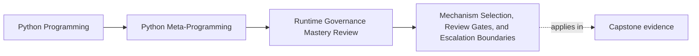
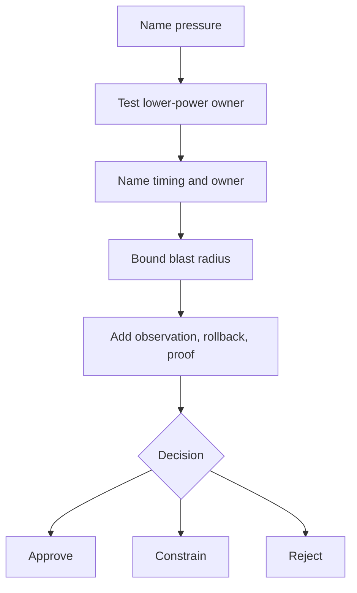
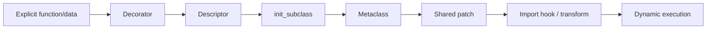
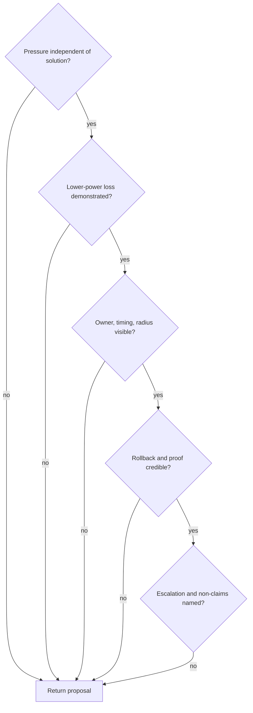

# Mechanism Selection, Review Gates, and Escalation Boundaries

<!-- page-maps:start -->
## Page Maps




<!-- page-maps:end -->

The final core turns the earlier mechanisms into a repeatable review decision. It is not a
ranking contest where "less magic" always wins. A higher-power mechanism earns approval
when its execution timing and ownership match a real pressure that lower-power designs
cannot preserve honestly.

The decision must still name costs. An approval with no blast radius, rollback, or proof
is enthusiasm, not governance.

## Three outcomes, not two

Use three decision states:

| Outcome | Meaning |
| --- | --- |
| approve | the mechanism, owner, and proposed boundary are justified as stated |
| constrain | the mechanism is justified only with a narrower lifetime, scope, or use case |
| reject | a different owner should solve the pressure |

`Constrain` is not a polite synonym for "maybe." It must state the enforceable boundary.
For example: exact module name, context-managed lifetime, tooling tests only, no
application dependency.

## Power depends on integration surface

A useful review ladder moves from explicit local behavior toward implicit process-wide
behavior:



This is a prompt, not a universal theorem. A descriptor may be clearer than repeated
properties when attribute access genuinely owns validation. A metaclass may be the
smallest owner of overwritten class-body declarations. The review question is:

> What required fact exists at this mechanism's execution point that a lower-power owner
> cannot observe or preserve?

If no required fact is lost, choose the lower-power owner.

## The executable decision record

Open `labs/runtime_governance/selection.py`. Every `GovernanceDecision` stores:

```python
@dataclass(frozen=True, slots=True)
class GovernanceDecision:
    pressure: str
    proposed_mechanism: str
    decision: str
    selected_owner: str
    lower_power_result: str
    blast_radius: str
    observability: str
    rollback: str
    proof: str
    escalation_signal: str
```

This is deliberately more demanding than a mechanism/reason pair.

- `pressure` prevents solution-first reasoning.
- `lower_power_result` records the alternative comparison.
- `blast_radius` names who pays the cost.
- `observability` tells a reviewer where to look.
- `rollback` states how baseline returns or why refusal is necessary.
- `proof` makes the claim executable.
- `escalation_signal` names the condition that would reopen the decision.

An escalation signal is not permission to escalate automatically. It identifies new
evidence that would justify another review.

## Read the six decisions as arguments

Run:

```console
make runtime-governance-lab
```

Inspect `mechanism_selection.decisions`. The packet contains six distinct arguments:

### Reject in-process adversarial evaluation

| Field | Decision |
| --- | --- |
| pressure | evaluate adversarial tenant policy text |
| proposal | `eval` with empty builtins |
| outcome | reject |
| selected owner | isolated policy service |
| lower-power result | prefer a bounded explicit policy model when sufficient |
| rollback | terminate the isolated process, not clean a namespace |

The rejection follows the trust boundary. Empty builtins cannot own resource isolation.

### Reject runtime protocol signature enforcement

| Field | Decision |
| --- | --- |
| pressure | enforce action method signatures at runtime |
| proposal | runtime-checkable protocol |
| outcome | reject |
| selected owner | static type checker plus explicit call binding |
| proof | static checks and executable binding failures |

The proposal cannot observe the fact it claims to enforce. Presence is not signature
compatibility.

### Constrain an owner-local patch

| Field | Decision |
| --- | --- |
| pressure | replace one dependency during a focused test |
| proposal | owner-local monkey patch |
| outcome | constrain |
| selected owner | scoped context-managed patch |
| blast radius | other code can observe the replacement while active |
| proof | success, exception, and absent-attribute restoration |

The test pressure is real, but the shared mutation prevents general approval. Dependency
injection remains preferred when the API permits it.

### Constrain an exact-name import hook

| Field | Decision |
| --- | --- |
| pressure | serve one virtual module in a compiler test |
| proposal | meta-path finder |
| outcome | constrain |
| selected owner | exact-name context-managed tooling hook |
| rollback | remove finder and owned cache entry |
| escalation signal | application behavior starts depending on the hook |

The constrained design exists to test import integration. Moving it into application
startup would cross the stated boundary and require rejection or redesign.

### Approve the bounded plugin metaclass

| Field | Decision |
| --- | --- |
| pressure | build contracts from tracked class declarations |
| proposal | `PluginMeta` |
| outcome | approve |
| lower-power result | `__init_subclass__` loses overwritten declaration events |
| observability | non-constructing class-creation and registry reports |
| proof | namespace, class-creation, registry, field, and action tests |

This is the crucial positive case. The metaclass earns approval because `__prepare__`
observes class-body assignment history before an ordinary class or
`__init_subclass__` exists. The runtime needs that exact timing.

Approval remains bounded to a class family. Discovery, reload coordination, and external
I/O are not smuggled into class creation.

### Reject package scanning in the metaclass

| Field | Decision |
| --- | --- |
| pressure | discover installed plugins during class creation |
| proposal | metaclass package scanning |
| outcome | reject |
| selected owner | explicit discovery and configuration boundary |
| blast radius | filesystem or metadata I/O during import |
| rollback | disable discovery independently from class definition |

The metaclass sees classes already imported. It does not therefore own deployment
discovery.

## The five-gate review

The evidence packet publishes this gate:

1. name the pressure before the mechanism;
2. show what the lower-power owner loses;
3. bound blast radius and make behavior observable;
4. provide rollback and focused proof;
5. name the escalation signal and non-claims.

Apply the gates in order. A proposal that cannot pass an earlier gate should not distract
reviewers with elaborate monitoring or rollback claims at a later gate.



## Write operational decisions

A durable review note can use this shape:

```text
Pressure:
Proposed mechanism:
Decision: approve | constrain | reject
Selected owner:
Lower-power comparison:
Execution timing:
Public-surface consequence:
Blast radius:
Observation route:
Rollback or refusal:
Focused proof:
What remains unproved:
Escalation signal:
```

Avoid language such as "clean," "elegant," "Pythonic," or "only a little magic" unless a
separate technical argument already establishes ownership. Those words describe taste,
not runtime consequences.

## Distinguish rollback from replacement

Approved and constrained mechanisms need a rollback story sized to their state:

| State | Plausible rollback |
| --- | --- |
| context-local replacement | restore exact attribute or remove introduced one |
| in-process registry | clear deterministic registry and rebuild through imports |
| generated class policy | code change and redeploy; clear associated runtime state |
| import hook experiment | remove finder and owned `sys.modules` entry |
| adversarial code process | terminate and replace process |

A rollback path may require deployment. It does not have to be instantaneous, but it must
be honest. "Remove the metaclass at runtime" would be false; existing class objects have
already been created.

## Proof must match the decision

| Claim | Suitable proof |
| --- | --- |
| syntax refused before execution | focused refusal test and evidence flag |
| runtime check is shallow | wrong-signature object that passes presence check |
| patch restores exact identity | static identity assertion after success and failure |
| hook is optional | no-hook behavior after full cleanup |
| metaclass needs preparation timing | overwritten-declaration evidence and comparison |
| registry is constrained | ordering, duplicate, and reset tests |

Test names and passing counts are useful, but a reviewer should still be able to explain
which assertion proves the decision.

## Run the focused gate

```console
python -m unittest discover -s tests -p "test_runtime_governance_selection.py" -v
```

The tests verify all three outcome classes, complete decision fields, the approved
metaclass argument, the rejected hostile execution owner, and the exact aggregate counts:

```text
approve = 1
constrain = 2
reject = 3
```

The counts are not a target. They make accidental loss or reclassification visible.

## Capstone transfer: audit the shipped runtime

Run:

```console
make capstone-governance
```

Compare its application-specific report with the course lab's general decisions. The
capstone:

- approves decorators, descriptors, `PluginMeta`, and observational CLI routes;
- constrains the process-global registry;
- rejects runtime evaluation, application patching, application hooks/transforms,
  package discovery during class creation, and automatic metaclass-conflict repair.

The two reports are intentionally not identical. The course lab teaches the decision
method across small experiments. The capstone applies that method to one real runtime.

## Exit review

Choose one unfamiliar metaprogramming proposal and produce the full review-note shape.
Then remove the mechanism name. If the note still explains pressure, owner, timing,
radius, observation, rollback, proof, and non-claims, the reasoning is durable.

You have completed the core sequence when "approve" is no longer the default sign of
success and "reject" no longer feels like failure to use Python deeply.
