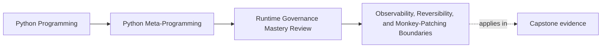
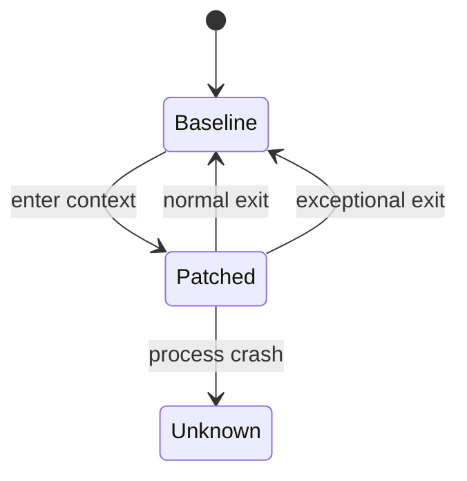

# Observability, Reversibility, and Monkey-Patching Boundaries

<!-- page-maps:start -->
## Page Maps




<!-- page-maps:end -->

A runtime change is not reviewable merely because it works. Another engineer must be able
to answer:

- which owner changed;
- when the change is visible;
- what identity was replaced;
- how baseline state returns;
- which failures defeat the rollback story.

This core uses an owner-local monkey patch because it makes all five questions observable.
The lesson is not that context managers make monkey patching generally safe. The lesson is
how quickly a precise rollback claim reaches its limits.

## The design pressure

Suppose a focused test must replace `Renderer.render`, and the API does not yet expose
dependency injection. Compare the choices:

| Choice | Visibility | Restoration burden |
| --- | --- | --- |
| pass a renderer dependency | explicit to the caller | none |
| subclass or adapter | explicit in object construction | none |
| test-fixture patch of the looked-up symbol | scoped but shared while active | fixture cleanup |
| permanent assignment to a library or global owner | process-wide and indefinite | manual, fragile |

Dependency injection is the first choice when the API permits it. The lab demonstrates the
third row as a constrained fallback.

## The executable patch boundary

Open `labs/runtime_governance/patching.py`:

```python
@contextmanager
def scoped_attribute_patch(
    owner: object,
    attribute: str,
    replacement: object,
) -> Iterator[PatchRecord]:
    if not attribute or attribute.startswith("__"):
        raise ValueError("patch attribute must be a non-dunder name")
    sentinel = object()
    original = inspect.getattr_static(owner, attribute, sentinel)
    record = PatchRecord(
        owner_type=type(owner).__name__,
        attribute=attribute,
        had_original=original is not sentinel,
        original_type=None if original is sentinel else type(original).__name__,
        replacement_type=type(replacement).__name__,
    )
    setattr(owner, attribute, replacement)
    try:
        yield record
    finally:
        if original is sentinel:
            delattr(owner, attribute)
        else:
            setattr(owner, attribute, original)
```

The function accepts an explicit owner and one explicit attribute. It refuses dunder
patches. It records what existed before mutation, then restores in `finally`.

That scope is materially better than a helper that accepts dotted import strings and
searches the process for something to replace. The caller can see the mutation target at
the call site.

## Why static lookup matters

The lab uses `inspect.getattr_static`, not ordinary `getattr`, to capture the original.
Ordinary attribute access may invoke descriptor binding or dynamic fallback. Static
lookup retrieves the stored class-dictionary object.

For this owner:

```python
class Renderer:
    @staticmethod
    def render(message: str) -> str:
        return f"original:{message}"
```

the stored original is a `staticmethod` descriptor. Saving `Renderer.render` through
ordinary lookup would save the resolved function instead. Restoring that function would
produce similar call output in this simple example, but it would not restore the original
descriptor identity.

Reversibility means restoring the owned object, not merely producing the same sample
string afterward.

## Trace success and failure

Inside `patching_evidence`, the lab records the original identity, enters the scope, calls
the replacement, and deliberately raises:

```python
try:
    with scoped_attribute_patch(Renderer, "render", replacement) as active:
        record = active
        inside_result = Renderer.render("incident")
        raise RuntimeError("exercise rollback")
except RuntimeError as error:
    failure_type = type(error).__name__
```

The expected evidence is:

```text
inside_scope.result = "patched:incident"
inside_scope.replacement_visible = true
after_scope.result = "original:incident"
after_scope.original_identity_restored = true
after_scope.body_failure_type = "RuntimeError"
```

The exception is not swallowed by the context manager. Cleanup happens, and the caller
still owns the body failure.

```mermaid
sequenceDiagram
  participant Caller
  participant Scope as scoped_attribute_patch
  participant Owner as Renderer.render
  Caller->>Scope: enter(owner, attribute, replacement)
  Scope->>Owner: save static identity; install replacement
  Caller->>Owner: call
  Owner-->>Caller: patched:incident
  Caller--xScope: RuntimeError
  Scope->>Owner: restore original descriptor
  Scope--xCaller: propagate RuntimeError
```

## Existing and absent attributes are different contracts

If the attribute existed, rollback must restore the exact original object.
If the attribute did not exist, rollback must remove the newly introduced attribute.

The sentinel distinguishes those states. Storing `None` as a missing marker would be
incorrect because `None` could be the legitimate original value.

The focused tests cover both branches:

- restore after normal exit;
- restore after exceptional exit;
- remove an attribute introduced only for the scope;
- reject empty and dunder attribute names.

These are not implementation-detail tests. They define what "reversible" means for this
helper.

## The patch record is evidence, not an audit system

`PatchRecord` publishes:

```text
owner_type
attribute
had_original
original_type
replacement_type
rollback_owner
```

That lets a test or review packet explain the mutation. The lab intentionally reports
`automatic_audit_storage = false`: no durable log is written, and the record disappears
unless the caller stores it.

Do not describe an in-memory record as operational audit history. Durable audit requires a
separate owner, retention policy, failure behavior, and likely redaction rules.

## Ordinary rollback has hard limits

The `finally` block proves restoration only while Python can run it.

| Situation | Does this helper restore? | Why |
| --- | --- | --- |
| context body returns normally | yes | context manager exits through `finally` |
| context body raises a Python exception | yes | stack unwinding reaches `finally` |
| another thread reads the attribute during the scope | not applicable | it sees the replacement; there is no isolation |
| process terminates abruptly | no | Python cleanup may never run |
| replacement mutates another object | no | that state is outside this patch owner |
| patch target is also cached elsewhere | not necessarily | restoring one attribute does not invalidate other references |

The evidence packet therefore publishes `concurrency_safe = false`. Context scope is a
lifetime boundary, not a thread-isolation boundary.

## Patch where lookup happens

Even a correctly restored patch can be ineffective when it targets the definition rather
than the symbol used by the code under test.

If `service.py` contains:

```python
from renderer import render
```

then patching `renderer.render` later does not replace `service.render`; the importing
module already owns a reference. Patch the symbol at the lookup owner, or redesign the
dependency to be explicit.

This rule is about Python name ownership, not a testing-library quirk.

## Observation comes before approval

A defensible patch proposal should state:

| Review field | Required answer |
| --- | --- |
| owner | exact object whose attribute changes |
| attribute | exact non-dunder name |
| timing | setup, active interval, and teardown |
| visibility | which callers or threads can observe it |
| original evidence | identity or static descriptor saved before change |
| rollback | restore existing object or remove introduced attribute |
| failure limit | crash, concurrency, caches, and secondary mutations |
| proof | success, exception, and absent-attribute tests |

If the proposal says only "temporary patch," it has not described a boundary.

## Run the focused evidence

From the course root:

```console
make runtime-governance-lab
python -m unittest discover -s tests -p "test_runtime_governance_patching.py" -v
```

Inspect `reversible_patching.inside_scope`, `after_scope`, `boundary`, and
`claim_limits`. Predict the values before reading them.

The tests prove ordinary restoration and published non-claims. They do not prove safe
parallel use or recovery after process termination.

## Capstone transfer: reject hidden replacement

The incident-plugin runtime rejects application monkey patching. Its runtime owners are
explicit modules—descriptors in `fields.py`, callable policy in `actions.py`, and class
creation in `framework.py`.

Run:

```console
make capstone-governance
```

The alternative named in the report is an explicit dependency or adapter replacement.
This keeps application ownership visible. Tests may still use a framework-provided scoped
patch where necessary, but that testing technique does not become the application's
extension architecture.

## Review checkpoint

Review this statement:

> The patch is safe because a context manager always restores it.

Replace it with a claim that names ordinary success and exception rollback, other-thread
visibility, and crash behavior. Then explain why identical output after the scope is
weaker evidence than original descriptor identity.

You are ready for the tooling core when "reversible" automatically makes you ask
"reversible under which failures, and for which owner?"
