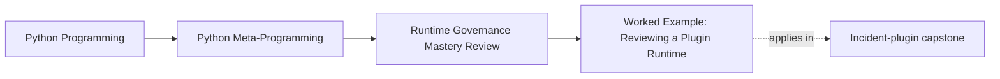
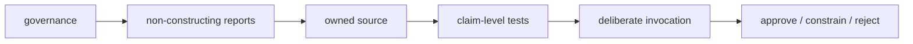
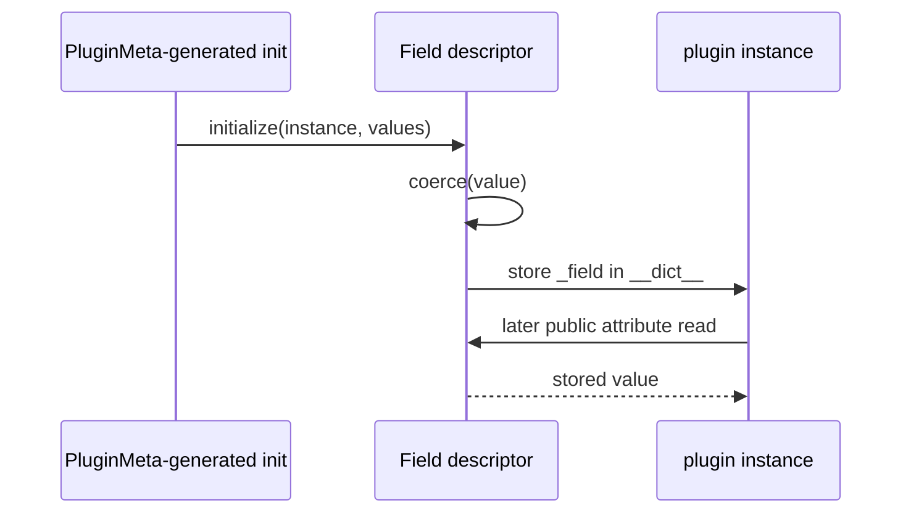

# Worked Example: Reviewing a Plugin Runtime for Observability and Control

<!-- page-maps:start -->
## Page Maps




<!-- page-maps:end -->

This worked example audits the incident-plugin capstone as a reviewer, not as someone
trying to admire every mechanism. The review starts with policy and observational
evidence. It invokes a plugin only after the runtime's owners and limits are understood.

The course lab remains the primary teaching surface. This capstone review is where you
transfer the five-core method into interacting decorators, descriptors, class creation,
global registration, and CLI evidence.

## Review question

The application needs incident-delivery adapters with:

- typed configuration fields;
- declared actions;
- generated constructor signatures;
- deterministic in-process lookup;
- manifests that tools can inspect without delivering an incident.

Does the shipped runtime use the smallest honest mechanisms for those pressures, and can a
reviewer observe and reverse their important effects?

## Establish the evidence order

From the course root:

```console
make capstone-governance
make capstone-field-system
make capstone-action-wrapper
make capstone-class-creation
make capstone-bind-action
make capstone-trace
```

The order is deliberate:

1. governance states the proposed decisions;
2. field, wrapper, and class-creation routes show mechanism ownership;
3. binding validates a proposed call without constructing or invoking;
4. trace finally constructs and executes one plugin.

Starting with `trace` would prove that one happy path runs, but not whether the runtime is
reviewable.

## Read the governance report as a hypothesis

`make capstone-governance` returns JSON with:

```text
scope = "incident-plugin runtime"
constructed = false
executed = false
decisions = 5
rejected_powers = 5
```

Treat the report as a hypothesis to verify against source and tests. A system cannot
certify its own governance merely by returning persuasive strings.

The report claims four approvals, one constrained stateful mechanism, and five explicit
rejections:

| Mechanism | Outcome | Claimed owner |
| --- | --- | --- |
| action decorators | approve | `actions.py` |
| field descriptors | approve | `fields.py` |
| `PluginMeta` | approve | `framework.py` |
| process-global plugin registry | constrain | `framework.py` |
| runtime introspection CLI | approve | `cli.py` and public helpers |

Now inspect whether each argument matches runtime behavior.

## Approval: action decorators own callable policy

The `@action` decorator runs when a plugin class body defines an action. It captures
`inspect.signature(function)`, builds an `ActionSpec`, and returns a wrapper.

The wrapper's runtime job is narrow:

```python
@wraps(function)
def wrapped(self, *args, **kwargs):
    bound = signature.bind(self, *args, **kwargs)
    bound.apply_defaults()
    result = function(self, *args, **kwargs)
    self._action_history.append(
        {
            "action": function.__name__,
            "arguments": {
                key: value
                for key, value in bound.arguments.items()
                if key != "self"
            },
            "result_type": type(result).__name__,
        }
    )
    return result
```

The public surface changes in visible ways:

- the callable carries `__plugin_action__`;
- `functools.wraps` supplies `__wrapped__` and preserves metadata;
- `__signature__` exposes the logical signature;
- successful invocations append action history.

`make capstone-action-wrapper` verifies those surfaces without invoking the action. The
report should show `constructed = false`, `executed = false`, wrapper depth `1`, and a
visible signature matching the original.

Approval is justified because action declaration and call instrumentation belong to the
callable. The report does not claim total transparency: a wrapper frame and call-time work
still exist.

## Approval: descriptors own assignment policy

Each `Field` is a data descriptor. `__set_name__` records the public and storage names;
`__set__` delegates coercion to a concrete field class; `__get__` reads per-instance
storage.



Run `make capstone-field-system`. For `WebhookNotifier`, the report names:

- field order: `endpoint`, `timeout_seconds`, `redact_summary`;
- the concrete coercion owner for each field;
- storage names and `plugin-instance.__dict__` as source of truth;
- `PluginMeta` as collection and constructor-generation owner.

It also rejects derived caching, external storage during attribute access, automatic
wrapper composition, annotation-inferred policy, and cross-field transactions. Those
rejections keep the descriptor system aligned with a real need: local configuration
coercion and validation.

## Approval: `PluginMeta` owns class-creation facts

The metaclass has three distinct hooks:

| Hook | Owned work |
| --- | --- |
| `__prepare__` | return `DefinitionNamespace`, which detects duplicate tracked declarations |
| `__new__` | collect inherited and declared fields/actions; generate signature and initializer; store class-creation evidence |
| `__init__` | register the completed non-abstract class |

`make capstone-class-creation` should report this trace:

```text
prepare:DefinitionNamespace
body:complete
new:shape
init:register
```

The command does not create an instance or run an action. It reads the
`ClassCreationSpec` captured while those facts existed.

The metaclass is stronger than a decorator or `__init_subclass__`, but the runtime needs
declaration-history evidence from `__prepare__`. That is the earned escalation. The
approval remains bounded to this class family.

## Constraint: registry state needs reset discipline

Concrete class creation mutates `_REGISTRY`. That state is process-global and import-time,
so it receives `constrain`, not unqualified approval.

The boundary is:

- keys are stable group and plugin names;
- public registry output is deterministically sorted;
- duplicates fail;
- `PluginMeta.clear_registry` can clear one group or all state;
- tests restore registry state between scenarios.

Rollback is not magic. Clearing removes lookup state; it does not destroy existing class
objects or rediscover plugins. Normal imports or process startup rebuild the expected
registry.

The focused proof belongs in registry and runtime tests: ordering, duplicate refusal,
abstract-class exclusion, and reset behavior.

## Approval: inspection is a public runtime capability

The CLI does more than demo the application. It lets reviewers ask questions without
crossing into construction or business execution:

| Command | Question |
| --- | --- |
| `manifest` | What public plugins, fields, and actions exist? |
| `field-system` | Which descriptor powers are accepted or rejected? |
| `action-wrapper` | What wrapper chain and signatures exist? |
| `bind-action` | Do supplied arguments bind to the stored signature? |
| `class-creation` | What happened during class definition? |
| `registry` | What process-global lookup state exists? |
| `governance` | Which runtime powers are approved, constrained, or rejected? |

These commands print JSON and preserve `constructed = false` and `executed = false` where
that distinction matters. `inspect`, `tour`, and `verify-report` save the outputs with a
bundle manifest so evidence can be reviewed after the command ends.

Observation is part of the application's public design, not documentation pasted over
private magic.

## Test a proposed call before execution

`make capstone-bind-action` binds supplied keyword arguments against the stored
`inspect.Signature`:

```text
action_name = "deliver"
bound_arguments.title = "CPU high"
bound_arguments.severity = "warning"
bound_arguments.summary = "node-1 crossed 90%"
executed = false
```

This is why the runtime rejects a runtime-checkable protocol as signature enforcement.
Explicit binding answers the actual runtime question without pretending shallow attribute
presence validates the call.

## Invoke only after the boundaries are visible

`make capstone-trace` constructs `PagerNotifier`, calls `preview`, and returns
configuration, result, and action history.

Now execution evidence can be interpreted:

- descriptor initialization explains the normalized configuration;
- the generated constructor explains keyword-only arguments;
- the decorator explains the action-history entry;
- registry lookup explains how the class was selected.

The trace is a consequence of previously inspected mechanisms, not a mysterious end-to-end
success.

## Verify each rejection

The governance report refuses powers the runtime could technically implement:

| Rejected power | Why it is outside the runtime | Selected alternative |
| --- | --- | --- |
| `eval` / `exec` configuration | configuration is data | scalar parsing and field validation |
| application monkey patching | replacement obscures ownership and concurrent visibility | dependency or adapter |
| application import hooks / AST rewriting | application does not own process-wide import or source transformation | ordinary imports and external tooling |
| package discovery during class creation | deployment discovery is not a class-definition fact | explicit discovery/configuration boundary |
| automatic metaclass-conflict repair | combined policies require semantic integration | explicit compatible owner and composition tests |

These rejections are part of the design. A plugin system is not more complete because it
discovers, rewrites, patches, and evaluates automatically.

## Claim-to-proof map

| Review claim | Source owner | Focused proof |
| --- | --- | --- |
| wrappers preserve logical metadata | `actions.py` | action-wrapper and runtime tests |
| fields coerce into instance storage | `fields.py` | field and field-system tests |
| class creation captures declaration history | `framework.py` | namespace and class-creation tests |
| registry is deterministic and resettable | `framework.py` | registry tests |
| governance route is observational | `governance.py`, `cli.py` | governance, CLI, and public API tests |
| saved evidence is complete and stable | capstone `Makefile`, bundle writer | bundle-manifest tests and bundle routes |

For a broad saved packet:

```console
make inspect
```

Read `governance.json` beside `field-system.json`, `action-wrapper.json`,
`class-creation.json`, `registry.json`, and `bundle-manifest.json`.

## Final review decision

A defensible review conclusion is:

> Approve the decorator, descriptor, bounded metaclass, and observational CLI owners.
> Constrain the process-global registry through deterministic output, duplicate refusal,
> and explicit reset. Reject execution, patching, import rewriting, discovery I/O, and
> automatic conflict repair because lower-power owners preserve clearer boundaries.

What this review does not prove:

- operational suitability for distributed plugin discovery;
- persistence or cross-process registry consistency;
- adversarial plugin isolation;
- arbitrary metaclass composition;
- production performance under an unstated workload.

Those are new pressures requiring new owners and new evidence, not implied benefits of the
current runtime.

## Learner handoff

Before opening the exercises, reproduce one row of the claim-to-proof map yourself:

1. run the smallest command;
2. locate the source that owns the reported fact;
3. locate the assertion that proves it;
4. write the strongest supported claim;
5. write one tempting claim the evidence does not support.

That five-part trace is the standard your own governance packet must meet.
