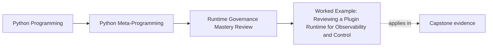

# Worked Example: Reviewing a Plugin Runtime for Observability and Control


<!-- page-maps:start -->
## Page Maps




<!-- page-maps:end -->

The five core lessons in Module 10 only become trustworthy when they meet one concrete
runtime that could have become much more magical than it did.

The course capstone is that runtime.

It combines:

- metaclass-driven registration
- descriptor-backed field validation
- decorator-based action metadata
- a public CLI that exposes runtime facts without forcing plugin work

That makes it the right worked example for this module.

This page should be read as a review packet, not as a victory lap for the capstone. The
lesson is not that the runtime is magical. The lesson is that it stays defensible because
its powers are narrow, inspectable, and paired with refusal surfaces.

If you are studying alone, keep one more rule beside the capstone:

- every time the runtime feels elegant, stop and name the exact public surface that keeps it reviewable
- then name one stronger power it deliberately refused instead of taking the elegant route further

## The review question

The question here is not "does the capstone use metaprogramming?"

It obviously does.

The real question is:

does it keep that metaprogramming observable, bounded, reversible enough for tests, and
honest enough for code review?

That is a Module 10 question.

## Evidence route for reading this runtime honestly

Use this route before approving the capstone design:

| Review step | What to inspect | What strong evidence looks like |
| --- | --- | --- |
| Start with observation | What can be learned without invoking plugin business behavior? | Manifest, registry, signatures, and saved proof outputs are visible |
| Name chosen powers | Which dynamic mechanisms are actually in play? | Metaclass, descriptors, and decorators are named precisely |
| Name refused powers | Which stronger mechanisms were left out? | Import hooks, dynamic execution, and side-effecting inspection are explicitly rejected |
| Check reversibility | How does shared runtime state return to baseline? | Registry reset and test-visible control surfaces exist |
| Check operational evidence | What traces, manifests, and tests prove the runtime remains reviewable? | Public proof surfaces and trace outputs stay inspectable |

## Worked-example reading order

Do not read the capstone as one continuous success story. Use this order instead:

1. inspect observational commands before operational ones
2. identify the chosen mechanisms and the refused stronger ones
3. trace the registry reset surface
4. inspect wrapper metadata and trace surfaces
5. only then decide whether the runtime stays inside the module's governance rules

That order keeps runtime evidence ahead of runtime admiration.

## Step 1: start with observational surfaces, not invocation

Good governance begins by checking whether the system exposes useful runtime facts without
performing business behavior.

In this capstone, the strongest first surfaces are:

- `manifest`
- `registry`
- `signatures`
- saved verification outputs from the proof route

Those surfaces matter because they let reviewers inspect:

- registered plugins
- generated constructor signatures
- declared actions and fields
- public runtime shape

before invoking plugin actions.

That is already a sign of discipline.

Keep the practical rule visible:

the best first command in a dynamic runtime is usually an observational command, not an
operational one.

## Step 2: identify which powers were chosen, and which were rejected

The capstone uses a metaclass for one narrow ownership reason:

- concrete subclasses should register themselves deterministically at class-definition time

That is a legitimate escalation because registration belongs to the class-creation moment.

The capstone does not escalate further into:

- import-hook-based plugin discovery
- runtime code generation through `exec`
- hidden business behavior during manifest export

Those rejections matter as much as the chosen mechanism.

## Chosen-power versus refused-power table

| Runtime concern | Chosen owner | Refused stronger owner |
| --- | --- | --- |
| deterministic plugin registration | metaclass at class-definition time | import-hook discovery |
| field-level validation | descriptors | code generation or runtime patching |
| action metadata | decorators and explicit wrapper surfaces | hidden invocation during inspection |
| public runtime introspection | CLI review commands and manifest builders | dynamic execution or side-effecting reflection |

## Step 3: inspect whether the metaclass case stays narrow

Inside the framework, `PluginMeta` owns a few visible jobs:

- collect declared fields
- collect declared actions
- generate a constructor signature
- assign stable plugin identity
- register concrete plugins while rejecting duplicates

That is a lot, but it still stays inside one coherent timing boundary: class creation.

It helps that the design also keeps review facts public:

- `PluginMeta.registry(...)`
- `PluginMeta.clear_registry(...)`
- `build_manifest(...)`

Those explicit surfaces keep the metaclass from becoming folklore.

## Approval questions this runtime can answer

After reading the public surfaces, a reviewer should be able to answer:

- what plugins are registered right now?
- what constructor shape does each plugin expose?
- what actions exist without invoking them?
- how can registry state be reset during tests?

If those questions become hard, the design is drifting out of Module 10 territory.

Add one more approval question:

- what stronger power was explicitly refused, and where is that refusal visible in the runtime surface?

## Step 4: check the reversibility story

A global registry is always a governance risk unless tests can restore baseline behavior.

The capstone addresses that by exposing a reset path:

```python
@classmethod
def clear_registry(cls, group: str | None = None) -> None:
    if group is None:
        _REGISTRY.clear()
        return
    _REGISTRY.pop(group, None)
```

That method is simple, but it earns trust:

- tests can isolate groups
- duplicate-registration checks stay deterministic
- incidents have a clear control surface for registry state

Without that reset hook, the metaclass choice would be much harder to defend.

That is a general rule, not just a capstone detail: global mechanisms earn trust only when
their control surfaces are public and boring.

## Step 5: confirm the public CLI is a review surface, not hidden magic

The CLI intentionally separates observation from invocation.

Observational commands:

- `manifest`
- `plugin`
- `field`
- `action`
- `registry`
- `signatures`

Operational commands:

- `invoke`
- `trace`

That split is excellent Module 10 discipline because reviewers can learn a great deal
before they cross into behavior execution.

In other words, the public interface respects the same course rule: inspect
first, run later.

## Review boundary for the CLI

| Command class | Why it helps governance |
| --- | --- |
| observational commands | expose runtime facts without side effects |
| operational commands | make behavior execution explicit and therefore reviewable |

The separation matters because one accidental side effect in a review command would erase a
large part of the runtime's trust story.

## Step 6: pressure-test traceability

The capstone's action wrappers preserve callable metadata and action history instead of
hiding what happened.

That matters because observability is the difference between:

- "the runtime adds policy"

and

- "the runtime adds policy, and we can still explain what happened afterward"

The strongest evidence here is not just the wrapper code. It is the paired proof surface:

- runtime tests for signature and metadata preservation
- trace output that exposes recorded action history

That is exactly the kind of double evidence Module 10 wants.

## Failure modes that would weaken the runtime immediately

Watch for these design moves:

| Bad change | Why it should be rejected |
| --- | --- |
| observational commands start invoking plugin actions | inspection becomes side-effecting |
| registry reset disappears or becomes hidden | tests and incidents lose a clear baseline path |
| action wrappers stop preserving signatures or metadata | runtime facts become harder to inspect honestly |
| plugin discovery shifts to import hooks | startup semantics become less explicit and harder to reason about |
| manifest rendering gains hidden plugin behavior | review surfaces stop being trustworthy evidence |

## Weak readings to reject early

| Weak reading | Why it fails |
| --- | --- |
| "the capstone works because the runtime is smart" | smart does not name observation, reset, or refusal surfaces |
| "the CLI already proves the runtime is safe" | observational commands are evidence, not universal safety |
| "the registry is fine because tests can reset it" | reset is only one governance surface, not the whole trust story |
| "plugin discovery could become automatic later" | later import-hook escalation is not justified by the current runtime |

## Step 7: name the strongest rejections

The capstone becomes a stronger review example because it visibly refuses several higher
power temptations.

Strong refusals include:

- no import hooks for plugin discovery
- no `eval` or `exec` for plugin loading or action dispatch
- no hidden plugin invocation during manifest rendering
- no unresettable global state

Those refusals are not omissions. They are architectural choices that protect review cost.

## A small approval summary

If you were writing the review note for this capstone, it could say something like this:

- metaclass use is justified because registration and generated signatures belong to class creation
- the registry remains deterministic and resettable
- public commands expose runtime facts without requiring plugin execution
- wrappers preserve inspectable call surfaces
- the design correctly rejects import-hook and dynamic-execution escalation

That is the kind of approval language Module 10 is trying to teach.

## What would make this example worse

The same runtime would become harder to defend if it changed in any of these directions:

- manifest generation started invoking plugin actions
- plugin discovery moved to import hooks instead of explicit module ownership
- registry state lost its clear reset path
- action wrappers stopped preserving signature visibility
- review commands became side-effecting commands

These are exactly the changes you should reject in Module 10 review.

## What approval should sound like here

Strong approval notes for this runtime usually sound like:

- "the metaclass is justified because class-definition-time registration is the real owner"
- "review commands remain observational, which keeps runtime facts inspectable"
- "registry state is resettable, so test isolation remains honest"
- "the runtime refuses stronger powers it does not need"

## What this worked example makes clear

The point is not "the capstone is perfect."

The boundary is:

- powerful runtime mechanisms can still be reviewable
- their reviewability depends on explicit proof surfaces and narrow ownership
- the strongest designs are usually the ones that refuse extra power they could technically take

That is why this example belongs at the end of the course.

Before leaving the page, write one sentence in each of these forms:

- "the observational surface that earns trust here is..."
- "the stronger mechanism correctly refused here is..."
- "the first change I would reject is..."

## Exit check for this page

Before moving on, make sure you can do all of the following:

- name one chosen power and one refused stronger power in the capstone
- point to one observational surface and one reset surface
- explain why side-effect-free inspection matters for runtime trust
- write one rejection note for a design change that would make the runtime less reviewable

## What to practice from this example

Try these before moving on:

1. Use the [Capstone Proof Guide](../capstone/capstone-proof-guide.md) to verify one observational claim and one operational claim.
2. Name one reason the capstone metaclass is justified and one higher-power escalation it correctly refuses.
3. Write one design change you would reject as making the runtime less observable.

If those feel ordinary, the module is ready for exercises that turn these review habits
into explicit answers.

## Continue through Module 10

- Previous: [Mechanism Selection, Review Gates, and Escalation Boundaries](mechanism-selection-review-gates-and-escalation-boundaries.md)
- Next: [Exercises](exercises.md)
- Return: [Overview](index.md)
- Terms: [Glossary](glossary.md)
