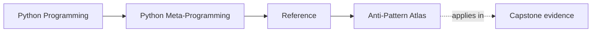

# Anti-Pattern Atlas

<!-- page-maps:start -->
## Page Maps

<!-- page-maps:end -->

Use this page when the question is no longer "which feature is this?" but "what kind of
bad metaprogramming idea is this, what damage does it cause, and how should I repair it?"

During a real design review, people rarely remember a metaprogramming course by module
title. They remember symptoms, smells, and clumsy runtime patterns. This page turns those
symptoms back into review language and repair routes.

## How to use the atlas

1. Start from the symptom, not the mechanism.
2. Match the symptom to the likely anti-pattern.
3. Check the first public proof route before opening internals.
4. Choose the narrowest repair that moves behavior to a lower-power or more observable boundary.

That order matters because many metaprogramming repairs become worse when they begin with
"rewrite everything."

## Common anti-patterns

| Anti-pattern | Why it is clumsy | Primary modules | First proof or review route |
| --- | --- | --- | --- |
| wrappers that erase signatures or metadata | tooling, debugging, and review lose the original callable surface | 03, 04, 05 | `make signatures` |
| inspection that executes behavior accidentally | observation becomes a side-effectful runtime action | 02, 03 | `make manifest` |
| decorators carrying hidden retry, caching, or validation policy | callable transformation turns into an unbounded policy layer | 04, 05 | `make action` |
| descriptors owning behavior that is not really about attribute access | field machinery hides what should stay explicit | 06, 07, 08 | `make field` |
| per-instance state stored on the descriptor itself | one instance leaks into another and the abstraction lies | 07, 08 | `make inspect` |
| metaclasses used for prestige instead of class-creation need | higher-power hooks hide lower-power designs | 06, 09 | `make registry` |
| import-time work that is heavy, stateful, or surprising | import order becomes a hidden runtime dependency | 01, 09, 10 | `make tour` |
| dynamic execution treated as configurable convenience | `eval` or `exec` bypass review, safety, and observability | 10 | `make proof` |

## Symptom to anti-pattern

| Symptom | Likely anti-pattern | Better question |
| --- | --- | --- |
| "This decorated function works, but tools cannot tell what it accepts anymore." | wrapper erased the callable contract | what public signature should still be visible |
| "Reading an attribute changed runtime state." | inspection and execution were collapsed | which tool would let me inspect structure without invoking behavior |
| "Every field object knows too much about the whole model." | descriptor owns framework architecture instead of one attribute contract | what explicit layer should own the wider policy |
| "The metaclass feels powerful, but I cannot explain why it must run before the class exists." | metaclass is covering for a lower-power alternative | which class decorator, descriptor, or helper almost solved the problem |
| "This runtime only works when imported in one specific order." | import-time work has become hidden control flow | what definition-time behavior should become explicit or testable |

## What each anti-pattern usually damages first

| Anti-pattern | First thing it damages | Why that matters pedagogically |
| --- | --- | --- |
| erased wrapper metadata | callable evidence | students stop learning to trust public signatures |
| side-effectful inspection | observation discipline | the course can no longer separate looking from doing |
| decorator policy sprawl | boundary clarity | wrappers become a hiding place instead of a teaching tool |
| overgrown descriptors | ownership clarity | attribute rules stop being about attributes |
| leaking descriptor state | runtime honesty | reusable field abstractions start lying about instances |
| prestige metaclasses | escalation judgment | stronger hooks appear inevitable instead of exceptional |
| hidden import-time work | predictability | runtime order becomes superstition instead of design |
| casual dynamic execution | governance | the course stops applying safety and review boundaries |

## Repair direction

When you identify an anti-pattern, do not jump straight to rewriting everything.

Use this order:

1. name the failure class precisely
2. find the matching module and review route
3. inspect the public runtime surface before editing the internals
4. apply the narrowest repair that moves behavior to a lower-power or more observable boundary

## Keep, change, reject examples

- Keep a descriptor when one field contract is the real owner and the per-instance behavior stays legible.
- Change a wrapper that hides traceback or signature information even if it technically still works.
- Change a metaclass design that could be replaced by explicit class registration with a smaller blast radius.
- Reject import-hook discovery when explicit imports or entry points keep the runtime more visible.
- Reject dynamic execution for untrusted input paths even if it feels flexible during development.

## Companion pages

- Use [Review Checklist](review-checklist.md) when you need reviewer questions after naming the smell.
- Use [Boundary Review Prompts](boundary-review-prompts.md) when the real issue is mechanism placement.
- Use [Topic Boundaries](topic-boundaries.md) when the smell may belong outside the course center.
- Use [Module Dependency Map](module-dependency-map.md) when you need to revisit the teaching sequence behind the smell.
- Use [Capstone Map](../capstone/capstone-map.md) when you want the repository route that exercises the same failure shape.

## Good stopping point

Stop when you can say:

- what symptom you observed
- what anti-pattern it most likely signals
- what proof route should expose it first
- what lower-power or more observable repair direction should be tried next
