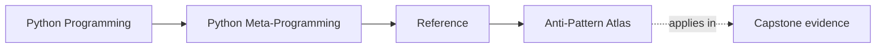

# Anti-Pattern Atlas

<!-- page-maps:start -->
## Page Maps

<!-- page-maps:end -->

Use this page when you already know something feels wrong and need language precise enough
to name the failure, not just complain about the vibe.

In real review work, people rarely remember the module title that taught them a lesson.
They remember symptoms: "the wrapper erased the signature," "inspection triggered work,"
"the metaclass feels impressive but unjustified." This page turns those symptoms back into
named failure patterns and repair directions.

## How to use the atlas

1. Start from the symptom.
2. Match it to the likeliest anti-pattern.
3. Check the first public proof route.
4. Choose the narrowest repair that moves behavior downward or makes it more observable.

Do not start by rewriting everything. Start by naming the failure class accurately.

## Common anti-patterns

| Anti-pattern | What it breaks first | First proof route |
| --- | --- | --- |
| wrappers that erase signatures or metadata | callable evidence and tooling trust | `make signatures` |
| inspection that executes behavior accidentally | observation discipline | `make manifest` |
| decorators carrying hidden retry, caching, or validation policy | boundary clarity | `make action` |
| descriptors owning behavior that is not really about attribute access | ownership clarity | `make field` |
| per-instance state stored on the descriptor itself | runtime honesty across instances | `make inspect` |
| metaclasses used for prestige instead of class-creation need | escalation judgment | `make registry` |
| heavy or surprising import-time work | predictability and rollout safety | `make tour` |
| dynamic execution treated as convenience | governance and trust boundaries | `make proof` |

## Symptom map

| Symptom | Likely anti-pattern | Better question |
| --- | --- | --- |
| tools cannot tell what a decorated function accepts anymore | wrapper erased the callable contract | what public signature should still be visible |
| reading an attribute changed runtime state | inspection and execution collapsed | which tool would let me inspect structure without invoking behavior |
| every field object knows too much about the whole model | descriptor grew into framework architecture | what explicit layer should own the wider policy |
| the metaclass feels powerful, but nobody can explain why it must run before the class exists | metaclass is covering for a lower-power alternative | which decorator, descriptor, or helper almost solved it |
| the runtime only works when imported in one specific order | import-time work became hidden control flow | what behavior should become explicit or testable |

## Repair direction

Once you name the anti-pattern:

1. locate the matching module or review page
2. inspect the public runtime surface before editing internals
3. move behavior to a lower-power or more explicit owner when possible
4. tighten the proof route so the repaired design stays reviewable

## Quick decisions

- Keep a descriptor when one field contract is truly the owner and instance behavior stays legible.
- Change a wrapper that hides signature, traceback, or traceability evidence.
- Change a metaclass design that explicit registration could replace.
- Reject import-hook discovery when explicit imports or entry points keep the runtime clearer.
- Reject dynamic execution for untrusted input paths even if it feels flexible in development.

## Good stopping point

Leave this page when you can say:

- what symptom you saw
- what anti-pattern it most likely signals
- what proof route should expose it first
- what more observable or lower-power repair should be tried next
