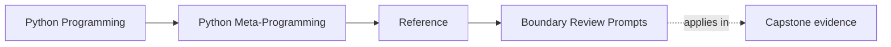

# Boundary Review Prompts

<!-- page-maps:start -->
## Page Maps

<!-- page-maps:end -->

Use these prompts when the code works but the ownership still feels wrong.

This page is not for syntax review or code style. It is for the harder question:

> which boundary should own this behavior, and what proves that choice is honest?

Many dynamic designs drift upward in power simply because nobody paused to ask that question.

## How to use this page

1. Name the behavior under review.
2. Decide which boundary is under pressure first.
3. Ask only the prompts for that boundary.
4. Escalate to a stronger boundary only if the current one cannot own the rule honestly.

If you start by asking every question at once, the page becomes noise.

## Observation boundary

Use this section when the pressure is about seeing before acting.

Ask:

- Could this be solved with inspection instead of behavior-changing hooks?
- Can a reviewer inspect the runtime shape without executing business behavior?
- What evidence is available from the public surface before opening internals?
- If the inspection route disappeared, what would become unreviewable first?

## Wrapper boundary

Use this section when a callable is being wrapped, decorated, or quietly policy-loaded.

Ask:

- Is this still one callable transformation, or has it become a policy engine?
- Which callable facts must remain visible after wrapping?
- What would become clearer if this behavior moved into an explicit object?
- If the wrapper vanished tomorrow, what invariant would still need another owner?

## Attribute boundary

Use this section when validation, coercion, caching, or reuse is landing on attribute access.

Ask:

- Does the rule truly belong to attribute access?
- Would a plain method or property explain the behavior more honestly?
- Where does per-instance state live, and can one instance leak into another?
- Is the descriptor still teaching one field contract, or quietly becoming architecture?

## Class-creation boundary

Use this section when the design claims the work must happen before the class exists as a finished object.

Ask:

- What specifically must happen before the class exists?
- Could a class decorator or explicit registration step own this instead?
- Is the class-definition behavior deterministic and resettable in tests?
- What lower-power tool almost worked, and what exact invariant did it fail to own?

## Governance boundary

Use this section when the mechanism is now powerful enough to raise trust, rollout, or rollback concerns.

Ask:

- Is this mechanism easier to debug than the boring alternative, or harder?
- Would you trust this hook in ordinary application code, or only in tooling?
- What rollback path exists if the dynamic behavior causes trouble under real use?
- Which proof route would convince another reviewer that the design stayed observable?

## Cross-boundary prompts

Ask these after the main boundary section:

- What lower-power owner was considered first?
- What new failure mode did the stronger owner introduce?
- Would another engineer still understand the behavior one file at a time?
- Is the current owner proportionate to the invariant it claims to own?

## Good stopping point

Leave this page when you can say:

- which boundary is actually under pressure
- why the current owner is right or wrong
- which lower-power owner was considered first
- what proof route should defend the final choice
