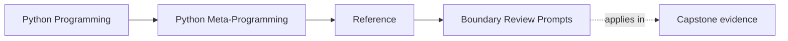

# Boundary Review Prompts

<!-- page-maps:start -->
## Page Maps

<!-- page-maps:end -->

Use these prompts when the code technically works but you still need to decide whether
the mechanism lives on the right boundary. These prompts are not for syntax review. They
are for ownership review.

## How to use this page

1. Name the behavior you are reviewing.
2. Decide which boundary is under pressure.
3. Ask only the prompts for that boundary first.
4. Escalate to a stronger boundary only when the current one cannot honestly own the rule.

That order matters because many dynamic designs drift upward in power simply because no
one stopped to ask where the behavior belonged.

## Observation boundary

Use these when the question is whether a design is still letting you look before you act.

- Could this be solved with inspection instead of behavior-changing hooks?
- Does the chosen approach let a reviewer inspect the runtime shape without execution?
- What evidence is available from the public surface before opening internals?
- If the inspection route disappeared, what teaching value would the design lose first?

## Wrapper boundary

Use these when a callable is being wrapped, decorated, or policy-loaded.

- Is this still one callable transformation, or has it become a policy engine?
- Which callable facts must remain visible after wrapping?
- What would become clearer if this behavior moved into an explicit object?
- If the wrapper were removed tomorrow, what invariant would still need another owner?

## Attribute boundary

Use these when validation, coercion, caching, or reusable field behavior is landing on attribute access.

- Does the rule truly belong to attribute access?
- Would a plain method or property explain the behavior more honestly?
- Where does per-instance state live, and can one instance interfere with another?
- Is the descriptor teaching one field contract, or quietly becoming framework architecture?

## Class-creation boundary

Use these when the design claims something must happen before the class exists as a finished object.

- What specifically must happen before the class exists?
- Could a class decorator or explicit registration step own this instead?
- Is the class-definition work deterministic and resettable in tests?
- What lower-power tool almost worked, and what exact invariant did it fail to own?

## Governance boundary

Use these when the mechanism is powerful enough to raise trust, rollout, or rollback concerns.

- Is this mechanism easier to debug than the boring alternative, or harder?
- Would you trust this hook in ordinary application code, or only in tooling?
- What rollback path exists if the dynamic behavior causes trouble under real use?
- Which proof route would show another reviewer that the design stayed observable?

## Power-ladder prompts

- What lower rung almost solved this problem?
- What new failure mode did the higher rung introduce?
- Would a reviewer still understand the behavior one file at a time?
- Is this mechanism still proportionate to the invariant it claims to own?

## Good stopping point

Stop when you can say:

- which boundary is actually under pressure
- why the current owner is right or wrong
- which lower-power owner was considered first
- what proof route should defend the final choice
