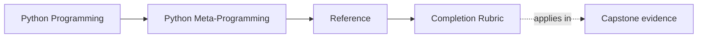

# Completion Rubric

<!-- page-maps:start -->
## Page Maps

<!-- page-maps:end -->

Use this page when you need to decide whether your understanding is merely familiar or
actually ready for review work.

Completion in this course does not mean "I have seen decorators, descriptors, and
metaclasses." It means "I can choose among them honestly, defend the choice, and prove
the result in a way another engineer could inspect."

## The real completion standard

You should be able to:

- name the lowest-power mechanism that honestly solves the current problem
- explain what extra blast radius a stronger mechanism would introduce
- preserve public evidence such as names, signatures, registration state, or manifest shape
- distinguish wrapper, descriptor, class-customization, and metaclass pressure clearly
- choose a proof route that is proportionate instead of theatrical
- make a review decision based on observability and governance, not novelty

## Four levels

| Level | What it means | What is still missing |
| --- | --- | --- |
| recognition | you can spot the mechanism in code | prestige can still replace judgment |
| explanation | you can describe what the mechanism does | you still may not know why it belongs there |
| judgment | you can compare it with lower-power alternatives | proof sizing and governance may still be weak |
| reviewable mastery | you can justify the mechanism, its blast radius, and its proof route | this is the target |

The target is reviewable mastery, not familiarity.

## Area-by-area signals

| Area | Strong completion signal | Weak signal that is not enough |
| --- | --- | --- |
| observation | you can inspect runtime shape without changing it accidentally | you can run tools but cannot say what executed |
| wrappers | you can name what metadata survived and why that matters | you can decorate functions but ignore signature loss |
| descriptors | you can explain why the invariant belongs on attribute access | you use descriptors because they feel reusable |
| metaclass escalation | you can name the lower-power tool that almost worked and why it failed | you jump to class-creation hooks without naming the missed rung |
| governance | you can defend one mechanism choice in a way a reviewer could approve without narration | you still rely on author trust instead of observable proof |

## Minimum capstone evidence

Use at least these routes:

1. `make PROGRAM=python-programming/python-meta-programming manifest`
2. `make PROGRAM=python-programming/python-meta-programming registry`
3. `make PROGRAM=python-programming/python-meta-programming capstone-walkthrough`

Running them is not enough unless you can explain which runtime boundary each one made visible.

## Questions a complete learner should answer

- What lower-power tool almost solved this problem?
- What runtime fact remains inspectable from the public surface?
- Which mechanism owns the class-definition-time invariant here?
- Which proof route would fail first if this mechanism stopped being worth its cost?
- What would become easier to debug if the design moved down one rung?

## Signs that completion is fake

| Pattern | Why it is still weak |
| --- | --- |
| "Metaclasses are for advanced plugin systems." | prestige language replaced a boundary argument |
| "The tests pass, so the design is good." | executable success is not the same as mechanism honesty |
| "The decorator is transparent enough." | "enough" is vague unless the surviving evidence is named |
| "The runtime is observable." | that claim is weak unless you can say what can be inspected without execution |

## Good stopping point

Leave this page when you can say:

- which level you are currently at
- what gap still keeps you from reviewable mastery
- which module, reference page, or capstone route would close that gap next
